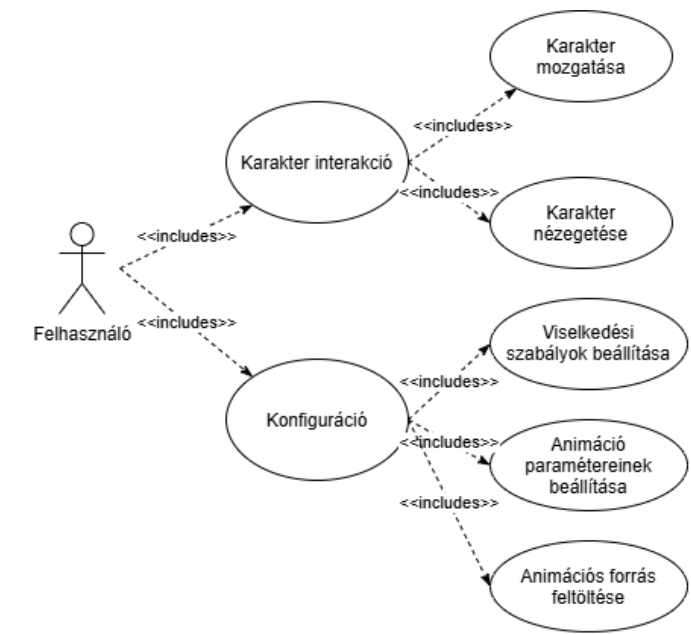

# MonkeyStack_Szoftverarchitektúrák_Házi

Tárgy: BME VIK Szoftverarchitektúrák (VIAUMA21)
Csapat: MonkeyStack

# Követelményspecifikáció

## Konfigurálható Screenmate Alkalmazás

Szoftverarchitektúrák tárgy házi feladat

## Feladatkiírás

A feladat egy olyan alkalmazás elkészítése, mely egy kis animációt rak a képernyőre (a teljes tartalom fölé), ami megy az egér után, reagál rendszer eseményekre, néha vicces dolgokat művel.
Animált mozgás adott tileset alapján, vagy animált gif alapokon.
Egérkurzor követése, oldalról beugrás stb.
Egyéb ténykedés (pl. látványos unatkozás), mind külön tileset
Rendszer eseményekre tud figyelni (processzor 100%, memória >90%, sokáig nincsen felhasználói aktivitás… bővíthető lista. Ilyenkor változhat, hogy mit csinál.)
Ablakok tetejére tud állni
.NET, C# környezet használata
Minél szabadabban konfigurálható

## Részletes feladatleírás

A projekt során célunk egy olyan .NET / C# alapú asztali alkalmazás elkészítése, amely a felhasználó képernyőjén megjelenő, a futó alkalmazások ablakai felett interaktív módon mozgó animált asztali karaktert (screenmate) valósít meg. A karakter képes reagálni a felhasználói interakciókra, az operációs rendszer ablakaira, valamint háttérben futó operációs rendszer szintű eseményekre és metrikákra, mindezt egy SQLite adatbázisban perzisztált, rugalmasan konfigurálható szabályrendszer és animációs készlet alapján.

A rendszer működése és funkcionális életciklusa a következő területekre tagolódik:

### Karakter megjelenítése és képernyőszintű viselkedése:

- Megjelenítés átlátszó, keret nélküli, mindig legfelül elhelyezkedő ablakban
- Képernyőelemekkel és nyitott ablakokkal való fizikai kölcsönhatás:
    - Az operációs rendszerben látható ablakok fejlécének/felső peremének felismerése, amikre a karakter “rá tud állni” / “sétálni tud rajta”
    - Gravitáció és esés kezelése (ha az alatta lévő ablak bezárul, minimalizálódik vagy elmozdul, a karakter lezuhan a következő felületre vagy a képernyő aljára / tálcára)
- Felhasználói interakciók kezelése:
    - Egérkurzor követése (mozgás, utánafordulás)
    - Karakter megragadása és közvetlen áthelyezése (drag-and-drop) egérrel
- Karakter belső állapotgépe:
    - Vannak beépített mozgásállapotok (pl. idle, séta, esés, mozgatás egérrel). Ezek az állapotok függetlenek a környezeti eseményektől.
    - Vannak olyan konfigurálható állapotok, amelyekben a környezeti eseményekre megírt konfiguráció határozza meg a végrehajtandó animációt, ami a karakter fölött jelenik meg (pl. kis tűz, ha a processzor > 60%, de nagy tűz, ha a processzor > 80% és pizsama, ha este van). Így a konfiguráció függvényében egyszerre több ilyen állapot is érvényben lehet (pl. pizsamában ég a karakter).

### Rendszeresemények és operációs rendszer szintű állapotfigyelés (OS checks):

- Rendszerállapotok folyamatos, konfigurálható gyakoriságú monitorozása a háttérben:
    - Processzorterhelés figyelése (pl. tartósan magas vagy 100%-os CPU-használat)
    - Rendszermemória kihasználtságának ellenőrzése (pl. memória > 90%)
    - Háttértár telítettség figyelése (pl. háttértár > 99%)
    - Akkumulátor töltöttsége (pl. töltöttség < 10%)
    - Megnyitott ablakok száma (pl. ablakok száma > 10)
    - Idő figyelése (pl. 20:30 után)
    - Felhasználói inaktivitás ideje (idle time érzékelése sokáig elmaradó billentyűzet- és egéresemény esetén)

### Animációs források és tileset-kezelés:

- Animációs médiaforrások rugalmas importálása:
    - Animált GIF fájlok betöltése
    - Egyedi képek (tileset / sprite sheet) használata
    - Több képkockát tartalmazó mappák beolvasása képsorozatként
- Képkockák és animációk paraméterezése:
    - Állapotokhoz rendelhető képkocka-sorozatok és időzítések (sebesség, ismétlődés/loop)
    - Az állapotok kirajzolási sorrendjének meghatározása (pl. legfelső legelőször)

### Konfiguráció és testreszabás (Konfigurációs ablak):

- Grafikus beállítófelület biztosítása a működés testreszabására:
    - Médiafájlok és tilesetek tallózása, hozzárendelése a karakter viselkedéseihez (mind a mozgási mind a környezeti állapotoknál)
    - Triggerfeltételek és küszöbértékek konfigurálása (pl. inaktivitási időkorlát, erőforrás-százalékok)
    - Mozgási és fizikai paraméterek finomhangolása (pl. mozgási sebesség, gravitáció mértéke)

### Adatperzisztencia és konfigurációkezelés (SQLite):
- Helyi SQLite adatbázis használata a beállítások és metaadatok tárolására:
    - A felvett animációk, elérési utak és metaadatok perzisztálása
    - A viselkedési szabályok (feltétel - animáció párok) tárolása
    - Konfiguráció automatikus betöltése az alkalmazás indításakor, valamint mentése a beállítóablakban végzett módosítások után

## Technikai paraméterek

A definiált alkalmazást .NET és C# platformra készítjük el annak érdekében, hogy hatékonyan és közvetlenül érhessük el az operációs rendszer felületi elemeit (ablakkezelés, átlátszó és mindig felül lévő megjelenítés), valamint a rendszeresemények monitorozásához szükséges erőforrás-metrikákat. Az alkalmazás az adatait (szabályrendszerek, animációs készletek és beállítások) egy helyi SQLite adatbázisban tárolja annak érdekében, hogy ne legyen szükség komoly infrastruktúra üzemeltetésére. Futtatáshoz a Windows operációs rendszer szükséges, ezen felül a program további, magától nem értetődő követelményeket nem támaszt a futtató számítógéptől.

## Szótár

### Screenmate (Karakter)

Az alkalmazás központi vizuális entitása; a képernyő legfelső rétegében, átlátszó és keret nélküli ablakban megjelenő animált asztali figura, amely fizikai és környezeti szabályok szerint interakcióba lép a felhasználóval, a nyitott ablakokkal és a rendszereseményekkel.

### Animációs forrás

Olyan grafikai állomány vagy mappa, amely a karakter megjelenítéséhez szükséges képkockákat (sprite-okat) biztosítja. Típusai a rendszerben:
- Animált GIF fájl (.gif kiterjesztéssel)
- Tileset / Sprite sheet (egyetlen képfájl, amely rácsszerűen vagy egymás mellett tartalmazza az animáció fázisait)
- Képsorozat-mappa (adott könyvtár, amely különálló képfájlok sorozataként tartalmazza a képkockákat)

### Mozgásállapot (Alapállapot)

A karakter beépített, fizikai és közvetlen navigációs állapota, amely független a háttérben zajló rendszereseményektől. Elemei: idle (tétlen), séta (pl. egérkövetés), esés (gravitáció), mozgatás (drag-and-drop).

### Környezeti (konfigurálható) állapot

Olyan vizuális állapot vagy animációs réteg, amely meghatározott [rendszeresemények](#rendszeresemény--metrika-os-check) hatására aktiválódik, és a karakter alapmozgása felett jelenik meg (pl. kis/nagy tűz, pizsama). Egy időben egyszerre több környezeti állapot is aktív lehet a karakteren.

### Rendszeresemény / Metrika (OS check)

Az operációs rendszer által szolgáltatott adat vagy állapot, amelyet a program meghatározott időközönként a háttérben monitoroz. Megfigyelt típusai: processzorterhelés (CPU), memóriahasználat (RAM), háttértár-telítettség, akkumulátortöltöttség, nyitott ablakok száma, rendszeridő, felhasználói inaktivitás ideje (idle time).

### Triggerfeltétel

Egy [rendszereseményhez](#rendszeresemény--metrika-os-check) tartozó logikai vagy numerikus küszöbérték (pl. CPU > 80%, inaktivitás > 5 perc), amelynek teljesülése aktiválja a hozzárendelt környezeti állapotot.

### Viselkedési szabály

Egy [triggerfeltétel](#triggerfeltétel) és az ahhoz rendelt [animációs forrás](#animációs-forrás) (vagy réteg) összerendelése a konfigurációban (pl. ha CPU > 60%  kis tűz animáció).

### Ablakperem (Járható felület)

Az operációs rendszerben futó ablakok felső éle/fejléce, amelyet a program fizikai akadályként/platformként ismer fel, és amelyre a karakter rá tud állni, illetve sétálni tud rajta.

## Use case diagram

## Komponensek

[Áttekintés](./docs/components.md)

