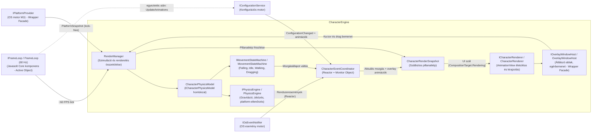

# Karakter motor – Belső komponens felbontás és architektúra terv

Ez a dokumentum az [Animációs motor (Karakter motor)](./overview.md) belső komponensekre bontását rögzíti a [Komponens terv](../components.md#animációs-motor) és az [MVC architektúra](../mvc_architecture.md#karakter-és-fizika) kiegészítéseként.

Kapcsolódó források:
- Fogalmak: [Szótár](../../README.md#szótár)
- Architektúrális minták: [patterns.md](../patterns.md)
- Közös MVC modell: [mvc_architecture.md](../mvc_architecture.md)
- Platform-szolgáltató szerződés (elfogadva): [platform_provider_proposal.md](../os_event_engine/platform_provider_proposal.md)
- Konfigurációs séma és animáció-előállítás: [schema.md](../configuration_engine/schema.md)

---

## Áttekintés és komponens-kapcsolatok

A [Screenmate (Karakter)](../../README.md#screenmate-karakter) működését jól elkülöníthető felelősségi körökre bontjuk, úgy, hogy a meglévő közös szerződések ([`ICharacterPhysicsModel`](../../src/MonkeyStack.Core/Character/ICharacterPhysicsModel.cs), [`IConfigurationService`](../../src/MonkeyStack.Core/Configuration/IConfigurationService.cs), [`IOsEventNotifier`](../../src/MonkeyStack.Core/Events/IOsEventNotifier.cs)) változatlanok maradnak.

---

## Belső komponensek (`CharacterEngine`)

### 1. Fizikai motor (`Physics`)
- **Interfész / osztály:** [`IPhysicsEngine`](../../src/CharacterEngine/Physics/IPhysicsEngine.cs), [`PhysicsEngine`](../../src/CharacterEngine/Physics/PhysicsEngine.cs)
- **Felelősség:** A karakter fizikai mozgásának és ütközéseinek tiszta matematikai kiszámítása a logikai alsó-középső talppont `(X, Y)` alapján:
  - gravitáció és esési sebesség integrálása,
  - két tick közötti $\Delta y$ szakasz ütközésvizsgálata az [ablakperemekkel](../../README.md#ablakperem-járható-felület) ([`PlatformSegment`](../../src/MonkeyStack.Core/Character/PlatformSegment.cs)),
  - platform-alátámasztás és platformszél-ráhagyás (`PlatformEdgeMargin`) ellenőrzése,
  - karakter befoglaló téglalapjának találatvizsgálata (drag-and-drop indításához).

### 2. Mozgási állapotgép (`StateMachine`)
- **Interfész / osztály:** [`IMovementStateMachine`](../../src/CharacterEngine/StateMachine/IMovementStateMachine.cs), [`MovementStateMachine`](../../src/CharacterEngine/StateMachine/MovementStateMachine.cs)
- **Felelősség:** A karakter beépített [mozgásállapotainak](../../README.md#mozgásállapot-alapállapot) ([`MovementState`](../../src/MonkeyStack.Core/Character/MovementState.cs): `Falling`, `Idle`, `Walking`, `Dragging`) és állapotátmeneteinek kezelése:
  - landolás (`Falling` → `Idle`), 2 másodperces tétlen időzítő (`Idle` → `Walking` véletlen iránnyal),
  - megfordulás a platform szélénél (`IsFacingLeft`),
  - platform elvesztése (`Idle` / `Walking` → `Falling`),
  - egérrel történő megragadás és elengedés (`*` → `Dragging` → `Falling`),
  - állapotváltás jelzése a [`CharacterEventCoordinator`](../../src/CharacterEngine/CharacterEventCoordinator.cs) felé.
- A meglévő [`CharacterPhysicsModel`](../../src/CharacterEngine/CharacterPhysicsModel.cs) az [`ICharacterPhysicsModel`](../../src/MonkeyStack.Core/Character/ICharacterPhysicsModel.cs) homlokzataként fogja össze a `PhysicsEngine`-t és a `MovementStateMachine`-t.

### 3. Esemény-koordinátor (meglévő)
- **Osztály:** [`CharacterEventCoordinator`](../../src/CharacterEngine/CharacterEventCoordinator.cs)
- **Felelősség:** A karakter [környezeti állapotainak](../../README.md#környezeti-konfigurálható-állapot) és aktuális animációinak nyilvántartása:
  - feliratkozik az [OS esemény értesítő motor](../components.md#os-esemény-értesítő-motor) eseményeire ([`IOsEventNotifier`](../../src/MonkeyStack.Core/Events/IOsEventNotifier.cs)) és frissíti az [`OsEventDataRegistry`](../../src/MonkeyStack.Core/Events/OsEventDataRegistry.cs)-t,
  - reagál a [`IConfigurationService.ConfigurationChanged`](../../src/MonkeyStack.Core/Configuration/IConfigurationService.cs) eseményre és a mozgásállapot-váltásokra,
  - szálbiztosan elérhetővé teszi az aktuális mozgás- és overlay [`IAnimation`](../../src/MonkeyStack.Core/Animation/IAnimation.cs) példányokat.

### 4. Render Manager és Pillanatkép (`Rendering`)
- **Osztályok:** [`RenderManager`](../../src/CharacterEngine/Rendering/RenderManager.cs), [`CharacterRenderSnapshot`](../../src/CharacterEngine/Rendering/CharacterRenderSnapshot.cs)
- **Felelősség:** A háttérben futó ~60 FPS-es szimulációs ciklus, az esemény-koordinátor és a WPF UI-szálas kirajzolás összekötése:
  - minden szimulációs ticken összegyűjti a platform-pillanatképet és az egérbemenetet, lépteti a fizikát, és állapotváltáskor frissíti a `CharacterEventCoordinator`-t,
  - a frissített állapotból szálbiztos [`CharacterRenderSnapshot`](../../src/CharacterEngine/Rendering/CharacterRenderSnapshot.cs) pillanatképet állít elő,
  - a WPF UI szál rajzolási ciklusában (`CompositionTarget.Rendering`) átadja a legfrissebb pillanatképet a renderelőnek.
- Ez a bontás elkerüli, hogy a `RenderManager` duplikálja a `CharacterEventCoordinator` OS-/konfig-kezelését, miközben a folyamatosan pörgő animációk és a 60 FPS-es mozgás is akadásmentesen kirajzolódnak.

### 5. Karakter Renderelő (`Rendering`)
- **Interfész / osztály:** [`ICharacterRenderer`](../../src/CharacterEngine/Rendering/ICharacterRenderer.cs), [`CharacterRenderer`](../../src/CharacterEngine/Rendering/CharacterRenderer.cs)
- **Felelősség:** A karakter alap-animációjának és a Z-index szerint rendezett overlay animációknak a kirajzolása a cél WPF `Canvas`-ra az [`AnimationView`](../../src/MonkeyStack.Core/Animation/AnimationView.cs) példányokon keresztül:
  - alsó-középső talppont `(X, Y)` átszámítása bal-felső sarok koordinátára,
  - vízszintes tükrözés (`IsFacingLeft`) az alap karakteren és az összes aktív overlay-en,
  - az `AnimationView` példányok teljes életciklus-kezelése (`Draw`, `Hide`, illetve `Detach` konfiguráció-újratöltéskor a memóriaszivárgás elkerülésére).

### 6. Overlay ablak- és bemenetkezelő (`Windowing`)
- **Interfész / osztály:** [`IOverlayWindowHost`](../../src/CharacterEngine/Windowing/IOverlayWindowHost.cs), [`OverlayWindowHost`](../../src/CharacterEngine/Windowing/OverlayWindowHost.cs)
- **Felelősség:** A WPF / Win32 ablakkezelés és egérbemenet becsomagolása:
  - átlátszó, keret nélküli, mindig legfelül elhelyezkedő (`Topmost`) ablak több monitor fölött,
  - kattintás-áteresztés a karakteren kívüli területeken, egérpozíció és drag-and-drop állapot biztosítása a szimuláció számára.

---

## Javasolt közös bővítések a `MonkeyStack.Core`-ban (egyeztetés után)

Az alábbi elemek több komponenst érintenek, ezért a `MonkeyStack.Core`-ba történő felvételük előtt a többi komponens felelősével egyeztetés szükséges:

| Javasolt Core elem | Érintett komponensek | Szerep |
|---|---|---|
| `IFrameLoop` / `FrameLoop` (`MonkeyStack.Core.Timing`) | `CharacterEngine`, `ConfigurationEngine` | Közös, ~60 Hz-es, `TimeProvider`-alapú tick-meghajtó, amely integrált módban egyszerre hajthatja a fizikai motort és a `ConfigurationService.UpdateAnimations(deltaTime)` ciklust, önálló (F5) módban pedig külön-külön is példányosítható. |
| `IPlatformProvider` (+ `PlatformSnapshot`, `ScreenArea`, `ScreenRect`) | `CharacterEngine`, `OsEventEngine` | Már elfogadva a #3-as PR-ben ([platform_provider_proposal.md](../os_event_engine/platform_provider_proposal.md)); a `Win32PlatformProvider` implementációt az OS motor adja (M11). |

---

## Alkalmazott architektúrális minták ([patterns.md](../patterns.md))

| Kategória | Minta | Alkalmazás helye |
|---|---|---|
| **Szolgáltatáshozzáférés és -konfiguráció** | **Wrapper Facade** | [`OverlayWindowHost`](../../src/CharacterEngine/Windowing/OverlayWindowHost.cs) (Win32 átlátszóság, click-through, kurzorlekérdezés), valamint az `IPlatformProvider` fogyasztása. |
| **Szolgáltatáshozzáférés és -konfiguráció** | **Component Configurator** | [`App.xaml.cs`](../../src/CharacterEngine/App.xaml.cs): integrált és önálló (standalone teszt) mód összekapcsolása, futásidejű konfigurációváltás kezelése. |
| **Eseménykezelés** | **Reactor** | [`CharacterEventCoordinator`](../../src/CharacterEngine/CharacterEventCoordinator.cs): az OS események, a `ConfigurationChanged` és a mozgásállapot-váltások eseményvezérelt fogadása. |
| **Konkurenciakezelés** | **Active Object** | A ~60 FPS-es tick-meghajtó (`IFrameLoop`), amely saját aszinkron ciklusban lépteti a szimulációt (és egyeztetés után az animációkat). |
| **Konkurenciakezelés** | **Half Sync / Half Async** | [`RenderManager`](../../src/CharacterEngine/Rendering/RenderManager.cs): az aszinkron szimulációs szál és a szinkron WPF UI renderelési ciklus (`CompositionTarget.Rendering`) szétválasztása a [`CharacterRenderSnapshot`](../../src/CharacterEngine/Rendering/CharacterRenderSnapshot.cs) segítségével. |
| **Szinkronizáció** | **Monitor Object**, **Scoped Locking**, **Thread-Safe Interface** | [`CharacterEventCoordinator`](../../src/CharacterEngine/CharacterEventCoordinator.cs) (`lock (_syncRoot)`), valamint a szálbiztos pillanatkép-csere a szimuláció és a [`CharacterRenderer`](../../src/CharacterEngine/Rendering/CharacterRenderer.cs) között. |

---

## Egyeztetendő pontok más komponensek felelőseivel

1. **Konfigurációs motor felelőse:**
   - Közös `IFrameLoop` (`MonkeyStack.Core`) hajtsa-e a `ConfigurationService.UpdateAnimations(deltaTime)`-t és a karakter fizikáját is, vagy a Config Engine belső saját időzítőt használjon?
   - Rétegsorrend tisztázása: az alap mozgásanimáció (`ZIndex = 0`) ne kerülhessen az `ZIndex = 0`-s overlay-ek fölé.
2. **OS esemény értesítő motor felelőse:**
   - `IPlatformProvider` Core-ba kerülésének ütemezése (M11), addig a `CharacterEngine` fallback/mock platform-szolgáltatóval fejleszt.
   - `PerMonitorV2` DPI manifest beállítása a `CharacterEngine` hostban és az M8 életciklus (`SharedOsMonitorService.Start()` / `UsePollingSettings` / `Dispose()`) bekötése.
