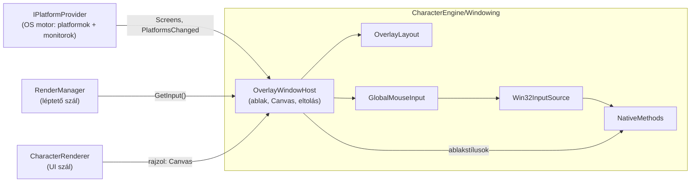

# Karakter motor – Overlay ablak és egérbemenet

Ez a dokumentum az [Animációs motor (Karakter motor)](./overview.md) ablakkezelő részének megvalósítását írja le: az átlátszó, mindig legfelül lévő ablakot, amelyben a [Screenmate (Karakter)](../../README.md#screenmate-karakter) megjelenik, és a globális egérbemenetet, amelyből a fizika a megragadást és a húzást számolja. A belső felbontást az [architektúra terv](./architecture.md) (6. pont) adja; a fizika leírása: [Fizika és mozgási állapotgép](./physics.md).

Kapcsolódó források:
- Fogalmak: [Szótár](../../README.md#szótár)
- Architektúrális minták: [patterns.md](../patterns.md)
- A platformok és a monitorok előállítása: [platform-javaslat](../os_event_engine/platform_provider_proposal.md) (OS esemény értesítő motor)

A döntéseknél jelöljük, mi jön a csapat tervéből (**terv**), és mi a megvalósítás saját döntése (**döntés**).

---

## Felépítés

| Fájl | Szerep |
|---|---|
| [`Windowing/IOverlayWindowHost.cs`](../../src/CharacterEngine/Windowing/IOverlayWindowHost.cs), [`OverlayWindowHost.cs`](../../src/CharacterEngine/Windowing/OverlayWindowHost.cs) | Az overlay ablak kezelője: beállítja a kapott WPF ablakot, ad egy rajzfelületet (`Canvas`) és az egér állapotát (`GetInput`). |
| [`Windowing/OverlayLayout.cs`](../../src/CharacterEngine/Windowing/OverlayLayout.cs) | Az ablak helye és mérete a monitorlistából, valamint a képernyő ↔ Canvas átváltás. |
| [`Windowing/GlobalMouseInput.cs`](../../src/CharacterEngine/Windowing/GlobalMouseInput.cs) | A kurzor helye DIP-ben és az elsődleges egérgomb állapota. |
| [`Windowing/INativeInputSource.cs`](../../src/CharacterEngine/Windowing/INativeInputSource.cs), [`Win32InputSource.cs`](../../src/CharacterEngine/Windowing/Win32InputSource.cs) | A nyers operációs rendszer-lekérdezések interfésze és Win32 megvalósítása. |
| [`Windowing/NativeMethods.cs`](../../src/CharacterEngine/Windowing/NativeMethods.cs) | A nyers Win32 deklarációk. |
| [`tests/CharacterEngine.Tests/Windowing`](../../tests/CharacterEngine.Tests/Windowing) | `GlobalMouseInputTests`, `OverlayLayoutTests`, `OverlayWindowHostTests` |

---

## Egérbemenet

- A kurzor helyét és a gomb állapotát globálisan, Win32 hívásokkal kérdezzük le (`GetCursorPos`, `GetAsyncKeyState`), nem WPF egéreseményekből (**döntés**). Az overlay ablak a karakteren kívül átengedi a kattintásokat, ezért a legtöbb egéreseményt meg sem kapja.
- A `GetInput()` pontosan azt a típust adja, amelyet a `RenderManager` bemenet-szolgáltatóként vár (`(double cursorX, double cursorY, bool isMouseDown)`), így metóduscsoportként átadható neki.
- **DIP-re váltás** (**döntés**): ugyanazt a szabályt követi, mint a platform-szolgáltató ([3.5 DPI](../os_event_engine/platform_provider_proposal.md#35-dpi)), hogy a kurzor és a platformok ugyanabban a koordinátarendszerben legyenek:

  | A folyamat DPI-tudatossága | Átváltás |
  |---|---|
  | DPI-tudatlan | nincs (a Windows már 96 DPI-re virtualizál) |
  | Rendszerszintű (a WPF alapértelmezése) | osztás a rendszer DPI-jével / 96 |
  | Monitoronkénti (PerMonitorV2) | osztás a kurzor alatti monitor DPI-jével / 96 |

  Ha a DPI nem kérdezhető le, a váltószám 1,0. Mivel a kód a folyamat beállításához igazodik, a DPI-manifestről szóló döntéstől függetlenül helyes.
- **Elsődleges gomb** (**döntés**): ha a Windowsban fel vannak cserélve az egérgombok (balkezes beállítás), a jobb gomb ragadja meg a karaktert. A `GetAsyncKeyState` ugyanis a fizikai gombot adja, nem az elsődlegeset.
- Ha a kurzor helye nem kérdezhető le (pl. zárolt asztal), a legutóbbi ismert helyet adjuk, hogy húzás közben ne ugorjon el a karakter (**döntés**).

---

## Koordináták

A fizika, a platformok és a kurzor képernyő-koordinátában (DIP) vannak, a WPF `Canvas` viszont az ablak bal-felső sarkától számol. Az overlay ablak az összes monitort lefedi (**terv**), így a bal-felső sarka a virtuális képernyő sarka, ami a fő monitortól balra vagy fölötte lévő monitornál negatív.

- Az ablak helye és mérete a monitorok teljes területének befoglaló téglalapja, a tálcát is beleértve (`OverlayLayout.FromScreens`). A monitorokat a platform-szolgáltatótól vesszük (`PlatformSnapshot.Screens`), nem a WPF `SystemParameters` értékeiből, így ugyanazzal a DPI-szabállyal kerülnek DIP-be, mint a platformok (**döntés**).
- **Az eltolást a host a Canvasra teszi** egy `TranslateTransform(-Left, -Top)` formájában (**döntés**). Így a renderelő továbbra is képernyő-koordinátában rajzolhat (a talppontból számolt bal-felső sarokba, [MVC terv](../mvc_architecture.md#view-réteg-1)), és a fizikának, valamint az egérnek sem kell átváltania.

---

## Overlay ablak

A host egy kapott, még meg nem jelenített WPF ablakot állít be, saját ablakot nem hoz létre (**döntés**). Így a bekötéskor eldönthető, melyik ablakot kapja. Az átlátszóság csak megjelenítés előtt állítható, ezért későn átadott ablaknál érthető hibát ad.

| Beállítás | Miért |
|---|---|
| `WindowStyle.None`, `AllowsTransparency`, átlátszó háttér | keret nélküli, átlátszó ablak (**terv**) |
| `Topmost` | mindig legfelül (**terv**) |
| `ShowInTaskbar = false` | ne jelenjen meg a tálcán |
| `ShowActivated = false`, natív `WS_EX_NOACTIVATE` | megjelenítéskor és kattintásra se vegye el a fókuszt a felhasználó ablakától |
| natív `WS_EX_TOOLWINDOW` | ne szerepeljen az Alt-Tab listában |
| `ResizeMode.NoResize`, kézi elhelyezés | a méretet és a helyet a host állítja |

- A host birtokolja az ablak tartalmát: egy saját `Canvas`-t tesz bele, amelyre a renderelő rajzol (**döntés**).
- A natív stílusokat az ablakkezelő (HWND) létrejöttekor (`SourceInitialized`) állítja be.
- **Monitorváltozás:** a platform-szolgáltató `PlatformsChanged` eseményére az elrendezést újraszámolja, és ha változott, a UI szálon alkalmazza. Az esemény bármelyik szálon jöhet.
- Ha nincs monitoradat (standalone futás, nincs platform-szolgáltató), a WPF virtuális képernyőjét fedi le.

### Kattintás-áteresztés

A karakteren kívül a kattintásnak az alatta lévő ablakokhoz kell jutnia (**terv**). Az `AllowsTransparency` beállítású WPF ablak a Windowsban rétegzett ablak (layered window), amelyen a teljesen átlátszó képpontok átengedik a kattintást. Ezért külön kapcsolgatás (`WS_EX_TRANSPARENT`) nem kell: a karakter képpontjai elkapják a kattintást (így az nem jut el például az alatta lévő ablak fejlécéhez), minden más átmegy. Ezt a viselkedést futó alkalmazásban kell ellenőrizni.

---

## Szálkezelés

- A `GlobalMouseInput` szálbiztos (`lock`): a fizika a léptető szálán kérdezi le, de más szálról is hívható. A zár csak egyetlen rövid lekérdezést véd.
- A `Win32InputSource`-nak nincs állapota, bármelyik szálról hívható.
- Az ablakot és a Canvast csak a UI szálon módosítjuk; a más szálról érkező monitorváltozást a host a `Dispatcher`-en keresztül teszi át a UI szálra.

---

## Alkalmazott minták ([patterns.md](../patterns.md))

| Kategória | Minta | Alkalmazás helye |
|---|---|---|
| **Szolgáltatáshozzáférés és -konfiguráció** | **Wrapper Facade** | `NativeMethods` + `Win32InputSource`: a nyers Win32 hívások típusos, hibakezelt metódusok mögött; `OverlayWindowHost`: az ablakbeállítások és a natív stílusok egy osztályban. A motor többi része sosem hív közvetlenül natív kódot. |
| **Konkurenciakezelés** | **Half Sync / Half Async** | A bármelyik szálon érkező `PlatformsChanged` eseményt a host a UI szálra teszi át (`Dispatcher.InvokeAsync`), az ablakot csak ott módosítja. |
| **Szinkronizáció** | **Monitor Object**, **Scoped Locking** | `GlobalMouseInput`: a legutóbbi ismert kurzorpozíció egyetlen zár alatt frissül és olvasódik. |

---

## Ismert korlátok

- **Eltérő DPI-jű monitorok:** a platform-szolgáltató minden monitort a saját DPI-jével vált DIP-re, egyetlen WPF ablak viszont egyetlen DPI-vel rajzol. Vegyes DPI-jű többmonitoros gépen ezért a „másik” monitoron a karakter rajza és a platformok nem feltétlenül kerülnek fedésbe. Azonos DPI-jű monitoroknál pontos. A pontos viselkedést két eltérő skálázású monitorral, futó alkalmazásban kell ellenőrizni.

---

## Tesztek

A tesztek a natív hívásokat hamis forrással (`FakeNativeInputSource`, `FakeScreenProvider`) helyettesítik. A WPF ablakot WPF (STA) szálon hozzuk létre, de nem jelenítjük meg, így a tesztek képernyő nélkül, a CI-ban is futnak.

| Tesztosztály | Mit fed le |
|---|---|
| `GlobalMouseInputTests` | DIP-re váltás mindhárom DPI-tudatosságnál, két eltérő DPI-jű monitor, hibás DPI-lekérdezés, a legutóbbi ismert pozíció, az elsődleges gomb normál és balkezes beállításnál. |
| `OverlayLayoutTests` | Egy monitor, a fő monitortól balra és fölötte lévő monitor, az átváltás oda-vissza. |
| `OverlayWindowHostTests` | Az ablakbeállítások, a saját Canvas, az elhelyezés és a Canvas eltolása két monitornál, monitorváltozás, a virtuális képernyő mint tartalék, leiratkozás. |

Unit teszttel nem ellenőrizhető, futó alkalmazásban kell kipróbálni: a natív stílusok (Alt-Tab, fókusz), a kattintás-áteresztés és a vegyes DPI.

---

## Továbbfejlesztési lehetőségek

- **Monitoronkénti overlay ablak:** minden monitor saját ablakot kapna a saját DPI-jével, ami megszüntetné a vegyes DPI-s korlátot. Ehhez a karaktert monitorhatár átlépésekor az egyik ablakból a másikba kellene átadni.
