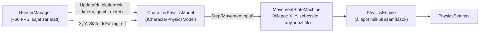
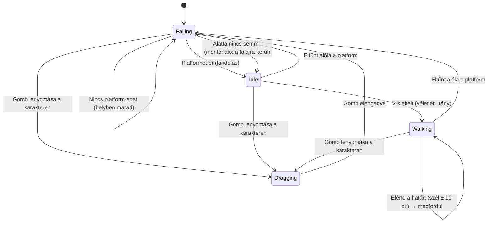

# Karakter motor – Fizika és mozgási állapotgép

Ez a dokumentum az [Animációs motor (Karakter motor)](./overview.md) fizikai részének megvalósítását írja le: hogyan esik, landol, sétál és húzható a [Screenmate (Karakter)](../../README.md#screenmate-karakter), és mi történik a szélsőséges esetekben. A belső felbontást az [architektúra terv](./architecture.md) (1–2. pont), a viselkedés specifikációját az [MVC terv „Karakter és Fizika” fejezete](../mvc_architecture.md#karakter-és-fizika) adja; ez a dokumentum ezeket nem ismétli, hanem kiegészíti a megvalósítás döntéseivel.

Kapcsolódó források:
- Fogalmak: [Szótár](../../README.md#szótár) ([Mozgásállapot](../../README.md#mozgásállapot-alapállapot), [Ablakperem](../../README.md#ablakperem-járható-felület))
- Architektúrális minták: [patterns.md](../patterns.md)
- A platformok előállítása: [platform-javaslat](../os_event_engine/platform_provider_proposal.md) (OS esemény értesítő motor)

A döntéseknél jelöljük, mi jön a csapat tervéből (**terv**), és mi a megvalósítás saját döntése (**döntés**).

---

## Felépítés

| Fájl | Szerep |
|---|---|
| [`CharacterPhysicsModel.cs`](../../src/CharacterEngine/CharacterPhysicsModel.cs) | Az [`ICharacterPhysicsModel`](../../src/MonkeyStack.Core/Character/ICharacterPhysicsModel.cs) homlokzata. Saját logikája nincs: az `Update` paramétereiből `MovementInput`-ot állít össze, és az állapotgépnek adja tovább. |
| [`StateMachine/MovementStateMachine.cs`](../../src/CharacterEngine/StateMachine/MovementStateMachine.cs) | A mozgási állapotgép: tárolja a pozíciót, a sebességet, az irányt és az időzítőket, és kezeli az állapotátmeneteket. |
| [`StateMachine/MovementInput.cs`](../../src/CharacterEngine/StateMachine/MovementInput.cs) | Egy lépés bemenete (idő, platformok, kurzor, egérgomb, karakterméret). |
| [`Physics/PhysicsEngine.cs`](../../src/CharacterEngine/Physics/PhysicsEngine.cs) | Állapot nélküli számítások: gravitáció, landolás, alátámasztás, találatvizsgálat, mentőháló. |
| [`Physics/PhysicsSettings.cs`](../../src/CharacterEngine/Physics/PhysicsSettings.cs) | A fizika fix, megváltoztathatatlan paraméterei. |
| [`tests/CharacterEngine.Tests`](../../tests/CharacterEngine.Tests) | `PhysicsSettingsTests`, `PhysicsEngineTests`, `MovementStateMachineTests`, `CharacterPhysicsModelTests` |

A Core-beli `ICharacterPhysicsModel` szerződés nem változott. Az állapotváltásról a fizika senkit nem értesít: a [`RenderManager`](../../src/CharacterEngine/Rendering/RenderManager.cs) minden lépés után összeveti a `State`-et a [`CharacterEventCoordinator`](../../src/CharacterEngine/CharacterEventCoordinator.cs) állapotával, és eltérés esetén ő hívja az `UpdateMovementState`-et.

---

## Koordináták és idő

- Minden koordináta képernyő-koordináta WPF egységben (DIP), **lefelé nő az Y**, ahogy a platform-szolgáltató is adja ([3.5 DPI](../os_event_engine/platform_provider_proposal.md#35-dpi)).
- A karakter pozíciója a talppontja, a kép alsó-középső pontja (**terv**). A befoglaló téglalap ebből: `[X − W/2, X + W/2] × [Y − H, Y]`.
- Az idő a lépések `deltaTime`-jainak összege, nem a rendszeróra (**döntés**), így a 2 másodperces várakozás tesztben valós várakozás nélkül ellenőrizhető.
- A lépés elején a `deltaTime`-ot levágjuk: a negatív érték nulla lesz, a `MaxDeltaTime`-nál hosszabb pedig `MaxDeltaTime` (**döntés**). Egy akadás (pl. debugger-szünet) után így a karakter nem ugrik át egyszerre nagy távolságot.
- Egy lépésben legfeljebb egy állapotváltás történik, az új állapot viselkedése a következő lépésben indul (**döntés**). 60 FPS mellett ez kb. 16 ms késés.

---

## Állapotgép

Az MVC terv állapotdiagramját két átmenet egészíti ki: a platform-adat hiánya és a mentőháló ([Szélsőséges esetek](#szélsőséges-esetek)).

### Falling (esés)
- Félig implicit Euler: előbb a sebesség nő a gravitációval (legfeljebb `MaxFallSpeedPxPerSec`-ig), majd a pozíció lép az új sebességgel (**döntés**).
- A landolást a két lépés közötti teljes elmozdulásra vizsgáljuk (`previousY ≤ platform.Y ≤ newY`, az X a platformon belül), így nagy sebességnél sem esik át a karakter a vékony peremeken (**terv**). Több találatnál a legfelső nyer.
- Landoláskor a talppont pontosan a peremre kerül, a sebesség nullázódik, és indul az Idle időzítő (**terv**; az időzítő nullázása minden landoláskor **döntés**).

### Idle (tétlen)
- Előbb az alátámasztást ellenőrizzük, csak utána az időzítőt (**döntés**): ha ugyanabban a lépésben jár le a 2 s, amikor az ablakot bezárják, a karakter leesik, és nem indul el a semmiben.
- Alátámasztás: van platform legfeljebb `SupportTolerancePx` (1 px) távolságra, és az X a platformon belül van. **A szélső ráhagyás itt nem számít** (**döntés**), különben a szél közelében landolt karakter azonnal leesne. A tűrésen belüli elmozdulást a talppont követi.
- Ha az ablakot ennél többel elmozdítják, a karakter leesik, és nem mozog együtt az ablakkal (**terv**, [platform-javaslat, 0. Döntések](../os_event_engine/platform_provider_proposal.md#0-döntések)).
- `IdleDuration` (2 s) után Walking, véletlen kezdőiránnyal (**terv**). A véletlen forrást a konstruktor kapja (`Func<bool>`), így a tesztek rögzíthetik (**döntés**).

### Walking (séta)
- `X += irány · WalkSpeedPxPerSec · dt`, a talp alatti **aktuális** platformon (**döntés**). Ha egy másik ablak kitakarja a platform egy részét, a megmaradt rész széle falként működik; ha a karakter éppen a kitakart részen állt, leesik (**terv**, [MVC terv, 4. pont](../mvc_architecture.md#modell-réteg-fizika-és-koordinátor), [platform-javaslat 3.2](../os_event_engine/platform_provider_proposal.md#32-takarás-occlusion)).
- A séta határai: `LeftX + PlatformEdgeMargin` és `RightX − PlatformEdgeMargin` (10 px). A határon a karakter megáll és megfordul (**terv**).
- Ha a karakter már a ráhagyás sávjában volt (pl. a szél közelében landolt), nem ugrik a határra, hanem helyben fordul meg (**döntés**), így nincs látható rántás.
- A ráhagyásnál keskenyebb platformon a karakter egy helyben áll, Walking állapotban marad, és nem fordul meg minden lépésben (**terv**: ne kerüljön végtelen ciklusba; a megoldás **döntés**). A platform-szolgáltató a 20 px-nél keskenyebb szakaszokat eleve kiszűri, ez csak védelem.

### Dragging (húzás)
- A megragadás bármelyik állapotból indulhat, ezért az állapotgép a `switch` előtt vizsgálja (**terv**).
- Csak **a lenyomás pillanata** számít: az előző lépésben fel volt engedve a gomb, most le van nyomva, és a kurzor a befoglaló téglalapon van (**döntés**). Ha a gombot máshol nyomják le (pl. egy ablakot húznak), és a kurzor lenyomott gombbal ér a karakterre, az nem ragadja meg.
- A megfogási pontot megtartjuk: a karakter nem ugrik a kurzor alá, hanem onnan húzható, ahol megfogták (**döntés**).
- Húzás közben nincs gravitáció és nincs landolás. Elengedéskor a karakter ott, nyugalomból kezd esni (**terv**: Falling; a nyugalomból indulás **döntés**, a lendületet nem viszi tovább).
- Az irány húzás közben nem változik (**döntés**).

---

## Szélsőséges esetek

### Nincs platform-adat
Ha a platformlista üres, a karakter esés közben helyben marad (**döntés**, a felhasználó választása). Integrált futásnál ez szinte nem fordul elő, mert a [`Win32PlatformProvider`](../../src/OsEventEngine/Platforms/Win32PlatformProvider.cs) az első pillanatképet a `Start()`-ban azonnal kiszámolja; standalone futásnál és teszteknél viszont igen. Enélkül a karakter kiesne a képernyő alján, és a később érkező platformok mind fölötte lennének.

### Mentőháló: alatta nincs semmi
Ha esés közben a karakter X-énél egyetlen platform sincs alatta (pl. a tálca alá vagy a monitorokon kívülre húzták, és ott engedték el), a karakter a talajra kerül, és ott landol (**döntés**, a felhasználó választása):
- ha van platform az X fölött, a legalsóra;
- ha az X egyetlen platform fölött sincs, a vízszintesen legközelebbire (egyenlő távolságnál a legalsóra), az X-et a szakaszra igazítva.

Ez mindig a **talaj** (alul lévő tálcánál a tálca teteje, egyébként a képernyő alja), sosem egy ablakperem. Ez a platform-szolgáltató két szabályán múlik ([3.4 Talaj és több monitor](../os_event_engine/platform_provider_proposal.md#34-talaj-és-több-monitor)): az ablakperemeket a munkaterületen belülre vágja (a talaj fölé), a talajt pedig a munkaterület teljes szélességében adja meg. Ha ezek a szabályok változnak, a mentőhálót újra át kell nézni.

---

## Paraméterek

A fizika paraméterei fixek, a Konfigurációs ablakban nem állíthatók ([view.md](../configuration_engine/view.md)).

| Paraméter | Érték | Hol | Megjegyzés |
|---|---|---|---|
| `GravityPxPerSec2` | 2000 | `PhysicsSettings` | Megegyezik a konfigurációs séma alapértékével ([schema.md](../configuration_engine/schema.md)); a `PhysicsSettingsTests` ellenőrzi. |
| `WalkSpeedPxPerSec` | 120 | `PhysicsSettings` | Mint fent. |
| `MaxFallSpeedPxPerSec` | 1500 | `PhysicsSettings` | Az esési sebesség felső korlátja. |
| `MaxDeltaTime` | 100 ms | `PhysicsSettings` | Egy lépésben legfeljebb ennyit szimulálunk. |
| `SupportTolerancePx` | 1 px | `PhysicsSettings` | Az alátámasztás függőleges tűrése. |
| `PlatformEdgeMargin` | 10 px | `CharacterPhysicsModel` | **Terv** ([MVC terv](../mvc_architecture.md#modell-réteg-fizika-és-koordinátor)). |
| `IdleDuration` | 2 s | `CharacterPhysicsModel` | **Terv**. |

A sétasebesség és a gravitáció a Konfigurációs motor `CharacterSettings` osztályában is szerepel, ott csak tárolódik. A fizika szándékosan nem onnan olvassa: az a Konfigurációs motor belső modellje, a Core-szerződés (`IConfigurationService`) pedig nem adja ki. Ha a paraméterek állíthatóvá válnak, a tiszta megoldás az, hogy az `IConfigurationService` kiadja őket ([Továbbfejlesztési lehetőségek](#továbbfejlesztési-lehetőségek)).

---

## Szálkezelés

A fizika (`CharacterPhysicsModel`, `MovementStateMachine`) **szándékosan nem szálbiztos**. Helyesen azért működik, mert ma egyedül a `RenderManager` hívja, a saját zárja (`lock (_syncRoot)`) alatt, a UI szál pedig csak a [`CharacterRenderSnapshot`](../../src/CharacterEngine/Rendering/CharacterRenderSnapshot.cs) pillanatképet olvassa. A `PhysicsEngine`-nek nincs állapota, a paraméterei megváltoztathatatlanok, ezért zár nélkül, bármelyik szálról hívható.

Ez a felosztás jelenleg a kód felépítéséből következik, külön szabály nem rögzíti. Két helyen sérülhet:
1. A pozíció beállítása (`SetPosition`), miközben a léptető (`IFrameLoop`) már fut: egy éppen futó lépés felülírhatja. Ezért a kezdőpozíciót a léptető bekötése előtt kell beállítani.
2. A [`MainWindow.RenderCharacter`](../../src/CharacterEngine/MainWindow.xaml.cs) zár nélkül olvassa a fizika tulajdonságait. Ma semmi nem hívja.

---

## Alkalmazott minták ([patterns.md](../patterns.md))

| Kategória | Minta | Alkalmazás helye |
|---|---|---|
| **Konkurenciakezelés** | **Half Sync / Half Async** | A fizika az aszinkron (léptető szálas) rétegben fut, a UI szál csak a pillanatképet olvassa; a fizika ezért nem tartalmaz UI-szálas kódot, és nem kell saját zár. |
| **Szinkronizáció** | **Monitor Object**, **Thread-Safe Interface** | A szinkronizációt a hívó `RenderManager` végzi egyetlen zárral; a fizika belső metódusai zár nélkül hívják egymást (Thread-Safe Interface: a zárolás a publikus határon, egy helyen történik). |
| **Szinkronizáció** | (megváltoztathatatlanság) | A `PhysicsSettings` és a `MovementInput` megváltoztathatatlan, a `PhysicsEngine` állapot nélküli, így megosztásukhoz nem kell zár. |

A [patterns.md](../patterns.md) listáján kívül: a `CharacterPhysicsModel` **Facade** (GoF) a motor és az állapotgép előtt, az állapotgép pedig a függőségeit (motor, véletlen forrás) a konstruktorban kapja, ami a tesztelhetőséget szolgálja.

---

## Tesztek

A tesztek csak publikus viselkedést ellenőriznek (pozíció, állapot, irány); a sebesség belső állapot, ezért az elmozdulásból következtetünk rá. A tesztek kerek paraméterekkel futnak (pl. gravitáció 1000, sétasebesség 120), hogy a várt értékek fejben is ellenőrizhetők legyenek.

| Tesztosztály | Mit fed le |
|---|---|
| `PhysicsSettingsTests` | Az alapértékek egyezése a konfigurációs sémával. |
| `PhysicsEngineTests` | Gravitáció és sebességkorlát, landolás gyors esésnél is, alátámasztás tűréssel, találatvizsgálat, mentőháló (tálca alatt, monitoron kívül, két monitor). |
| `MovementStateMachineTests` | Mind a négy állapot és az átmenetek, a `deltaTime` levágása, az időzítő nullázása, a ráhagyási sáv, a keskeny platform, a megfogás csak lenyomáskor és a megfogási ponttal, az üres lista és a mentőháló. |
| `CharacterPhysicsModelTests` | A homlokzat minden paramétert változatlanul továbbad, és a paraméter nélküli konstruktor a valódi fizikát futtatja. |

---

## Továbbfejlesztési lehetőségek

- **Felugrás takaráskor:** ha egy elé húzott ablak kitakarja a platformot, a karakter leesés helyett felkerülhetne az elülső ablak tetejére (az csak egy karakternyivel van feljebb). Az egyszerű változat csak a mi kódunkat érinti; egy saját ugró animációhoz új mozgásállapot kellene a Core-ba és a Konfigurációs motorba.
- **Dobás:** elengedéskor a karakter vihetné tovább a húzás lendületét. Ehhez vízszintes sebesség kellene a fizikába.
- **Állítható fizikai paraméterek:** az `IConfigurationService` kiadhatná a sétasebességet és a gravitációt; ez Core-módosítás, egyeztetni kell a Konfigurációs motor felelősével.
