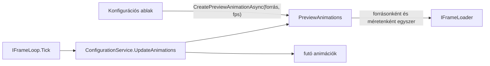

## Konfigurációs motor – szerkesztő homlokzat, mintavételezés és léptetés

Ez a dokumentum a [futó konfiguráció](./service.md) kiegészítése. Azt írja le, hogyan valósítja meg a [`ConfigurationService`](../../src/ConfigurationEngine/ConfigurationService.cs) a konfigurációs ablak homlokzatát ([`IConfigurationEditor`](../../src/ConfigurationEngine/IConfigurationEditor.cs), a View oldala: [view.md, "Kapcsolat a modellel"](./view.md#kapcsolat-a-modellel)) és az OS motor mintavételezési beállításait ([`IPollingSettingsProvider`](../../src/MonkeyStack.Core/Events/IPollingSettingsProvider.cs)), és hogyan lépnek az animációk a közös léptető ([`IFrameLoop`](../../src/MonkeyStack.Core/Timing/IFrameLoop.cs)) ütemére. Fogalmak: [Szótár](../../README.md#szótár), minták: [patterns.md](../patterns.md).

---

### Felépítés

| Fájl | Szerep |
|---|---|
| [`MonkeyStack.Core/Timing/IFrameLoop.cs`](../../src/MonkeyStack.Core/Timing/IFrameLoop.cs), [`FrameLoop.cs`](../../src/MonkeyStack.Core/Timing/FrameLoop.cs) | A közös, ~60 Hz-es léptető a [Karakter motor tervében](../character_engine/architecture.md#javasolt-közös-bővítések-a-monkeystackcore-ban-egyeztetés-után) javasolt formában |
| [`ConfigurationService.cs`](../../src/ConfigurationEngine/ConfigurationService.cs) | A három interfész (`IConfigurationService`, `IPollingSettingsProvider`, `IConfigurationEditor`) megvalósítása |
| [`Runtime/PreviewAnimations.cs`](../../src/ConfigurationEngine/Runtime/PreviewAnimations.cs) | A konfigurációs ablak előnézeti animációi, megosztott képkockákkal |
| [`Validation/IMediaValidator.cs`](../../src/ConfigurationEngine/Validation/IMediaValidator.cs) | Új művelet: `ReadImageSizeAsync`, egy forrás képének tényleges mérete |
| [`tests/ConfigurationEngine.Tests`](../../tests/ConfigurationEngine.Tests) | `ConfigurationEditorTests`, `PollingSettingsTests`, `Timing/FrameLoopTests` |

**Konstruktorok.** A szolgáltatásnak nincs saját időzítője, ezért mindkét konstruktor kötelezően megkapja a léptetőt:

- `ConfigurationService(IFrameLoop frameLoop)`: a felhasználó adatbázisával és a szállított képekkel ([service.md, "Felépítés"](./service.md#felépítés));
- `ConfigurationService(IConfigurationStore, IFrameLoader, IMediaValidator, IFrameLoop)`: a tesztek ezzel adnak át hamis függőségeket.

A léptetőt a host hozza létre, indítja és dobja el; a szolgáltatás csak feliratkozik rá, és a `Dispose`-ban leiratkozik.

---

### Közös léptető (`IFrameLoop`)

- **Szerződés:** az [`IFrameLoop.Tick`](../../src/MonkeyStack.Core/Timing/IFrameLoop.cs) ütemenként egyszer tüzel az előző ütem óta eltelt idővel ([`FrameTickEventArgs.DeltaTime`](../../src/MonkeyStack.Core/Timing/FrameTickEventArgs.cs)), a léptető saját szálán. A feliratkozók egymástól függetlenek: egy kivétel nem éri el a többit, és nem állítja le a léptetőt.
- **Megvalósítás:** a [`FrameLoop`](../../src/MonkeyStack.Core/Timing/FrameLoop.cs) egy `PeriodicTimer`-rel vár a következő ütemre, és az eltelt időt a kapott `TimeProvider` órájából méri, így az ütemezési csúszást is továbbadja. Tesztben hamis órával (`FakeTimeProvider`) determinisztikusan léptethető. `Start` és `Stop` többször is hívható, a `Dispose` után nem indítható újra.
- **Léptetés:** a szolgáltatás minden ütemben meghívja az `UpdateAnimations`-t, amely a futó konfiguráció animációit és a konfigurációs ablak előnézeteit is lépteti. Az animációk szálbiztosak ([Animáció](../mvc_architecture.md#animáció)), így a léptető szála léptetheti őket, miközben a UI szál rajzolja őket.

| Futás | Ki hozza létre a léptetőt | Állapot |
|---|---|---|
| Integrált ([`CharacterEngine/App.xaml.cs`](../../src/CharacterEngine/App.xaml.cs)) | az `App`: `SharedFrameLoop`, a konstruktorban indul | a közös szolgáltatás ezt kapja; a Karakter fizikája később ugyanerre iratkozhat fel |
| Önálló konfigurációs ablak ([`ConfigurationEngine/MainWindow.xaml.cs`](../../src/ConfigurationEngine/MainWindow.xaml.cs)) | az ablak: saját léptető és saját szolgáltatás | bezáráskor mindkettőt eldobja |
| Önálló karakterablak ([`CharacterEngine/MainWindow.xaml.cs`](../../src/CharacterEngine/MainWindow.xaml.cs)) | a tartalék szolgáltatás egy el nem indított léptetőt kap | a Karakter motor saját ciklusa váltja majd |

---

### A szerkesztő homlokzat (`IConfigurationEditor`)

A View-nak szóló Wrapper Facade: mögötte a tároló, a validátor, a médiaellenőrzés és a képkocka-betöltés. A szolgáltatás az [Extension Interface](../patterns.md) minta szerint valósítja meg, így a Karakter továbbra is csak az `IConfigurationService`-t látja.

| Művelet | Mit csinál |
|---|---|
| `LoadAsync` | A tároló betöltése ([`IConfigurationStore.LoadAsync`](../../src/ConfigurationEngine/Storage/IConfigurationStore.cs)). Minden hívás új, független másolatot ad, így a View szabadon módosíthatja |
| `Validate` | A mentéssel azonos normalizálás után a [`ConfigurationValidator`](../../src/ConfigurationEngine/Validation/ConfigurationValidator.cs); a View objektumai nem változnak |
| `ValidateMediaAsync` | A forrás `Full` médiaellenőrzése ([Médiafájlok validálása](./schema.md#médiafájlok-validálása)) |
| `SaveAsync` | Validátor és minden forrás `Full` ellenőrzése; hiba esetén `ConfigurationValidationException`, és semmi nem tárolódik. Utána a tároló ment, visszaírja az új azonosítókat, és a `Changed` eseményére a szolgáltatás a háttérben újratölt ([Component Configurator](./schema.md#alkalmazott-minták)) |
| `SetCharacterSize` | Mint eddig ([service.md](./service.md)); az előnézeteket is átméretezi |
| `CreatePreviewAnimationAsync`, `ReleasePreviewAnimation(s)` | [Előnézetek](#előnézetek) |
| `MediaLoadFailures` | A futó konfiguráció be nem töltött forrásai (eddig csak a szolgáltatáson volt elérhető) |
| `ReadImageSizeAsync` | A forrás képének tényleges mérete pixelben: sprite sheetnél a teljes kép, eltérő rácsnál is ([view.md, "4. Animációs források"](./view.md#4-animációs-források)) |

Az utolsó kettő és a `LoadAsync` másolat-garanciája **javaslat** a konfigurációs ablak felelősének: a View még nem használja őket, a [`FakeConfigurationEditor`](../../src/ConfigurationEngine/View/Fakes/FakeConfigurationEditor.cs) is megkapta őket.

#### Előnézetek

- **Külön példányok:** a futó konfigurációtól függetlenek, ezért az újratöltés (pl. mentés után) nem érinti őket; csak a `ReleasePreviewAnimation` és a `ReleasePreviewAnimations` dobja el őket. Eldobás után nem lépnek.
- **Megosztott képkockák:** ugyanannak a forrásnak (a betöltést meghatározó mezők: típus, útvonal, rács) a képkockái méretenként egyszer töltődnek be. Ha egy betöltés több kérést szolgál ki, az egyik kérő megszakítása csak a saját várakozását állítja le. A már egyetlen előnézet által sem használt képkockák eldobódnak.
- **Méretváltás:** az előnézetek azonnal az új méretet kapják (a régi képkockák nyújtva), és a háttérben az új méretű képkockák töltődnek be ugyanazokba a példányokba. Ha egy forrás az új méretre nem tölthető be, a régi képkockák maradnak.
- **Hiba:** a nem betölthető forrásra `MediaLoadException`; a sikertelen betöltést a következő kérés újrapróbálja (pl. miután a felhasználó pótolta a fájlt).

---

### Mintavételezési beállítások (`IPollingSettingsProvider`)

- `GetPollingInterval(metric)`: a futó konfiguráció [`MetricPolling`](./schema.md#5-metricpolling--rendszeresemény-mintavételezés) sora szerint, `null` a kikapcsolt metrikánál. Az első betöltés előtt, illetve a konfigurációból hiányzó metrikánál a séma alapértéke.
- `PollingSettingsChanged`: minden újratöltés után, ha legalább egy metrika gyakorisága vagy be-/kikapcsolt állapota változott; az első betöltésnél az alapértékekhez képest. Más konfigurációs változásra nem tüzel. A feliratkozók egymástól függetlenek, és sosem a motor zárja alatt futnak.

---

### Ami a host bekötésére vár

A hostot ([`CharacterEngine/App.xaml.cs`](../../src/CharacterEngine/App.xaml.cs)) a Karakter motor felelőse köti be. Ebben a változtatásban csak annyi került bele, amennyi a kötelező léptető miatt kellett (a `SharedFrameLoop` létrehozása és indítása). A még hiányzó lépések:

- `SharedConfigurationService.InitializeAsync()` az indításkor;
- `SharedOsMonitorService.UsePollingSettings(...)` a szolgáltatással mint `IPollingSettingsProvider` ([OS motor terv](../os_event_engine/plan.md));
- `OpenConfigurationWindow`: a szolgáltatás átadása `IConfigurationEditor`-ként (`MainWindow(IConfigurationEditor)`), utána az átmeneti konstruktor törölhető;
- a léptető és a szolgáltatás eldobása kilépéskor; a fizika feliratkozása ugyanarra a léptetőre.

---

### Alkalmazott minták

| Minta | Hol |
|---|---|
| **Active Object** | [`FrameLoop`](../../src/MonkeyStack.Core/Timing/FrameLoop.cs): saját aszinkron ciklus, a hívók csak feliratkoznak |
| **Extension Interface** | a `ConfigurationService` három interfésze: mindegyik fogyasztó csak a sajátját látja |
| **Wrapper Facade** | az `IConfigurationEditor` (tároló, validátorok, médiaellenőrzés, betöltés mögötte) és az `IMediaValidator.ReadImageSizeAsync` (WPF dekóderek) |
| **Component Configurator** | mentés után újraindítás nélküli újratöltés; a mintavételezés változása a `PollingSettingsChanged`-del jut el az OS motorhoz |
| **Monitor Object**, **Scoped Locking**, **Thread-Safe Interface** | [`PreviewAnimations`](../../src/ConfigurationEngine/Runtime/PreviewAnimations.cs) és `FrameLoop`: minden művelet zár alatt, bármelyik szálról hívható |
