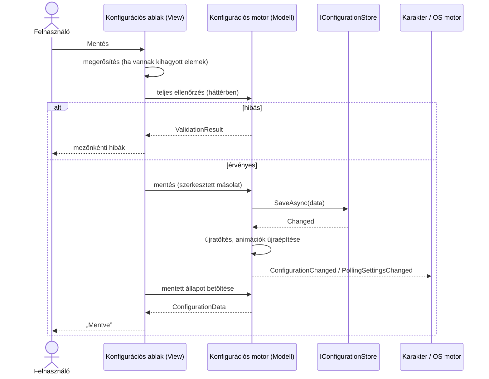
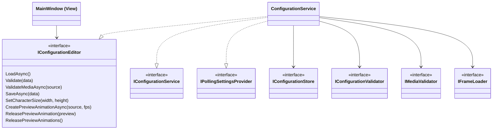

## Konfigurációs ablak

Ez a dokumentum a [Konfigurációs motor](../components.md#konfigurációs-motor) **View rétegét**, a konfigurációs ablakot írja le: milyen részekből áll, mit lehet benne beállítani, és hogyan kapcsolódik a modellhez.

Fogalmak: [Szótár](../../README.md#szótár). Komponens áttekintés: [overview.md](./overview.md). A beállítható adatok és érvényes értékeik: [Séma és validálás](./schema.md). A közös modell és a View réteg elvárásai: [MVC architektúra](../mvc_architecture.md#config-engine).

---

### Áttekintés

A konfigurációs ablak egyetlen [WPF](../tech_stack.md) ablak, amely fülekre tagolódik. Megnyitáskor a teljes konfiguráció betöltődik egy szerkeszthető másolatba. A felhasználó ezt a másolatot módosítja, és a változtatások csak **Mentés**kor kerülnek az adatbázisba, **Elvetés**kor pedig visszaáll a legutóbb mentett állapot. Egyetlen kivétel a [karakter mérete](#1-karakter-mérete), amely azonnal érvényesül (de szintén csak Mentéskor tárolódik).

| Fül | Rész | Mit lehet állítani | Séma tábla |
|---|---|---|---|
| Karakter | [Karakter mérete](#1-karakter-mérete) | Az animációk egységes mérete | [`CharacterSettings`](./schema.md#4-charactersettings--karakter-beállítások) |
| Karakter | [Mozgási animációk](#2-mozgási-animációk) | [Mozgásállapotonként](../../README.md#mozgásállapot-alapállapot) a forrás és a sebesség | [`MovementAnimation`](./schema.md#2-movementanimation--mozgásállapot-animációja) |
| Szabályok | [Viselkedési szabályok](#3-viselkedési-szabályok-rétegek) | [Triggerfeltétel](../../README.md#triggerfeltétel) és overlay animáció, rétegként listázva | [`BehaviorRule`](./schema.md#3-behaviorrule--viselkedési-szabály) |
| Források | [Animációs források](#4-animációs-források) | [Animációs források](../../README.md#animációs-forrás) tallózása, törlése | [`AnimationSource`](./schema.md#1-animationsource--animációs-forrás) |
| Mintavételezés | [Mintavételezés](#5-mintavételezés) | [Rendszeresemények](../../README.md#rendszeresemény--metrika-os-check) lekérdezési gyakorisága | [`MetricPolling`](./schema.md#5-metricpolling--rendszeresemény-mintavételezés) |

A füleken kívül két rész mindig látható:

- **Figyelmeztető sáv** (felül): akkor jelenik meg, ha betöltéskor elemek maradtak ki, vagy az adatbázis alapértékekre állt vissza. Részletek: [Hibajelzés](#hibajelzés).
- **Mentés / Elvetés gombok** (alul). Részletek: [Mentés](#mentés).

Az [élő előnézet](#élő-előnézet) azokban a sorokban jelenik meg, amelyekhez animáció tartozik (mozgási animációk, szabályok, források).

Vázlat:

```
┌ Konfiguráció ───────────────────────────────────────┐
│ ⚠ 2 elem kimaradt betöltéskor          [Részletek]  │
├─────────────────────────────────────────────────────┤
│ [Karakter] [Szabályok] [Források] [Mintavételezés]  │
│                                                     │
│  Méret: [100] × [100] px                            │
│  ── Mozgási animációk ──                            │
│  Idle      [forrás ▾]  [10 fps]   ▶ előnézet        │
│  Walking   [forrás ▾]  [12 fps]   ▶ előnézet        │
│  Falling   [forrás ▾]  [10 fps]   ▶ előnézet        │
│  Dragging  [forrás ▾]  [10 fps]   ▶ előnézet        │
│                                                     │
├─────────────────────────────────────────────────────┤
│                               [Elvetés]  [Mentés]   │
└─────────────────────────────────────────────────────┘
```

---

### 1. Karakter mérete

A „Karakter” fül tetején, a [mozgási animációk](#2-mozgási-animációk) fölött ([MVC terv, View réteg](../mvc_architecture.md#view-réteg)).

| Mező | Vezérlő | Tartomány | Alapérték |
|---|---|---|---|
| `CharacterWidth` | számmező (px) | 16–512 | 100 |
| `CharacterHeight` | számmező (px) | 16–512 | 100 |

A határokat a View a [`ConfigurationLimits.CharacterSizePx`](../../src/ConfigurationEngine/Model/ConfigurationLimits.cs) értékéből veszi, így ugyanazokat használja, mint a validátor.

**Azonnali érvényesülés (kivétel a mentési alapelv alól):** érvényes érték beírásakor a View rögtön meghívja az [`IConfigurationEditor.SetCharacterSize`](../../src/ConfigurationEngine/IConfigurationEditor.cs) műveletet. Ennek hatására minden animáció átméreteződik, és egyszer tüzel a `ConfigurationChanged` esemény ([schema.md](./schema.md#4-charactersettings--karakter-beállítások)). Így az [élő előnézet](#élő-előnézet) és a futó karakter is azonnal az új méretet mutatja.

- Az adatbázisba a méret a többi beállítással együtt, csak **Mentés**kor kerül.
- **Elvetés**kor a View visszaállítja a legutóbb mentett méretet a szolgáltatáson is.
- Érvénytelen érték (üres, nem szám, tartományon kívüli) nem kerül a szolgáltatásba: a mező hibát jelez ([Hibajelzés](#hibajelzés)), és az utolsó érvényes méret marad érvényben.

A karakter fizikai paraméterei (`WalkSpeedPxPerSec`, `GravityPxPerSec2`, `FollowCursor`) **nem jelennek meg** az ablakban: a fizikai modell fix paraméterekkel fut ([Karakter és Fizika](../mvc_architecture.md#karakter-és-fizika)), a mezők csak tárolódnak ([schema.md](./schema.md#4-charactersettings--karakter-beállítások)). Megjelenítésük [továbbfejlesztési lehetőség](#továbbfejlesztési-lehetőségek).

### 2. Mozgási animációk

A „Karakter” fülön, a [méret](#1-karakter-mérete) alatt. Minden [mozgásállapothoz](../../README.md#mozgásállapot-alapállapot) **pontosan egy, fix sor** tartozik ([`MovementAnimation`](./schema.md#2-movementanimation--mozgásállapot-animációja)), ezért sort hozzáadni vagy törölni nem lehet. A sorok sorrendje a [`MovementState`](../../src/MonkeyStack.Core/Character/MovementState.cs) sorrendje: `Idle` (tétlen), `Walking` (séta), `Falling` (esés), `Dragging` (mozgatás).

| Oszlop | Vezérlő | Érvényes érték |
|---|---|---|
| Állapot | felirat (nem szerkeszthető) | – |
| Forrás (`AnimationSourceId`) | legördülő lista az [animációs források](#4-animációs-források) nevével | létező forrás |
| Sebesség (`FramesPerSecond`) | számmező (fps) | 1–60, alapérték 10 ([`ConfigurationLimits.FramesPerSecond`](../../src/ConfigurationEngine/Model/ConfigurationLimits.cs)) |
| Előnézet | [élő előnézet](#élő-előnézet) | – |

- A legördülő lista a szerkesztett másolat forrásait mutatja, így a „Források” fülön újonnan tallózott forrás mentés előtt is azonnal választható (az [ideiglenes azonosítóján](#tallózás) keresztül).
- „Nincs animáció” lehetőség nincs: az alapanimációkat képként szállítjuk, és első indításkor animációs forrásként kerülnek be ([Tárolás](./schema.md#tárolás)), így mindig választható érvényes forrás.
- Ha egy állapot sora betöltéskor hiányzott vagy kimaradt, a tároló a szállított alapanimációra állítja vissza, és ez a [kihagyott elemek](#kihagyott-elemek) között jelenik meg ([Validálás](./schema.md#validálás)). A sorban így **mindig van kiválasztott forrás**, üres állapot nincs. Mentéskor a validátor minden állapothoz megkövetel egy animációt.
- Irányonkénti animáció nincs: balra nézéskor a Karakter View tükröz ([Karakter és Fizika](../mvc_architecture.md#view-réteg-1)), ezért az előnézet mindig a tükrözetlen képet mutatja.
- A módosítások a szerkesztett másolatba kerülnek, és **Mentés**kor tárolódnak ([Mentés](#mentés)).

### 3. Viselkedési szabályok (rétegek)

A „Szabályok” fül a [viselkedési szabályokat](../../README.md#viselkedési-szabály) ([`BehaviorRule`](./schema.md#3-behaviorrule--viselkedési-szabály)) **lista + részletek** elrendezésben mutatja: felül a rétegek listája, alatta a kijelölt szabály összes mezője.

```
[+ Új szabály]  [Törlés]
┌───┬──────────┬──────────────┬────────┬───────────┐
│ ☑ │ Nagy tűz │ CPU > 80 %   │ Z = 20 │ ▶ előnézet│  ◀ kijelölve
│ ☑ │ Kis tűz  │ CPU > 60 %   │ Z = 20 │ ▶ előnézet│
│ ☑ │ Pizsama  │ 20:30–06:00  │ Z = 10 │ ▶ előnézet│
└───┴──────────┴──────────────┴────────┴───────────┘
── Nagy tűz ─────────────────────────────────────────
Név:            [Nagy tűz          ]   ☑ Engedélyezve
Feltétel:       [CPU ▾] [> ▾] [80] %
Animáció:       [fire_big ▾]  [10] fps        ▶ előnézet
Réteg (ZIndex): [20]
Kizáró csoport: [fire ▾]      Prioritás: [20]
```

#### Rétegek listája

- **Sorrend:** csökkenő `ZIndex`, így a legfelső réteg áll legelöl ([schema.md](./schema.md#3-behaviorrule--viselkedési-szabály), a specifikáció „legfelső legelőször” elvárása). Azonos `ZIndex` esetén az `Id` dönt, ugyanúgy, mint a kirajzolásnál: a lista a kirajzolási sorrend fordítottja, így mindig a felül rajzolt réteg áll elöl. A lista a `ZIndex` mező elhagyásakor rendeződik újra, nem gépelés közben, hogy a kijelölés ne ugráljon.
- **Oszlopok:** engedélyezés (jelölőnégyzet, a listából is kapcsolható), név, a feltétel rövid szöveges alakja (pl. `CPU > 80 %`, `20:30–06:00`), `ZIndex`, [élő előnézet](#élő-előnézet).
- **Figyelmeztetések a sorban:** hibás mező esetén a sor hibát jelez ([Hibajelzés](#hibajelzés)). Ha a szabály metrikájának [mintavételezése](#5-mintavételezés) ki van kapcsolva, a sor jelzi, hogy a szabály így sosem teljesül ([schema.md](./schema.md#5-metricpolling--rendszeresemény-mintavételezés)).
- **Új szabály:** a lista legfelső rétegeként jön létre (`ZIndex` = a legnagyobb meglévő + 1, legfeljebb 100), alapértékekkel és kijelölve. Forrás nincs kiválasztva, ezt a felhasználónak kell megadnia.
- **Törlés:** a kijelölt szabályt törli a szerkesztett másolatból. Megerősítést nem kér, mert az **Elvetés** visszahozza.
- A betöltéskor **kihagyott** szabályok nem ebben a listában, hanem a [Hibajelzés](#hibajelzés) szerint jelennek meg.

#### Részletek

| Csoport | Mező | Vezérlő | Érvényes érték |
|---|---|---|---|
| Alap | `Name` | szövegmező | 1–64 karakter |
| Alap | `IsEnabled` | jelölőnégyzet | – |
| [Triggerfeltétel](../../README.md#triggerfeltétel) | `Metric` | legördülő lista | [metrikák](./schema.md#metrikák-és-értéktartományok) |
| Triggerfeltétel | `Operator` | legördülő lista jelekkel: `>`, `≥`, `<`, `≤`, `között` | – |
| Triggerfeltétel | `Threshold` | számmező a metrika mértékegységével | a metrika tartománya |
| Triggerfeltétel | `ThresholdUpper` | számmező, **csak `között` operátornál látható** | a metrika tartománya |
| Animáció | `AnimationSourceId` | legördülő lista az [animációs források](#4-animációs-források) nevével | létező forrás |
| Animáció | `FramesPerSecond` | számmező (fps) | 1–60, alapérték 10 |
| Réteg | `ZIndex` | számmező | 0–100 |
| Kizárás | `ExclusiveGroup` | szerkeszthető legördülő lista a már használt csoportnevekkel; üres vagy csak szóközből álló név = nincs csoport (ilyenkor a prioritás inaktív) | 0–32 karakter |
| Kizárás | `Priority` | számmező, **csak csoport megadásakor aktív** | 0–100 |

- **Mértékegység és tartomány a metrikától függ** ([`ConfigurationLimits.MetricRange`](../../src/ConfigurationEngine/Model/ConfigurationLimits.cs)): `%` (CPU, memória, háttértár, akkumulátor), `db` (ablakok száma), `perc` (inaktivitás). Metrika váltásakor a küszöbértékek megmaradnak; ha az új tartományon kívül esnek, a mező hibát jelez.
- **Idő metrika:** a küszöbök `HH:mm` alakban szerkeszthetők, a View alakítja át éjfél óta eltelt percekre. `között` operátornál, ha az alsó határ későbbi, mint a felső, a mező mellett megjelenik: „éjfélen átnyúló intervallum” ([schema.md](./schema.md#metrikák-és-értéktartományok)).
- **Operátor váltásakor** `között`-ről másra a felső határ törlődik, `között`-re váltáskor kötelezővé válik ([Mezőszintű szabályok](./schema.md#mezőszintű-szabályok)).
- A kizáró csoport és a prioritás jelentése a mezők mellett súgószövegként jelenik meg ([Kiértékelés](./schema.md#kiértékelés)): azonos csoportból egyszerre csak a legnagyobb prioritású teljesülő szabály aktív.
- A módosítások a szerkesztett másolatba kerülnek, és **Mentés**kor tárolódnak ([Mentés](#mentés)).

### 4. Animációs források

A „Források” fül az [animációs források](../../README.md#animációs-forrás) ([`AnimationSource`](./schema.md#1-animationsource--animációs-forrás)) könyvtára. A [szabályokhoz](#3-viselkedési-szabályok-rétegek) hasonlóan **lista + részletek** elrendezésű. Itt csak a forrás betöltési módja állítható; a sebesség és a réteg a felhasználás helyén van ([schema.md](./schema.md#1-animationsource--animációs-forrás)).

```
[+ Fájl tallózása…]  [+ Mappa tallózása…]  [Törlés]
┌──────────┬─────────────┬──────────────────────┬───────────────┬───────────┐
│ Név      │ Típus       │ Útvonal              │ Használja     │ Előnézet  │
├──────────┼─────────────┼──────────────────────┼───────────────┼───────────┤
│ fire_big │ GIF         │ …\fire_big.gif       │ Nagy tűz      │ ▶         │ ◀
│ walk     │ Sprite sheet│ …\walk.png           │ Walking       │ ▶         │
│ pyjama   │ Képmappa    │ …\pyjama\            │ –             │ ▶         │
└──────────┴─────────────┴──────────────────────┴───────────────┴───────────┘
── fire_big ──────────────────────────────────────────────────
Név:     [fire_big        ]     Típus: GIF
Útvonal: C:\…\fire_big.gif      [Csere…]
```

#### Tallózás

- **Fájl tallózása** (`OpenFileDialog`, szűrő: `.gif`, `.png`, `.jpg`, `.jpeg`, `.bmp`): `.gif` esetén `Gif`, egyébként `SpriteSheet` típusú forrás jön létre.
- **Mappa tallózása** (`OpenFolderDialog`): `ImageFolder` típusú forrás jön létre.
- A típust a View a választásból határozza meg, ezért a részletekben csak felirat. A **Csere…** gomb ugyanilyen típusú fájlt vagy mappát enged választani.
- Az új forrás neve a fájl vagy mappa neve; ha ez már foglalt, sorszámot kap (pl. `fire (2)`), mert a névnek egyedinek kell lennie. Az ütközést a View a validátorhoz hasonlóan kis- és nagybetűtől függetlenül vizsgálja (`Fire` és `fire` ütközik).
- Az új forrás egyedi, negatív **ideiglenes azonosítót** kap (`-1`, `-2`, …), így mentés előtt is hivatkozhat rá egy mozgási animáció vagy szabály. Mentéskor a tároló a valódi azonosítót a hivatkozásokkal együtt visszaírja a View objektumaiba ([Ideiglenes azonosítók](./implementation.md#ideiglenes-azonosítók)).
- Tallózás után a View a háttérben lefuttatja a teljes médiaellenőrzést ([`IMediaValidator`](../../src/ConfigurationEngine/Validation/IMediaValidator.cs), `Full`), így a hibák (pl. hálózati útvonal, túl nagy fájl, nem dekódolható kép) már a mentés előtt megjelennek ([Médiafájlok validálása](./schema.md#médiafájlok-validálása), [Hibajelzés](#hibajelzés)). Az ellenőrzés idején a sor „ellenőrzés…” állapotot mutat, a felület nem blokkolódik.

#### Részletek

| Mező | Vezérlő | Érvényes érték |
|---|---|---|
| `Name` | szövegmező | 1–64 karakter, egyedi |
| `SourceType` | felirat | – |
| `Path` | felirat + **Csere…** gomb | [Médiafájlok validálása](./schema.md#médiafájlok-validálása) |
| `FrameWidth`, `FrameHeight` | számmező (px), **csak sprite sheetnél** | 1–1024 |
| `Columns`, `Rows` | számmező, **csak sprite sheetnél** | 1–64 |
| `FrameCount` | számmező, **csak sprite sheetnél**; alapértéke `Columns × Rows` | 1 – `Columns × Rows` |

Sprite sheetnél a rács mezői mellett megjelenik a kép tényleges mérete és a rácsból számolt méret (`Columns × FrameWidth` × `Rows × FrameHeight`), hogy eltérés esetén látszódjon, melyik értéket kell javítani.

#### Törlés tiltása

Egy forrás **nem törölhető, amíg mozgási animáció vagy szabály használja** ([Mezőszintű szabályok](./schema.md#mezőszintű-szabályok)):

- A „Használja” oszlop a szerkesztett másolat alapján felsorolja a forrást használó mozgásállapotokat és szabályokat.
- Használt forrásnál a **Törlés** gomb inaktív, a súgószövege megmondja, mi használja (pl. „Nem törölhető, használja: Walking, Kis tűz”).
- Ha a felhasználó előbb minden használó helyen másik forrást választ, a törlés engedélyezetté válik, mentés nélkül is.
- A tároló adatbázis-szinten is tiltja a törlést (`ON DELETE RESTRICT`); ez csak védelmi háló, a View nem enged ilyen mentést elindítani.

A módosítások a szerkesztett másolatba kerülnek, és **Mentés**kor tárolódnak ([Mentés](#mentés)).

### 5. Mintavételezés

A „Mintavételezés” fül a [rendszeresemények](../../README.md#rendszeresemény--metrika-os-check) lekérdezési beállításait ([`MetricPolling`](./schema.md#5-metricpolling--rendszeresemény-mintavételezés)) mutatja. Minden [`Metric`](../../src/MonkeyStack.Core/Events/Metric.cs) értékhez **pontosan egy, fix sor** tartozik, sort hozzáadni vagy törölni nem lehet.

```
┌─────────────────────┬───────────────┬──────────────────┬──────────────────────┐
│ Metrika             │ Engedélyezve  │ Gyakoriság       │ Szabályok            │
├─────────────────────┼───────────────┼──────────────────┼──────────────────────┤
│ CPU (%)             │ ☑             │ [1000] ms        │ Kis tűz, Nagy tűz    │
│ Memória (%)         │ ☑             │ [1000] ms        │ –                    │
│ Akkumulátor (%)     │ ☐             │ [30000] ms       │ ⚠ Lemerülés          │
│ …                   │               │                  │                      │
└─────────────────────┴───────────────┴──────────────────┴──────────────────────┘
                                              [Alapértékek visszaállítása]
```

| Oszlop | Vezérlő | Érvényes érték |
|---|---|---|
| Metrika | felirat a mértékegységgel ([Metrikák](./schema.md#metrikák-és-értéktartományok)) | – |
| `IsEnabled` | jelölőnégyzet | – |
| `IntervalMs` | számmező (ms), mellette olvasható alak (pl. „= 30 s”) | 250–60000 ([`ConfigurationLimits.PollingIntervalMs`](../../src/ConfigurationEngine/Model/ConfigurationLimits.cs)) |
| Szabályok | felirat: a metrikát használó [szabályok](#3-viselkedési-szabályok-rétegek) nevei | – |

- Kikapcsolt metrikánál a gyakoriság mező inaktív, de az értéke megmarad, így visszakapcsoláskor nem kell újra beírni.
- Ha egy kikapcsolt metrikát szabály használ, a sor figyelmeztet, hogy ezek a szabályok így sosem teljesülnek ([schema.md](./schema.md#5-metricpolling--rendszeresemény-mintavételezés)). Ugyanez a jelzés a [szabálylistában](#rétegek-listája) is megjelenik.
- Az **Alapértékek visszaállítása** gomb minden sort a [séma alapértékeire](./schema.md#5-metricpolling--rendszeresemény-mintavételezés) állít (engedélyezve, metrikánkénti alapgyakoriság) a szerkesztett másolatban.
- A módosítások **Mentés**kor tárolódnak ([Mentés](#mentés)). Az OS esemény értesítő motor ezután az [`IPollingSettingsProvider`](../../src/MonkeyStack.Core/Events/IPollingSettingsProvider.cs) `PollingSettingsChanged` eseményéből értesül a változásról; a View az OS motorral közvetlenül nem kommunikál.

---

### Élő előnézet

Minden sor, amelyhez animáció tartozik ([mozgási animációk](#2-mozgási-animációk), [szabályok](#3-viselkedési-szabályok-rétegek), [források](#4-animációs-források)), folyamatosan, loopolva lejátssza a saját animációját ([MVC terv, View réteg](../mvc_architecture.md#view-réteg)). Az előnézet a **szerkesztett állapotot** mutatja: egy újonnan tallózott forrás vagy egy átírt sebesség mentés előtt is azonnal látszik, a futó karaktert viszont nem érinti.

#### Előnézeti animációk

- A View a [modellen keresztül](#kapcsolat-a-modellel) kér a szolgáltatástól egy **előnézeti** [`IAnimation`](../../src/MonkeyStack.Core/Animation/IAnimation.cs) példányt a szerkesztett forráshoz és sebességhez. A szolgáltatás ugyanazzal a betöltéssel és skálázással készíti el, mint a karakter animációit ([Animációk előállítása](./schema.md#animációk-előállítása)), így az előnézet pontosan azt mutatja, ami mentés után a karakteren megjelenik.
- Az előnézeti animációk **külön példányok**: a Karakter nem kapja meg őket. A **motor lépteti őket** a karakter animációival együtt (`UpdateAnimations`), a [közös modell](../mvc_architecture.md#animáció) szerint; a View csak rajzol. Ugyanannak a forrásnak a képkockái megosztottak, így egy forrás csak egyszer töltődik be.
- A View **egyik animációt sem módosítja**, csak rajzolja őket. Ezért **sebesség vagy forrás változásakor** (másik forrás kiválasztása, tallózás, csere, sprite sheet rács módosítása) új előnézeti animációt kér, a régit pedig egyenként eldobja (`ReleasePreviewAnimation(preview)`); a többi sor előnézete nem változik. A képkockák megosztottak, így sebességváltáskor a forrás nem töltődik be újra.
- **Méret változásakor** ([Karakter mérete](#1-karakter-mérete)) az előnézeti animációkat is a motor méretezi át; a View ilyenkor sem módosítja őket.
- A betöltés a háttérben fut. Addig a sor „betöltés…” állapotot mutat; ha a forrás nem tölthető be, az előnézet helyén a hiba üzenete jelenik meg ([Hibajelzés](#hibajelzés)).

#### Kirajzolás

- Minden előnézet egy saját `Canvas`-ra rajzol egy saját [`AnimationView`](../../src/MonkeyStack.Core/Animation/AnimationView.cs) példánnyal, a `(0, 0)` pontba, tükrözés nélkül (`Draw(0, 0)`). A listák soraiban a `Canvas` kicsinyítve (`Viewbox`), a részletek panelen teljes karakterméretben látszik.
- A View egy rajzolási ciklusban (`CompositionTarget.Rendering`) **csak kirajzol**: meghívja a `Draw`-t, amely az animáció aktuális képkockáját mutatja. A léptetést nem a View végzi. Csak az aktuális fülön látható előnézetek rajzolódnak ki.
- Az animációk szálbiztosak és a képkockák fagyasztottak ([Animáció](../mvc_architecture.md#animáció)), így a motor léptetheti őket, miközben a UI szál rajzolja őket, és a háttérben betöltött képkockák is biztonságosan kirajzolhatók.

#### Élettartam

Az előnézeti animációk a konfigurációs ablakhoz tartoznak. Eldobás után a motor már nem lépteti őket, ezért a View minden régi előnézetet eldob, mielőtt újat kér helyette:

| Mikor | Mit dob el a View | Művelet |
|---|---|---|
| Sebesség- vagy forrásváltás egy sorban | csak az adott sor régi előnézetét | `ReleasePreviewAnimation(preview)` |
| Sor törlése (szabály, forrás) | csak a törölt sor előnézetét | `ReleasePreviewAnimation(preview)` |
| **Elvetés** | az összeset, majd a mentett állapotból újakat kér | `ReleasePreviewAnimations()` |
| Az ablak bezárása | az összeset | `ReleasePreviewAnimations()`, `AnimationView.Detach` |

**Mentés** után az előnézetek megmaradnak, mert már a mentett állapotot mutatják.

---

### Hibajelzés

A View kétféle hibát jelez: a szerkesztés közben talált **mezőhibákat**, és a betöltéskor **kihagyott elemeket** ([Validálás](./schema.md#validálás)).

#### Mezőnkénti hibajelzés

A hibák három forrásból jönnek:

| Forrás | Mikor fut | Mit talál |
|---|---|---|
| Beviteli hiba (View) | gépeléskor | a mező szövege nem alakítható át (pl. nem szám, hibás `HH:mm`); ilyen érték nem kerül a szerkesztett másolatba |
| [`IConfigurationValidator`](../../src/ConfigurationEngine/Validation/IConfigurationValidator.cs) | minden módosítás után, a teljes szerkesztett másolaton | tartományok, kötelező mezők, kereszthivatkozások ([Mezőszintű szabályok](./schema.md#mezőszintű-szabályok)) |
| [`IMediaValidator`](../../src/ConfigurationEngine/Validation/IMediaValidator.cs) (`Full`) | tallózás / csere után és mentéskor, a háttérben | a médiafájl hibái ([Médiafájlok validálása](./schema.md#médiafájlok-validálása)) |

A validátor gyors és mellékhatás nélküli, ezért a View minden módosítás után újrafuttathatja. Így a szabályok egy helyen vannak, a View nem ismétli meg őket.

**Megjelenítés:**

- A [`ValidationError`](../../src/ConfigurationEngine/Validation/ValidationError.cs) a `Kind` + `ItemKey` + `PropertyName` hármassal azonosítja a mezőt. A View ezt a [`ValidationResult.ErrorsFor`](../../src/ConfigurationEngine/Validation/ValidationResult.cs) segítségével rendeli a mezőhöz (`ItemKey`: az `Id`, negatív ideiglenes azonosítójú új elemnél is; 0 azonosítójú új elemnél a listabeli index, `#index` alakban; mozgási animációnál és mintavételezésnél az állapot / metrika neve).
- A hibás mező piros keretet kap, alatta megjelenik a hibaüzenet (WPF `INotifyDataErrorInfo`). A `PropertyName = null` hibák a sor egészére vonatkoznak, ezek a részletek panel tetején jelennek meg.
- A hibás elem sora a listában hibajelet kap, a fül fejléce pedig a hibák számát (pl. „Szabályok (2)”), így a nem látható fülek hibái sem vesznek el.
- Amíg van hiba, a **Mentés** gomb inaktív, mellette „N hiba” felirat, amelyre kattintva a View az első hibás mezőre ugrik ([Mentés](#mentés)).

#### Kihagyott elemek

Betöltéskor a tároló a hibás elemeket kihagyja, és a [`ConfigurationLoadResult`](../../src/ConfigurationEngine/Storage/ConfigurationLoadResult.cs) `DroppedItems` listájában adja vissza (okkal együtt). Ezek nincsenek benne a szerkesztett másolatban, ezért a View külön mutatja őket. Kivétel a mozgásállapot sora: azt a tároló a szállított alapanimációra állítja vissza, így a másolatban is szerepel ([Mozgási animációk](#2-mozgási-animációk)), a kihagyott elemek között pedig az eredeti hiba látszik.

- **Figyelmeztető sáv** az ablak tetején: „N elem kimaradt betöltéskor” és **Részletek** gomb. Ha az adatbázis sérült volt és alapértékekkel jött létre (`DatabaseWasReset`), a sáv ezt is jelzi, a `config.db.bak` fájl említésével.
- A **Részletek** panel elemenként mutatja a típust, a nevet (vagy kulcsot) és az okokat. Ha egy elem csak azért maradt ki, mert az általa használt forrás hibás, ez is az okok között szerepel ([`DroppedItem`](../../src/ConfigurationEngine/Validation/DroppedItem.cs)).
- A `DroppedItem` az elem adatait nem tartalmazza, ezért a kihagyott elem nem nyitható meg szerkesztésre. Ha a felhasználó vissza szeretné kapni, a megfelelő fülön újra felveszi, helyes értékekkel (mozgásállapotnál a sorban választ másik forrást).
- **Törlés:** a mentés a teljes tárolt állapotot lecseréli ([`IConfigurationEditor.SaveAsync`](../../src/ConfigurationEngine/IConfigurationEditor.cs)), ezért a kihagyott elemek **mentéskor véglegesen törlődnek**. A Részletek panel és a mentés előtti megerősítés ezt kifejezetten jelzi ([Mentés](#mentés)).

---

### Mentés

A **Mentés** gomb (és a `Ctrl+S`) akkor aktív, ha a szerkesztett másolat eltér a mentett állapottól, és nincs [mezőhiba](#mezőnkénti-hibajelzés).

#### Lépések

1. **Megerősítés kihagyott elemek esetén.** Ha betöltéskor elemek maradtak ki, a View felsorolja őket, és megerősítést kér, mert mentéskor véglegesen törlődnek ([Kihagyott elemek](#kihagyott-elemek)).
2. **Zárolás.** A szerkesztés a mentés idejére tiltott, az ablak alján „Mentés…” állapot látszik. A felület nem fagy le, mert a további lépések a háttérben futnak.
3. **Teljes ellenőrzés.** Lefut a validátor és minden forrásra a `Full` médiaellenőrzés ([Validálás](./schema.md#validálás)). Ha hibát talál, a mentés megszakad, semmi nem tárolódik, és a hibák a mezőknél jelennek meg.
4. **Tárolás.** A View az [`IConfigurationEditor.SaveAsync`](../../src/ConfigurationEngine/IConfigurationEditor.cs) hívással átadja a szerkesztett másolatot, a modell pedig az [`IConfigurationStore.SaveAsync`](../../src/ConfigurationEngine/Storage/IConfigurationStore.cs) hívással lecseréli a tárolt állapotot. Az új elemek itt kapnak valódi azonosítót, amelyet a tároló a hivatkozásokkal együtt visszaír a View objektumaiba ([Ideiglenes azonosítók](./implementation.md#ideiglenes-azonosítók)).
5. **Újratöltés a motorban** ([Component Configurator](./schema.md#alkalmazott-minták)). A tároló `Changed` eseményére a szolgáltatás újraolvassa a konfigurációt, újraépíti az animációkat, és kiváltja a `ConfigurationChanged` eseményt (a Karakternek), illetve – ha a mintavételezés változott – a `PollingSettingsChanged` eseményt (az OS motornak). A View ebben a lépésben nem vesz részt.
6. **A View frissítése.** A View újra betölti a mentett állapotot (az új azonosítókkal), lecseréli vele a szerkesztett másolatot, és „Mentve” állapotot mutat. Az [előnézetek](#élettartam) megmaradnak, mert már a mentett állapotot mutatják. A kihagyott elemek listája kiürül.



#### Hibák mentés közben

- [`ConfigurationValidationException`](../../src/ConfigurationEngine/Validation/ConfigurationValidationException.cs): védelmi háló, mert a View mentés előtt validál. Ha mégis előfordul, a benne lévő hibák a mezőknél jelennek meg.
- Egyéb hiba (pl. zárolt vagy írhatatlan adatbázisfájl): a figyelmeztető sávban jelenik meg az üzenet. A szerkesztett másolat megmarad, a mentés megismételhető.
- A modell eseményei bármelyik szálon kiváltódhatnak ([`IConfigurationStore.Changed`](../../src/ConfigurationEngine/Storage/IConfigurationStore.cs)), ezért a View a UI szálra (`Dispatcher`) továbbítja őket, mielőtt a felületet frissíti.

#### Elvetés és bezárás

- **Elvetés:** ha van mentetlen változás, megerősítést kér, majd újratölti a mentett állapotot, és a szolgáltatáson is visszaállítja a mentett [karakterméretet](#1-karakter-mérete).
- **Ablak bezárása mentetlen változással:** a View megkérdezi, hogy menti, elveti, vagy mégsem zárja be az ablakot.

---

### Kapcsolat a modellel

A View a Konfigurációs motort egyetlen interfészen, az [`IConfigurationEditor`](../../src/ConfigurationEngine/IConfigurationEditor.cs)-on keresztül éri el. Ez a View-nak szóló **Wrapper Facade**: mögötte van a tároló, a validátorok, a médiafájlok ellenőrzése és a képkocka-betöltő, a View ezekről nem tud.

Az `IConfigurationEditor` a `ConfigurationEngine` projektben él, nem a Core-ban, mert csak a konfigurációs ablak használja. A `ConfigurationService` valósítja meg az eddigi interfészei mellett ([Extension Interface](./schema.md#alkalmazott-minták)): a Karakter így továbbra is csak az [`IConfigurationService`](../../src/MonkeyStack.Core/Configuration/IConfigurationService.cs)-t, az OS motor csak az [`IPollingSettingsProvider`](../../src/MonkeyStack.Core/Events/IPollingSettingsProvider.cs)-t, a View pedig csak az `IConfigurationEditor`-t látja.



A műveletek pontos szerződése az [`IConfigurationEditor`](../../src/ConfigurationEngine/IConfigurationEditor.cs) dokumentációs kommentjeiben található. Melyik fejezet melyik műveletet használja:

| Művelet | Fejezet |
|---|---|
| `LoadAsync` | [Áttekintés](#áttekintés) (megnyitás), [Kihagyott elemek](#kihagyott-elemek), [Mentés](#mentés) 6. lépés, Elvetés |
| `Validate` | [Mezőnkénti hibajelzés](#mezőnkénti-hibajelzés) |
| `ValidateMediaAsync` | [Tallózás](#tallózás) |
| `SaveAsync` | [Mentés](#mentés) 3–5. lépés |
| `SetCharacterSize` | [Karakter mérete](#1-karakter-mérete), Elvetés |
| `CreatePreviewAnimationAsync`, `ReleasePreviewAnimation`, `ReleasePreviewAnimations` | [Élő előnézet](#élettartam) |

A műveletek szálbiztosak, és a UI szálról hívhatók. Az aszinkron műveletek a lassú munkát (fájlrendszer, dekódolás, adatbázis) a háttérben végzik, így a felület nem fagy le.

#### Az ablak létrehozása

A [`MainWindow`](../../src/ConfigurationEngine/MainWindow.xaml.cs) konstruktora a meglévő mintát követi ([Külön-külön indíthatóság](../mvc_architecture.md#alapelvek-közös-modell-és-független-view-k)): integrált futásnál a host adja át a közös `ConfigurationService` példányt `IConfigurationEditor`-ként, önálló (F5) futásnál a `MainWindow` maga hoz létre egyet.

---

### Alkalmazott minták

A [javasolt minták](../patterns.md) közül, a [közös modell mintáival](../mvc_architecture.md#alkalmazott-architektúrális-minták) és a [Konfigurációs motor mintáival](./schema.md#alkalmazott-minták) összhangban:

- **Wrapper Facade** (a View fő mintája): az [`IConfigurationEditor`](#kapcsolat-a-modellel) egyetlen, a View igényeire szabott OO interfész mögé rejti a tárolót (EF Core, SQLite), a validátorokat, a médiafájlok ellenőrzését (fájlrendszer, `BitmapDecoder`) és a képkocka-betöltést. A View csak a konfiguráció adatosztályait ([`ConfigurationData`](../../src/ConfigurationEngine/Model/ConfigurationData.cs)), a hibákat ([`ValidationError`](../../src/ConfigurationEngine/Validation/ValidationError.cs)) és kész [`IAnimation`](../../src/MonkeyStack.Core/Animation/IAnimation.cs) objektumokat lát. Így a tárolás vagy a betöltés megváltozása nem érinti a View-t, és a View egy hamis (mock) facade-dal önállóan is tesztelhető.
- **Extension Interface**: a `ConfigurationService` szerepenként külön interfészt ad, és minden kliens csak a sajátját kapja: a Karakter az `IConfigurationService`-t, az OS motor az `IPollingSettingsProvider`-t, a konfigurációs ablak az `IConfigurationEditor`-t. A View-nak szóló szerkesztő műveletek így nem jelennek meg a Karakter interfészén, és a Core sem változik.
- **Component Configurator**: a [Mentés](#mentés) után a motor újraindítás nélkül újraolvassa és alkalmazza a konfigurációt. A konfigurációs ablak integrált módban a közös szolgáltatáspéldányt kapja, önálló (F5) módban saját példányt hoz létre ([Az ablak létrehozása](#az-ablak-létrehozása)).
- **Half Sync / Half Async**: a UI szál szinkron marad (szerkesztés, gyors validálás, kirajzolás), a lassú munka (médiaellenőrzés, képkocka-betöltés, mentés) aszinkron, a háttérben fut. Az eredmények és a modell eseményei a `Dispatcher`-en keresztül, sorban jutnak vissza a UI szálra ([Élő előnézet](#élő-előnézet), [Mentés](#mentés)).
- **Thread-Safe Interface** és **Monitor Object**: az `IConfigurationEditor` műveletei szálbiztosak, és az előnézeti [`Animation`](../../src/MonkeyStack.Core/Animation/Animation.cs) példányok (fagyasztott képkockákkal) a háttérszálon készülhetnek, és a motor léptetheti őket, miközben a UI szál rajzolja őket.

---

### Továbbfejlesztési lehetőségek

A [Konfigurációs motor továbbfejlesztési lehetőségei](./schema.md#továbbfejlesztési-lehetőségek) mellett, a konfigurációs ablakra vonatkozóan:

- A karakter fizikai paramétereinek (séta sebesség, gravitáció, kurzorkövetés) megjelenítése a „Karakter” fülön, ha a fizikai modell állíthatóvá válik ([Karakter mérete](#1-karakter-mérete)).
- Arányzár a karakterméretnél (a szélesség és a magasság együtt változik).
- Rétegek átrendezése húzással vagy fel / le gombokkal a `ZIndex` közvetlen beírása helyett.
- Szabály duplikálása (pl. „Kis tűz” → „Nagy tűz” más küszöbbel).
- **Szabálytesztelő:** a metrikák értékeinek kézi megadásával (pl. CPU = 85 %, 22:00) megmutatni, mely szabályok lennének aktívak, és a karakter előnézetén az overlay-eket a mozgási animációval együtt, a valós rétegsorrendben kirajzolni.
- Sprite sheet rácsának automatikus felismerése (képkockaméret javaslata a kép méretéből).
- Visszavonás / újra (undo / redo) a szerkesztett másolaton.
- Kihagyott elemek javítása helyben: a kihagyott elem adatai alapján a View visszavehetné szerkesztésre, és a hibás mezőket jelölné, így nem kellene újra felvenni ([Kihagyott elemek](#kihagyott-elemek)).
- Felület a sémában tervezett bővítésekhez: karaktercsomagok importálása / exportálása, konfigurációs profilok kezelése.
