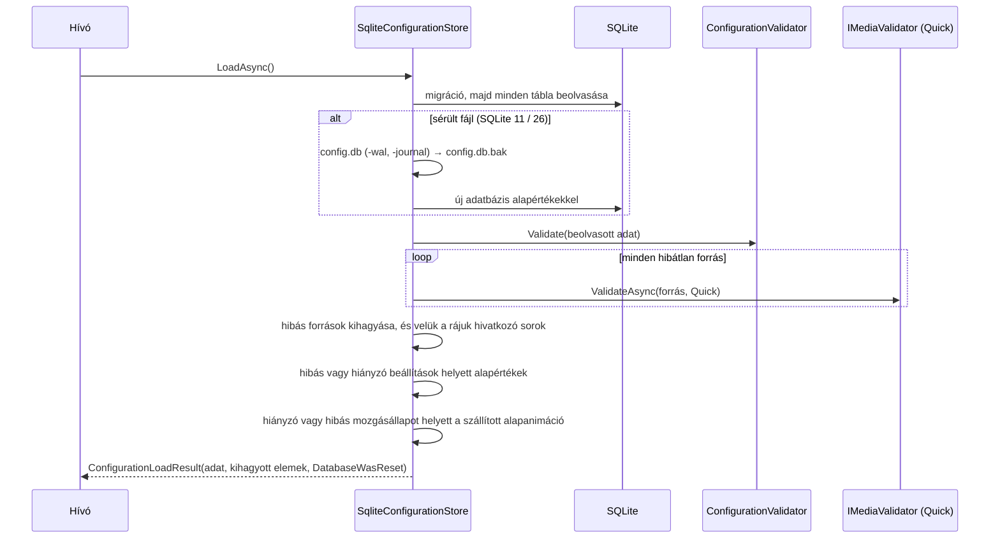
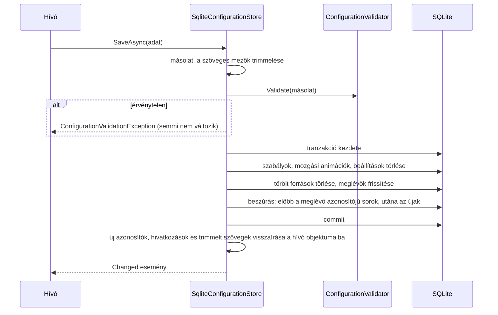

## Konfigurációs motor – implementáció

Ez a dokumentum a [Konfigurációs motor](../components.md#konfigurációs-motor) megvalósítását írja le. Hogy mit tárolunk és mi érvényes, azt a [Séma és validálás](./schema.md) rögzíti; a komponensek közös modelljét az [MVC terv](../mvc_architecture.md#config-engine). Fogalmak: [Szótár](../../README.md#szótár).

---

### Tárolás és validálás

#### Felépítés

| Fájl | Szerep |
|---|---|
| [`Storage/SqliteConfigurationStore.cs`](../../src/ConfigurationEngine/Storage/SqliteConfigurationStore.cs) | Az [`IConfigurationStore`](../../src/ConfigurationEngine/Storage/IConfigurationStore.cs) megvalósítása: betöltés, mentés, helyreállítás |
| [`Storage/ConfigurationDbContext.cs`](../../src/ConfigurationEngine/Storage/ConfigurationDbContext.cs) | EF Core leképezés: táblák, szövegként tárolt felsorolások, `RESTRICT` hivatkozások, alapadatok |
| [`Storage/TolerantEnumConverter.cs`](../../src/ConfigurationEngine/Storage/TolerantEnumConverter.cs) | Ismeretlen felsorolás-szöveg → nem definiált érték, amit a validátor kiszűr |
| [`Storage/Migrations/`](../../src/ConfigurationEngine/Storage/Migrations) | EF Core migrációk |
| [`Validation/ConfigurationValidator.cs`](../../src/ConfigurationEngine/Validation/ConfigurationValidator.cs) | Az [`IConfigurationValidator`](../../src/ConfigurationEngine/Validation/IConfigurationValidator.cs) megvalósítása: mező- és kereszthivatkozási szabályok |
| [`Model/ConfigurationDefaults.cs`](../../src/ConfigurationEngine/Model/ConfigurationDefaults.cs) | Alapértékek és a szállított alapanimációk: új adatbázis, illetve hiányzó vagy hibás sor helyett |
| [`tests/ConfigurationEngine.Tests`](../../tests/ConfigurationEngine.Tests) | A validátor és a tároló tesztjei |
| [`Media/`](../../src/ConfigurationEngine/Media), [`Validation/MediaValidator.cs`](../../src/ConfigurationEngine/Validation/MediaValidator.cs), [`assets/`](../../src/ConfigurationEngine/assets) | Médiaréteg: képkockák betöltése és skálázása, a médiafájlok ellenőrzése, szállított képek; részletesen: [Médiaréteg](./media.md) |

Az adatbázis helye `%LOCALAPPDATA%\MonkeyStack\config.db`. A tároló minden művelethez saját kapcsolatot nyit kapcsolat-készlet nélkül, így a fájl a művelet végén felszabadul. A migráció példányonként csak az első műveletnél fut le, illetve újra, ha az adatbázisfájl közben eltűnt vagy helyreállítás miatt új jön létre.

#### Betöltés



- Csak akkor tekintjük sérültnek a fájlt, ha az SQLite szerint nem adatbázis (26) vagy sérült (11). Egy zárolt vagy más okból elérhetetlen adatbázist nem dobunk el, ilyenkor a hiba a hívóhoz jut.
- A sérült fájl a `-wal` és `-journal` naplójával együtt kerül félre (`config.db.bak-wal`), így a mentés a még vissza nem írt tranzakciókkal együtt nyitható meg. Egy korábbi `config.db.bak` nem íródik felül: időbélyeggel félrekerül (`config.db.bak.<UTC időbélyeg>`).
- A 0 bájtos `config.db` (pl. megszakadt létrehozás után) hiányzónak számít: a `DatabaseWasReset` ilyenkor is igaz, így az ablak jelezheti, hogy alapértékek töltődtek be.
- Az ismeretlen felsorolás-szöveg (pl. `Metric = 'Gpu'`) nem okoz kivételt: a `TolerantEnumConverter` nem definiált értékre képezi le, a validátor jelzi, és csak az érintett sor marad ki.
- Minden kihagyott elemhez tartozik egy [`DroppedItem`](../../src/ConfigurationEngine/Validation/DroppedItem.cs) az okokkal, ezt jeleníti meg a konfigurációs ablak. Egy hibás forrás miatt kimaradó szabálynál az ok: „A hivatkozott animációs forrás (…) érvénytelen.”
- A hét metrika mintavételezési beállítása mindig teljes: a hiányzók alapértéket kapnak.
- A négy mozgásállapot mozgási animációja is mindig teljes. A hiányzó vagy kihagyott állapot a szállított alapanimációt kapja ([Tárolás](./schema.md#tárolás)): a forrását a betöltött források közül típus és útvonal, ennek híján név alapján keressük. Ha nincs meg (pl. egy korábbi mentés lecserélte), a forrás ideiglenes negatív azonosítóval visszakerül, és a következő mentéskor tárolódik. A kihagyott állapotnál az okok között ott van: „Helyette az alapértékek érvényesek.” A teljesen hiányzó sort, a mintavételezéshez hasonlóan, nem jelezzük.
- Az új adatbázis a szállított alapanimációkat az első migráció alapadataiból kapja (`HasData`): mozgásállapotonként egy képsorozat-mappa forrást rögzített azonosítóval, és a hozzá tartozó mozgási animációt. A forrásazonosítók automatikusan növekednek (`AUTOINCREMENT`), így egy törölt forrás azonosítóját az SQLite nem osztja ki újra.

#### Mentés



A szabályokra, a mozgási animációkra és a beállításokra semmi nem hivatkozik, ezért ezek a mentéskor egyszerűen újra bekerülnek (a meglévő azonosítók megmaradnak). Az animációs forrásokra hivatkoznak, ezért azokat egyenként szinkronizáljuk; a még használt forrás törlését a validátor már a tranzakció előtt megakadályozza.

#### Ideiglenes azonosítók

Egy még nem mentett elem azonosítója 0 vagy egy egyedi negatív szám. Ha a konfigurációs ablakban egy új forrást rögtön egy új szabályhoz is hozzárendelnek, a forrás negatív ideiglenes azonosítót kap (pl. `-1`), és a szabály erre hivatkozik. Mentéskor a tároló a valódi azonosítót a hívó objektumaiba is visszaírja, a hivatkozásokkal együtt:

| | Mentés előtt | Mentés után |
|---|---|---|
| Új forrás `Id` | `-1` | `4` |
| Új szabály `Id` | `0` | `7` |
| Új szabály `AnimationSourceId` | `-1` | `4` |

A validálási hibák kulcsa (`ItemKey`) negatív azonosítónál maga az azonosító, 0-nál a listabeli index (`#3`). Ismétlődő azonosítónál a második és további előfordulás kulcsa szintén a listabeli index, így a hiba egyértelműen egy elemre mutat.

A mentés a hívó konfigurációjának másolatán dolgozik ([`ModelCopies`](../../src/ConfigurationEngine/Storage/ModelCopies.cs)): érvénytelen konfigurációnál a hívó objektumai nem változnak. Új modellmezőnél a megfelelő `Copy` metódust is bővíteni kell; a `ModelCopiesTests` ezt ellenőrzi.

#### Alkalmazott minták

A [javasolt minták](../patterns.md) közül:

- **Wrapper Facade**: az `SqliteConfigurationStore` mögött van az EF Core és az SQLite; a hívó csak `ConfigurationData`-t lát.
- **Thread-Safe Interface** és **Scoped Locking**: a betöltést és a mentést egy `SemaphoreSlim` sorosítja, amelyet `try`/`finally` blokk old fel, így a tároló bármelyik szálról hívható. A lassabb lépések (validálás, médiaellenőrzés) a záron kívül futnak.
- **Component Configurator**: a sikeres mentés után kiváltott `Changed` esemény indítja a futó konfiguráció újratöltését.

#### Biztonság

- Az adatbázist csak EF Core-on keresztül érjük el, amely minden lekérdezést paraméterezve küld; nyers SQL-t string-összefűzéssel nem írunk.
- Hibás adat nem kerül az adatbázisba (mentés előtti validálás), és a kívülről elrontott adatbázis sem állítja le az alkalmazást (betöltéskori validálás, helyreállítás).

#### Fejlesztői tudnivalók

```bash
dotnet test MonkeyStack.slnx
```

```bash
dotnet tool restore
```

```bash
dotnet ef migrations add <Név> --project src/ConfigurationEngine --output-dir Storage/Migrations
```

A modell változásakor új migráció kell; indításkor a tároló automatikusan lefuttatja.
