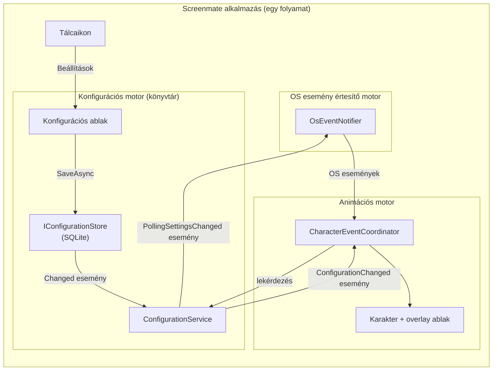
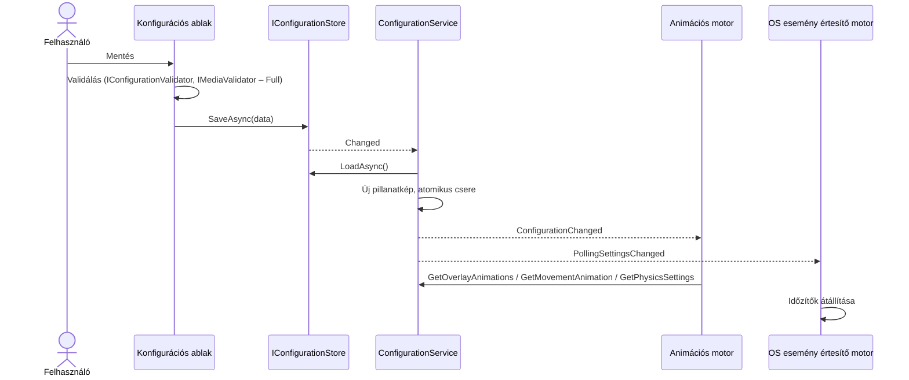

## Konfigurációs motor – integráció

Ez a dokumentum azt írja le, hogyan kapcsolódik a [Konfigurációs motor](../components.md#konfigurációs-motor) a másik két komponenshez: mit ad vissza az [Animációs motornak](../components.md#animációs-motor), hogyan kapja meg a beállításait az [OS esemény értesítő motor](../components.md#os-esemény-értesítő-motor), és hogyan jut el egy mentett változás a futó karakterhez. A tárolt adatok leírása: [Séma és validálás](./schema.md). Fogalmak: [Szótár](../../README.md#szótár).

Röviden:

1. A Konfigurációs motor **animáció-leírókat** ad vissza, nem lejátszható animációkat ([1.](#1-animáció-leírók)).
2. A karakter és a konfigurációs ablak **egy alkalmazásban, egy folyamatban** fut, így egy mentés eseményként jut el a karakterhez, nem kell lekérdezgetni ([2.](#2-közös-host-alkalmazás-és-változásértesítés)).
3. A fizikai és a mintavételezési beállítások is a Konfigurációs motortól jönnek, ugyanezzel az értesítéssel ([3.](#3-fizikai-és-mintavételezési-beállítások)).

A komponensek közötti típusok a `MonkeyStack.Core`-ban vannak ([Közös típusok](#közös-típusok)), így egyik komponens sem függ a másik belső felépítésétől.

---

### 1. Animáció-leírók

A Konfigurációs motor csak **leírja**, mit kell lejátszani; az Animációs motor dönti el, **hogyan**. A kettő között egy egyszerű, megváltoztathatatlan adatrekord utazik:

```csharp
namespace MonkeyStack.Core.Animation;

public enum AnimationSourceType { Gif, SpriteSheet, ImageFolder }

/// Sprite sheet rácsa; csak SpriteSheet esetén van értéke.
public sealed record SpriteGrid(int FrameWidth, int FrameHeight, int Columns, int Rows, int FrameCount);

/// Mit kell lejátszani. Nem tölt be semmit, csak leír.
public sealed record AnimationDescriptor(
    int SourceId,                // az AnimationSource azonosítója; a gyorsítótár kulcsa
    AnimationSourceType SourceType,
    string FullPath,             // abszolút útvonal, a relatív "assets" útvonalat a Konfigurációs motor már feloldotta
    SpriteGrid? Grid,
    TimeSpan? FrameDuration,     // null: GIF esetén a fájlba ágyazott időzítés
    bool Loop,
    double Scale);
```

Az [`IConfigurationService`](../../src/ConfigurationEngine/IConfigurationService.cs) leírókat ad vissza:

```csharp
// ZOrder szerint növekvő sorrendben: az első kerül legalulra.
IReadOnlyList<AnimationDescriptor> GetOverlayAnimations(OsEventDataRegistry registry);

// Sosem null: ha nincs (érvényes) beállítás, a beépített alapértelmezett animáció leírója.
AnimationDescriptor GetMovementAnimation(MovementState state);
```

Az Animációs motorban egy gyár a leíróból [`IAnimation`](../../src/MonkeyStack.Core/Animation/IAnimation.cs)-t készít, és `SourceId` szerint gyorsítótárazza, így egy képet csak egyszer kell betölteni.

#### Miért így

Egy lejátszható `IAnimation` létrehozása megjelenítési feladat: képek betöltése, GIF dekódolása, sprite sheet felvágása, időzítő indítása. Ez az Animációs motorhoz tartozik.

| Szempont | Eredmény |
|---|---|
| Felelősségek | A Konfigurációs motor nem tud a megjelenítésről, az Animációs motor nem tud az SQLite-ról. |
| Függőségek | Az `IAnimation` implementációi az Animációs motorban vannak, amely hivatkozik a Konfigurációs motorra. Ha a Konfigurációs motor hozná létre őket, körkörös függőség keletkezne; a leíróval mindkét fél csak a Core-ra támaszkodik. |
| Újraindulás | A [`CharacterEventCoordinator`](../../src/CharacterEngine/CharacterEventCoordinator.cs) minden OS eseménynél újra lekérdezi az overlay-eket. A rekordok érték szerint hasonlíthatók: ha az új lista megegyezik az előzővel, az Animációs motor nem csinál semmit, és a futó animáció nem indul újra. |
| Szálbiztonság | A rekord megváltoztathatatlan, így a háttérszálról érkező OS események és a mentés nem zavarják egymást. |
| Több overlay | A lista természetes módon írja le, ha egyszerre több [környezeti állapot](../../README.md#környezeti-konfigurálható-állapot) aktív (pl. "pizsamában ég a karakter"). |

---

### 2. Közös host alkalmazás és változásértesítés

**Egyetlen alkalmazás, egyetlen folyamat** fut: a screenmate. Ez a *host*, amely induláskor létrehozza és összekapcsolja a komponenseket, és a tálcaikon menüjéből megnyitja a konfigurációs ablakot ugyanabban a folyamatban. A hostot az Animációs motor alkalmazása adja, mivel a [komponens tervben](../components.md#kapcsolatok) ő áll középen és ő ismeri a másik kettőt. A Konfigurációs motor osztálykönyvtár, amely a konfigurációs ablakot is tartalmazza.



Egy mentés útja, lekérdezgetés nélkül:



Ez a **Component Configurator** minta lényege: a futó komponensek újraindítás nélkül kapják meg az új konfigurációt.

Az események bármelyik szálon kiváltódhatnak. Aki a UI-t módosítja (Animációs motor), a saját `Dispatcher`-ére teszi át a feldolgozást.

#### Miért nem külön program

Ha a konfigurációs ablak külön programként futna, a futó karakter nem értesülne a mentésről. Ilyenkor vagy időnként újra kellene olvasnia az adatbázist, ami felesleges munka és késleltetés, vagy figyelnie kellene a fájl változását, ami SQLite esetén megbízhatatlan: egy mentés több fájlírással jár, és a változás pillanata nem egyértelmű. Egy folyamaton belül egy egyszerű .NET esemény elég.

---

### 3. Fizikai és mintavételezési beállítások

Az Animációs motor a fizikai paramétereket az `IConfigurationService`-től kérdezi le, és a `ConfigurationChanged` eseményre kérdezi le újra:

```csharp
PhysicsParameters GetPhysicsSettings();
event EventHandler? ConfigurationChanged;
```

Az OS esemény értesítő motor nem hivatkozik a Konfigurációs motorra. A mintavételezési beállításokat egy Core-beli interfészen keresztül kapja, amelyet a Konfigurációs motor implementál, és a host ad át neki:

```csharp
namespace MonkeyStack.Core.Events;

public interface IPollingSettingsProvider
{
    /// null: a metrika ki van kapcsolva, nem kell lekérdezni.
    TimeSpan? GetPollingInterval(Metric metric);
    event EventHandler? PollingSettingsChanged;
}
```

---

### Közös típusok

A `MonkeyStack.Core` projektben, a komponensek közötti szerződés részeként:

| Típus | Szerepe |
|---|---|
| `AnimationDescriptor`, `SpriteGrid`, `AnimationSourceType` | Mit kell lejátszani ([1.](#1-animáció-leírók)) |
| `PhysicsParameters` | Megváltoztathatatlan fizikai paraméterek: `WalkSpeedPxPerSec`, `GravityPxPerSec2`, `CharacterScale`, `FollowCursor` ([3.](#3-fizikai-és-mintavételezési-beállítások)) |
| `Metric` | A szabályokban és a mintavételezésben használt metrikák ([séma](./schema.md#metrikák-és-értéktartományok)) |
| `IPollingSettingsProvider` | Mintavételezési beállítások az OS esemény értesítő motornak ([3.](#3-fizikai-és-mintavételezési-beállítások)) |
