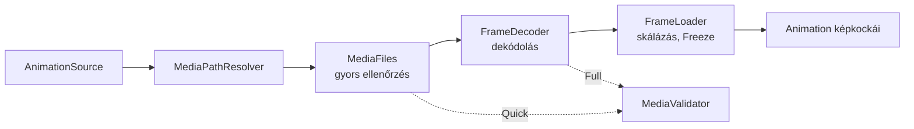

## Konfigurációs motor – médiaréteg

Ez a dokumentum a [Konfigurációs motor](../components.md#konfigurációs-motor) médiarétegét írja le: hogyan lesznek az [animációs forrásokból](../../README.md#animációs-forrás) fix méretű képkockák, és hogyan ellenőrizzük a felhasználó által tallózott fájlokat. A szabályokat (korlátok, kiterjesztések) a [Séma és validálás](./schema.md#médiafájlok-validálása) rögzíti, a tárolást és a betöltés menetét az [implementáció](./implementation.md). Fogalmak: [Szótár](../../README.md#szótár).

---

### Felépítés

| Fájl | Szerep |
|---|---|
| [`Media/MediaPathResolver.cs`](../../src/ConfigurationEngine/Media/MediaPathResolver.cs) | Útvonal-feloldás: a relatív útvonal az `assets` mappához képest értendő; hálózati, eszköz- és hiányos útvonal (`C:kep.gif`) nem megengedett |
| [`Media/MediaFiles.cs`](../../src/ConfigurationEngine/Media/MediaFiles.cs) | A forrás fájljai a gyors ellenőrzésekkel: létezés, kiterjesztés, fájlméret, a mappa képeinek száma |
| [`Media/NaturalFileNameComparer.cs`](../../src/ConfigurationEngine/Media/NaturalFileNameComparer.cs) | A képsorozat-mappa természetes sorrendje (`frame2` < `frame10`) |
| [`Media/FrameDecoder.cs`](../../src/ConfigurationEngine/Media/FrameDecoder.cs) | Dekódolás eredeti méretben: GIF-egymásra rakás, sprite sheet vágása, képsorozat |
| [`Media/FrameLoader.cs`](../../src/ConfigurationEngine/Media/FrameLoader.cs) | Az [`IFrameLoader`](../../src/ConfigurationEngine/Media/IFrameLoader.cs) megvalósítása: dekódolás és skálázás a karakter méretére |
| [`Validation/MediaValidator.cs`](../../src/ConfigurationEngine/Validation/MediaValidator.cs) | Az [`IMediaValidator`](../../src/ConfigurationEngine/Validation/IMediaValidator.cs) megvalósítása: gyors (`Quick`) és teljes (`Full`) ellenőrzés |
| [`assets/movement/`](../../assets/movement) | A szállított alapanimációk képei, mozgásállapotonként egy mappa |
| [`tests/ConfigurationEngine.Tests/Media`](../../tests/ConfigurationEngine.Tests/Media) | A betöltő és az ellenőrző tesztjei |

Az ellenőrző és a betöltő ugyanazt az útvonal-feloldást, fájllistát és dekódert használja, így amit a teljes ellenőrzés elfogad, azt a betöltő is be tudja tölteni.

---

### Dekódolás

- **GIF**: a GIF képkockái a teljes kép egy-egy téglalapját rajzolják újra, ezért a képkockákat egy vásznon rakjuk egymásra: a képkocka a saját helyére kerül, átlátszó pixelei alatt az előző állapot látszik. Utána az eltávolítási mód (*disposal*) szerint a vászon megmarad, a téglalap átlátszóra törlődik, vagy visszaáll a képkocka előtti állapot. A GIF-be ágyazott időzítést [nem használjuk](./schema.md#1-animationsource--animációs-forrás).
- **Sprite sheet**: a képkockákat a rácsból vágjuk ki balról jobbra, majd fentről lefelé, `FrameCount` darabot. A kép mérete pontosan `Columns × FrameWidth` × `Rows × FrameHeight` kell legyen.
- **Képsorozat-mappa**: a mappa (almappák nélküli) képei természetes sorrendben; minden kép azonos méretű kell legyen. A más kiterjesztésű fájlok kimaradnak.

Minden képkocka `Pbgra32` formátumú, fagyasztott (`Freeze`) `BitmapSource`, így szálak között megosztható.

---

### Skálázás

A képkockákat a karakter méretére (`CharacterWidth × CharacterHeight`) skálázzuk: aránytartóan, alul középre igazítva, a maradék terület átlátszó. Így a karakter "talpa" minden animációban a terület alján van, és az overlay-ek ugyanahhoz a ponthoz igazodnak.

A dekódoló a képkockákat egyenként adja át a skálázásnak, így egyszerre csak egy eredeti méretű képkocka van a memóriában. A karakter méretének változásakor a motor a forrásokat újra betölti; ez ritka, ezért az eredeti képkockákat nem tartjuk meg.

A skálázott képkockák viszont mind a memóriában maradnak, ezért egy forrás betöltött képkockái együtt legfeljebb 64 MB-ot foglalhatnak (`ConfigurationLimits.MediaMaxLoadedBytes`). Az alap karakterméreten (100 × 100 px) ez mind az 500 képkockának elég, 512 × 512 px-en 64-nek. Ha egy forrás ennél több képkockából áll, a betöltése `MediaLoadException`-nel meghiúsul. A mentés előtti ellenőrzés ezt nem nézi, mert nem ismeri a karakter méretét.

---

### Biztonság

A felhasználó tetszőleges fájlt tallózhat, ezért ([Médiafájlok validálása](./schema.md#médiafájlok-validálása)):

- **Útvonal**: hálózati (`\\szerver\…`, hálózati meghajtó, pl. `Z:\`) és eszközútvonal (`\\?\…`, `\\.\…`) nem megengedett; ugyanaz a feloldás fut ellenőrzéskor és betöltéskor.
- **Méretkorlátok a dekódolás előtt**: a fájlméretet a beolvasás előtt, a képméretet és a képkockaszámot a fejlécből, a pixelek kiolvasása előtt ellenőrizzük. Egy apró fájl, amely óriási képet ír le, így nem foglal le memóriát. A betöltött képkockák együttes méretét a [Skálázás](#skálázás) korlátja fogja vissza.
- **Csak beépített dekóderek**: a formátumot a fájl első bájtjaiból (*magic bytes*) állapítjuk meg, és csak a WPF beépített PNG, JPEG, BMP vagy GIF dekóderét indítjuk el. A rendszerre telepített egyéb képkodekek (pl. TIFF, HEIF) a fájlt nem is látják. A kiterjesztésnek is egyeznie kell a forrás típusával.
- **Nincs zárolás**: a fájlt egyben beolvassuk és rögtön elengedjük, így betöltés után a felhasználó szerkesztheti vagy törölheti. Olvasás közben sem zárjuk ki a többi programot (pl. képszerkesztő, felhőszinkron).
- A dekóderek kivételei (sérült fájl, ismeretlen formátum) és az olvasási hibák magyar üzenetű `MediaLoadException`-né, illetve validálási hibává alakulnak; nem állítják le az alkalmazást.

---

### Ellenőrzés

| Mélység | Mikor fut | Mit néz |
|---|---|---|
| `Quick` | betöltéskor, a tárolóban | útvonal, létezés, kiterjesztés, fájlméret; mappánál legalább 1 és legfeljebb 500 kép |
| `Full` | mentés előtt, a konfigurációs ablakban | a `Quick` ellenőrzések, a tényleges dekódolás, a képméret, a képkockaszám, a sprite sheet rácsa, a mappa képeinek mérete |

A hiba a forrás hibás mezőjéhez kötődik, így a konfigurációs ablak a megfelelő mezőnél jelzi: az útvonal- és fájlhibák a `Path`-hoz, a túl nagy `FrameCount` a `FrameCount`-hoz. A rács és a kép méretének eltérése a forrás egészére vonatkozik, mert a hibás fájl és a hibás rács is okozhatja. A hiba kulcsa a forrás `Id`-ja, ezért a még nem mentett forrás negatív ideiglenes azonosítót kapjon ([Ideiglenes azonosítók](./implementation.md#ideiglenes-azonosítók)).

A teljes ellenőrzés háttérszálon fut; a gyors ellenőrzés csak fájlrendszer-lekérdezés.

---

### Szállított képek

A relatív útvonalak alapja az alkalmazás mappájában lévő `assets` mappa. A képek a repó gyökerében lévő [`assets`](../../assets) mappában vannak, hogy könnyen megtalálhatók és cserélhetők legyenek. A build kimenetbe a [`ConfigurationEngine`](../../src/ConfigurationEngine) projekt másolja őket, és a projektre hivatkozó alkalmazások kimenetébe is átkerülnek.

A [szállított alapanimációk](./schema.md#tárolás) mappái (`movement/idle`, `movement/walking`, `movement/falling`, `movement/dragging`) egyelőre ideiglenes, egyszerű figurák, állapotonként 4 képkocka 128 × 128 px-ben. A végleges grafika ugyanezekbe a mappákba kerül; a tesztek ellenőrzik, hogy a szállított képek átmennek a teljes ellenőrzésen.

---

### Alkalmazott minták

A [javasolt minták](../patterns.md) közül:

- **Wrapper Facade**: az `IFrameLoader` és az `IMediaValidator` mögött van a WPF képkezelése és a fájlrendszer; a hívó csak `AnimationSource`-ot ad, és kész képkockákat vagy validálási hibákat kap.
- **Thread-Safe Interface**: a betöltő és az ellenőrző állapot nélküli, bármelyik szálról hívható, és a visszaadott képkockák fagyasztottak, így a Karakter és a konfigurációs ablak szálai zár nélkül olvashatják őket.
