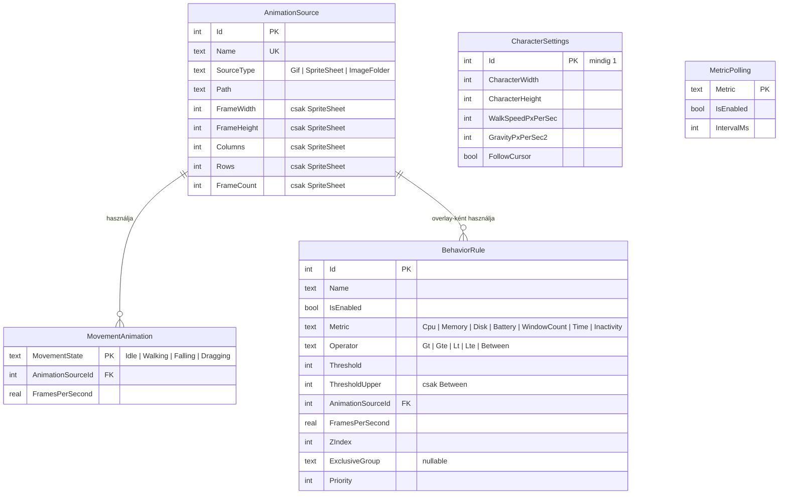

## Konfigurációs séma és validálás

Ez a dokumentum rögzíti, hogy a [Konfigurációs motor](../components.md#konfigurációs-motor) **mit enged konfigurálni**, milyen formában tárolja (SQLite), és milyen szabályok szerint validálja az adatokat. Ebből állítja elő a motor az [Animációs motor](../components.md#animációs-motor) számára az animációkat, és ezek a beállítások határozzák meg az [OS esemény értesítő motor](../components.md#os-esemény-értesítő-motor) mintavételezési gyakoriságát is.

Fogalmak: [Szótár](../../README.md#szótár). Komponens áttekintés: [overview.md](./overview.md). A komponensek közös modellje: [MVC architektúra](../mvc_architecture.md#config-engine).

---

### Áttekintés

A konfiguráció öt részből áll:

| Rész | Tábla | Mit ír le |
|---|---|---|
| [Animációs forrás](#1-animationsource--animációs-forrás) | `AnimationSource` | Egy [animációs forrás](../../README.md#animációs-forrás) (GIF / tileset / képsorozat-mappa), és hogyan kell betölteni |
| [Mozgási animáció](#2-movementanimation--mozgásállapot-animációja) | `MovementAnimation` | Melyik [mozgásállapothoz](../../README.md#mozgásállapot-alapállapot) melyik animáció tartozik, milyen sebességgel |
| [Viselkedési szabály](#3-behaviorrule--viselkedési-szabály) | `BehaviorRule` | [Triggerfeltétel](../../README.md#triggerfeltétel) → overlay animáció ([viselkedési szabály](../../README.md#viselkedési-szabály)), sebességgel és rétegsorrenddel |
| [Karakter beállítások](#4-charactersettings--karakter-beállítások) | `CharacterSettings` | Az animációk egységes mérete, sebesség, gravitáció, kurzorkövetés (egysoros tábla) |
| [Mintavételezés](#5-metricpolling--rendszeresemény-mintavételezés) | `MetricPolling` | [Rendszeresemények](../../README.md#rendszeresemény--metrika-os-check) lekérdezési gyakorisága |

Az enum értékek **szövegként** tárolódnak (EF Core `HasConversion<string>()`), így az adatbázis olvasható, és egy enum bővítése nem tolja el a meglévő értékeket.

---

### 1. `AnimationSource` – Animációs forrás

| Mező | Típus | Kötelező | Érvényes érték |
|---|---|---|---|
| `Id` | int | igen | automatikus |
| `Name` | text | igen | 1–64 karakter, egyedi, vezérlőkarakter nélkül, trimmelve |
| `SourceType` | enum | igen | `Gif`, `SpriteSheet`, `ImageFolder` |
| `Path` | text | igen | lásd [Médiafájlok validálása](#médiafájlok-validálása) |
| `FrameWidth`, `FrameHeight` | int | csak `SpriteSheet` | 1–1024 px |
| `Columns`, `Rows` | int | csak `SpriteSheet` | 1–64 |
| `FrameCount` | int | csak `SpriteSheet` | 1 – `Columns × Rows` (az utolsó sor lehet hiányos) |

A forrás csak azt írja le, honnan és hogyan kell betölteni a képkockákat. A lejátszási sebesség és a rétegsorrend a felhasználás helyén (mozgási animáció, szabály) van, így ugyanaz a forrás több helyen, eltérő beállítással is használható.

A sprite sheet képkockái balról jobbra, majd fentről lefelé haladva olvasódnak. A képsorozat-mappa fájljai természetes sorrendben (`frame2.png` < `frame10.png`) követik egymást. A GIF fájlba ágyazott időzítést nem használjuk: minden animáció a hozzá beállított, egyenletes `FramesPerSecond` sebességgel játszódik le.

### 2. `MovementAnimation` – Mozgásállapot animációja

| Mező | Típus | Kötelező | Érvényes érték |
|---|---|---|---|
| `MovementState` | enum (PK) | igen | a [`MovementState`](../../src/MonkeyStack.Core/Character/MovementState.cs) értékei: `Idle`, `Walking`, `Falling`, `Dragging` |
| `AnimationSourceId` | int (FK) | igen | létező `AnimationSource` |
| `FramesPerSecond` | real | igen | 1–60 (alapértelmezés 10) |

Minden mozgásállapothoz **pontosan egy** sor tartozik, ezt a validátor mentéskor ellenőrzi. Az alapanimációkat az alkalmazás képként szállítja, és első indításkor animációs forrásként kerülnek be ([Tárolás](#tárolás)). Ha egy állapot sora betöltéskor hiányzik vagy hibás, a szállított alapanimáció érvényes helyette, így a karakter sosem tűnik el.

A séma irányonkénti animációt nem tárol: ha a karakter balra néz, a Karakter View a karaktert és az overlay-eket is vízszintesen tükrözi ([Karakter és Fizika](../mvc_architecture.md#view-réteg-1)).

### 3. `BehaviorRule` – Viselkedési szabály

| Mező | Típus | Kötelező | Érvényes érték |
|---|---|---|---|
| `Id` | int | igen | automatikus |
| `Name` | text | igen | 1–64 karakter |
| `IsEnabled` | bool | igen | – |
| `Metric` | enum | igen | `Cpu`, `Memory`, `Disk`, `Battery`, `WindowCount`, `Time`, `Inactivity` |
| `Operator` | enum | igen | `Gt` (>), `Gte` (≥), `Lt` (<), `Lte` (≤), `Between` (zárt intervallum) |
| `Threshold` | int | igen | a metrika tartományában (lásd lent) |
| `ThresholdUpper` | int | csak `Between` | a metrika tartományában; `Time` kivételével `≥ Threshold` |
| `AnimationSourceId` | int (FK) | igen | létező `AnimationSource` |
| `FramesPerSecond` | real | igen | 1–60 (alapértelmezés 10) |
| `ZIndex` | int | igen | 0–100. Kisebb értéket rajzolunk előbb, a nagyobb kerül felülre. A konfigurációs ablak a rétegeket csökkenő `ZIndex` szerint listázza, így a specifikációnak megfelelően a legfelső réteg áll legelöl |
| `ExclusiveGroup` | text | nem | 0–32 karakter. Azonos csoportból egyszerre csak egy szabály lehet aktív |
| `Priority` | int | igen | 0–100. Csoporton belül a nagyobb nyer |

Az overlay animáció a karakterrel azonos helyen, a karakter **fölé rajzolva** jelenik meg (a "karakter fölött" a kirajzolási sorrendre vonatkozik, nem a pozícióra), ezért nincs külön pozíció-eltolás.

#### Metrikák és értéktartományok

A [`Metric`](../../src/MonkeyStack.Core/Events/Metric.cs) közös típus a Core-ban: a szabályok, a mintavételezési beállítások és az OS esemény értesítő motor is ezt használja. A metrikák a [`OsEventDataRegistry`](../../src/MonkeyStack.Core/Events/OsEventDataRegistry.cs) mezőire képződnek le:

| `Metric` | Forrás mező | Mértékegység | Tartomány |
|---|---|---|---|
| `Cpu` | `Cpu.UsagePercent` | % | 0–100 |
| `Memory` | `Memory.UsagePercent` | % | 0–100 |
| `Disk` | `Disk.UsagePercent` | % | 0–100 |
| `Battery` | `Battery.ChargePercent` | % | 0–100 |
| `WindowCount` | `WindowCount.WindowCount` | db | 0–1000 |
| `Time` | `Time.Hour * 60 + Time.Minute` | perc éjfél óta | 0–1439 (a UI `HH:mm`-ként mutatja) |
| `Inactivity` | `Inactivity.InactivityMinutes` | perc | 0–1440 |

`Time` + `Between` esetén megengedett, hogy `Threshold > ThresholdUpper`: ez **éjfélen átnyúló** intervallum (pl. 20:30–06:00 → `1230`–`360`).

#### Kiértékelés

A séma úgy készült, hogy a README példái (*kis tűz, ha CPU > 60%; nagy tűz, ha CPU > 80%; pizsama, ha este van*) konfigurációval, kód nélkül leírhatók legyenek. Egy adott registry-állapotra a `GetOverlayAnimations` így számolja ki az aktív [környezeti állapotokat](../../README.md#környezeti-konfigurálható-állapot):

1. Csak az `IsEnabled` szabályok számítanak.
2. Ha a szabály metrikájához még nem érkezett adat (`null` a registry-ben), a szabály nem teljesül.
3. A teljesülő szabályokat `ExclusiveGroup` szerint csoportosítjuk. Csoportonként csak a legnagyobb `Priority` marad (egyenlőségnél a kisebb `Id`). A csoport nélküli szabályok mind megmaradnak.
4. A maradék szabályok animációit `ZIndex` szerint növekvő sorrendben adjuk vissza.

Példa:

| Name | Metric | Operator | Threshold | ExclusiveGroup | Priority | ZIndex |
|---|---|---|---|---|---|---|
| Kis tűz | Cpu | Gt | 60 | `fire` | 10 | 20 |
| Nagy tűz | Cpu | Gt | 80 | `fire` | 20 | 20 |
| Pizsama | Time | Between | 1230 – 360 | – | 0 | 10 |

CPU = 85%, 22:00 → aktív: *Pizsama* (ZIndex 10), majd *Nagy tűz* (ZIndex 20) → "pizsamában ég a karakter".

### 4. `CharacterSettings` – Karakter beállítások

Egyetlen sor (`Id = 1`); ha hiányzik, az alapértékekkel jön létre.

| Mező | Típus | Tartomány | Alapérték |
|---|---|---|---|
| `CharacterWidth` | int | 16–512 px | 100 |
| `CharacterHeight` | int | 16–512 px | 100 |
| `WalkSpeedPxPerSec` | int | 10–2000 | 120 |
| `GravityPxPerSec2` | int | 100–10000 | 2000 |
| `FollowCursor` | bool | – | igaz |

A méretet az [`IConfigurationService`](../../src/MonkeyStack.Core/Configuration/IConfigurationService.cs) `CharacterWidth` és `CharacterHeight` tulajdonsága teszi elérhetővé. Módosításakor minden animáció átméreteződik, és a `ConfigurationChanged` esemény tüzel. A konfigurációs ablakban csak a méret állítható: a karakter fizikai modellje fix paraméterekkel fut ([Karakter és Fizika](../mvc_architecture.md#karakter-és-fizika)). A `WalkSpeedPxPerSec`, `GravityPxPerSec2` és `FollowCursor` mezők alapértékekkel tárolódnak, a [továbbfejlesztéshez](#továbbfejlesztési-lehetőségek).

### 5. `MetricPolling` – Rendszeresemény-mintavételezés

Metrikánként egy sor (a specifikáció szerinti "konfigurálható gyakoriságú monitorozás"). Az OS esemény értesítő motor ezt az [`IPollingSettingsProvider`](../../src/MonkeyStack.Core/Events/IPollingSettingsProvider.cs) interfészen keresztül kapja meg, amelyet a Konfigurációs motor valósít meg, és a host ad át. Így az OS motor csak a Core-tól függ.

- `GetPollingInterval(metric)`: a beállított gyakoriság, kikapcsolt metrikára `null`.
- `PollingSettingsChanged`: csak akkor tüzel, ha a mintavételezési beállítások változtak (a régi és az új konfiguráció összevetése alapján), más konfigurációs változásra nem.

| Mező | Típus | Tartomány | Alapérték |
|---|---|---|---|
| `Metric` | enum (PK) | lásd [Metrikák](#metrikák-és-értéktartományok) | – |
| `IsEnabled` | bool | – | igaz |
| `IntervalMs` | int | 250–60000 | `Cpu`, `Memory`: 1000; `Inactivity`, `WindowCount`: 2000; `Disk`, `Battery`, `Time`: 30000 |

Kikapcsolt metrikát nem kérdezünk le, így a rá vonatkozó szabályok sem teljesülnek.

---

### Animációk előállítása

A [közös modell](../mvc_architecture.md#animáció) szerint a Konfigurációs motor hozza létre és lépteti az [`Animation`](../../src/MonkeyStack.Core/Animation/Animation.cs) objektumokat; az Animációs motor kész animációkat kap:

1. **Képkockák betöltése**: minden `AnimationSource` képkockáit egyszer töltjük be (`IFrameLoader`), és `CharacterWidth × CharacterHeight` méretre skálázzuk: aránytartóan, alsó-középre igazítva, a maradék területet átlátszóan kitöltve.
2. **Animáció soronként**: minden `MovementAnimation` és `BehaviorRule` sor saját `Animation` példányt kap a saját `FramesPerSecond` és `ZIndex` értékével. A képkockák a példányok között megosztottak, így ugyanaz a forrás eltérő sebességgel és rétegben is használható.
3. **Léptetés**: az összes animáció folyamatosan loopol; a motor `UpdateAnimations(deltaTime)` hívással lépteti őket.
4. **Változás**: méretváltozáskor a képkockák újraskálázódnak; mentés után a motor újraépíti az animációkat. Mindkét esetben `ConfigurationChanged` tüzel, és a Karakter újra lekérdezi az animációkat.

A konfigurációs ablak élő előnézete nem ezeket a példányokat rajzolja. A motor minden előnézethez külön piszkozat példányt készít a még el nem mentett adatokból. Ez a View saját megjelenítési állapota, a karakter nem kapja meg. A piszkozatokat is a motor lépteti, a View csak rajzol, és egyik animációt sem módosítja.

---

### Validálás

A validálás **egy helyen** történik (`IConfigurationValidator`), és két ponton fut le:

- **Mentéskor** (konfigurációs ablak): hibás adat nem kerül az adatbázisba, a hibák mezőnként jelennek meg a UI-ban.
- **Betöltéskor**: az adatbázis kívülről is szerkeszthető (pl. DB Browser for SQLite), ezért az indításkor beolvasott adatot is ellenőrizzük.

Betöltéskor a hibás sorokat **kihagyjuk és naplózzuk**, nem állítjuk le miattuk az alkalmazást. A kihagyott elemek az okkal együtt **megjelennek a konfigurációs ablakban**, így a felhasználó látja, miért nem működik egy szabály, és javíthatja vagy törölheti:

| Hiba | Viselkedés |
|---|---|
| Hibás `AnimationSource` | kimarad; az erre hivatkozó szabályok és mozgási animációk is kimaradnak |
| Hibás `BehaviorRule` | kimarad |
| Hiányzó / hibás `MovementAnimation` | a szállított alapanimáció (ha a forrása is hiányzik, az is visszakerül) |
| Hiányzó / hibás `CharacterSettings`, `MetricPolling` sor | alapértékek |
| Ismeretlen enum szöveg (pl. `Metric = "Gpu"`) | a sor kimarad |
| Hiányzó vagy sérült adatbázisfájl | a sérült fájl `config.db.bak`-ként félrekerül, és egy új, alapértékekkel feltöltött adatbázis jön létre |

#### Mezőszintű szabályok

A táblák "Érvényes érték" oszlopai a mezőszintű szabályok. Ezen felül:

- Szöveges mezők: trimmelve tároljuk, vezérlőkarakter (`\0`, `\n` stb.) nem megengedett.
- Kereszthivatkozás: minden `AnimationSourceId` létező forrásra mutat. Egy forrás nem törölhető, amíg szabály vagy mozgási animáció használja (`ON DELETE RESTRICT`), a UI ezt jelzi.
- `Between` esetén `ThresholdUpper` kötelező, más operátornál üres.
- `SpriteSheet` esetén a rács mezők kötelezőek, más típusnál üresek.

#### Médiafájlok validálása

A felhasználó tetszőleges fájlt tallózhat, ezért ezek kezelése biztonsági szempontból is lényeges:

- **Útvonal**: `Path.GetFullPath`-szel normalizáljuk. Hálózati (UNC, `\\szerver\...`) útvonal nem megengedett. Relatív útvonal az alkalmazás `assets` mappájához képest értelmeződik (az alkalmazással szállított képekhez).
- **Kiterjesztés**: `Gif` → `.gif`. `SpriteSheet` → `.png`, `.jpg`, `.jpeg`, `.bmp`. `ImageFolder` → a mappa ilyen kiterjesztésű fájljai, a többi figyelmen kívül marad.
- **Tartalom**: nem csak a kiterjesztést nézzük, a fájlt ténylegesen dekódoljuk (WPF `BitmapDecoder`). Ha nem dekódolható, a forrás érvénytelen.
- **Méretkorlátok**: fájl ≤ 20 MB, kép ≤ 4096 × 4096 px, legfeljebb 500 képkocka. Ez véd a memóriát elfogyasztó fájlok ellen; a karakter maga nem okozhat "memória > 90%" eseményt.
- **Sprite sheet**: a kép mérete `Columns × FrameWidth` × `Rows × FrameHeight` kell legyen.
- **Képsorozat-mappa**: legalább 1 kép, és minden kép azonos méretű.
- Médiafájlból **soha nem futtatunk kódot** és nem töltünk be más fájlt.

Mentéskor a teljes ellenőrzés a háttérben fut. Betöltéskor a tároló csak a gyors ellenőrzéseket végzi (útvonal, létezés, kiterjesztés, méret); a dekódolás a képkockák betöltésekor történik. Ha egy forrás ekkor mégsem tölthető be, a mozgásállapot a szállított alapanimációt kapja, a rá hivatkozó szabályok pedig nem jelennek meg.

#### SQL injection

Az adatbázist kizárólag EF Core-on keresztül érjük el, ami minden lekérdezést paraméterezve küld. Nyers SQL-t string-összefűzéssel nem írunk.

---

### Tárolás

- Fájl: `%LOCALAPPDATA%\MonkeyStack\config.db` (nem kell hozzá rendszergazdai jog).
- Sémaváltozás: EF Core migrációk (`__EFMigrationsHistory` tábla). Indításkor `Database.Migrate()` fut.
- Első indításkor létrejönnek a karakter beállításai, a mintavételezés alapértékei, valamint a szállított alapanimációk: mozgásállapotonként egy képsorozat-mappa forrás (`movement/idle`, `movement/walking`, `movement/falling`, `movement/dragging`, az `assets` mappához képest) és a hozzá tartozó [mozgási animáció](#2-movementanimation--mozgásállapot-animációja) 10 képkocka/s sebességgel. Szabály nem jön létre; példaszabályok (pl. a [Kiértékelés](#kiértékelés) tüzei és pizsamája) szállított képekkel később bekerülhetnek.

---

### Alkalmazott minták

A [javasolt minták](../patterns.md) közül, a [közös modell mintáival](../mvc_architecture.md#alkalmazott-architektúrális-minták) összhangban:

- **Component Configurator**: a konfiguráció futás közben, újraindítás nélkül cserélhető. A konfigurációs ablakban mentett változtatás után a motor újraolvassa és validálja az adatbázist, újraépíti az animációkat, és a `ConfigurationChanged` eseménnyel jelzi a változást a Karakternek.
- **Wrapper Facade**: az [`IConfigurationService`](../../src/MonkeyStack.Core/Configuration/IConfigurationService.cs) mögé rejtjük az EF Core-t, az SQLite-ot és a fájlrendszert. A hívó csak metrikákat és mozgásállapotot ad át, és kész, fix méretre skálázott, folyamatosan léptetett `IAnimation` objektumokat kap vissza.
- **Extension Interface**: a `ConfigurationService` szerepenként külön interfészt ad, és minden kliens csak azt kapja meg, amelyikre szüksége van: a Karakter az `IConfigurationService`-t, az OS esemény értesítő motor az `IPollingSettingsProvider`-t. Az OS motor így nem látja az animációkat, és nem kap értesítést a számára érdektelen változásokról.
- **Monitor Object**, **Scoped Locking** és **Thread-Safe Interface**: az OS események háttérszálról érkeznek, a Karakter ~60 FPS-sel olvas, miközben a UI szálon mentés történhet. A [`ConfigurationService`](../../src/ConfigurationEngine/ConfigurationService.cs) publikus műveletei egy közös zár (`lock (_syncRoot)`) alatt futnak. Újratöltéskor az új szabályok és animációk a záron kívül készülnek el (a lassú képbetöltés nem blokkolja az olvasókat), és a zár alatt egyben cserélődnek le.

---

### Továbbfejlesztési lehetőségek

- Összetett feltételek (ÉS / VAGY több metrikára) egy szabályon belül.
- Hiszterézis vagy minimális aktív idő ("legalább N másodpercig teljesül"), hogy a határérték körül ingadozó metrika ne villogtassa az overlay-t.
- A GIF fájlokba ágyazott, képkockánként eltérő időzítés megtartása.
- Állítható séta sebesség, gravitáció és kurzorkövetés (a mezők már tárolódnak a `CharacterSettings`-ben).
- Karaktercsomagok importálása és exportálása (zip + manifest), ugyanezzel a validálással.
- Több konfigurációs profil, és váltás köztük.
