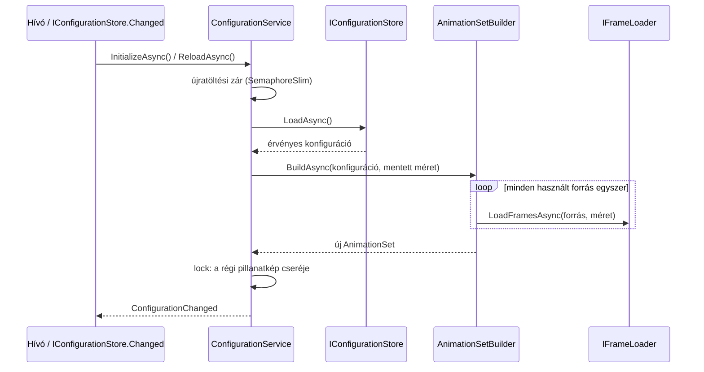

## Konfigurációs motor – futó konfiguráció

Ez a dokumentum a [Konfigurációs motor](../components.md#konfigurációs-motor) [`ConfigurationService`](../../src/ConfigurationEngine/ConfigurationService.cs) osztályát írja le: hogyan lesz a tárolt konfigurációból futó animáció, hogyan értékeli ki a szabályokat, és hogyan cseréli a konfigurációt újraindítás nélkül. Mit tárolunk és mi érvényes: [Séma és validálás](./schema.md); a tárolás és a betöltés: [implementáció](./implementation.md); a képkockák betöltése: [Médiaréteg](./media.md). Fogalmak: [Szótár](../../README.md#szótár).

---

### Felépítés

| Fájl | Szerep |
|---|---|
| [`ConfigurationService.cs`](../../src/ConfigurationEngine/ConfigurationService.cs) | Az [`IConfigurationService`](../../src/MonkeyStack.Core/Configuration/IConfigurationService.cs) megvalósítása: betöltés, újratöltés, méretváltás, léptetés, lekérdezések |
| [`Rules/RuleEvaluator.cs`](../../src/ConfigurationEngine/Rules/RuleEvaluator.cs) | A szabályok kiértékelése egy registry-állapotra; állapot nélküli, tiszta függvények |
| [`Runtime/AnimationSetBuilder.cs`](../../src/ConfigurationEngine/Runtime/AnimationSetBuilder.cs) | A betöltött konfigurációból felépíti az animációkat, méretváltáskor pedig betölti az új méretű képkockáikat |
| [`Runtime/AnimationSet.cs`](../../src/ConfigurationEngine/Runtime/AnimationSet.cs) | A futó konfiguráció pillanatképe: animációk, szabályok, kikapcsolt metrikák, betöltési hibák |
| [`Media/MediaLoadFailure.cs`](../../src/ConfigurationEngine/Media/MediaLoadFailure.cs) | Egy forrás, amely a felépítéskor vagy a legutóbbi méretváltáskor nem töltődött be |
| [`tests/ConfigurationEngine.Tests`](../../tests/ConfigurationEngine.Tests) | `RuleEvaluatorTests`, `ConfigurationServiceTests` |

A paraméter nélküli konstruktor a felhasználó adatbázisát ([`SqliteConfigurationStore`](../../src/ConfigurationEngine/Storage/SqliteConfigurationStore.cs), gyors médiaellenőrzéssel) és a szállított képeket ([`FrameLoader`](../../src/ConfigurationEngine/Media/FrameLoader.cs)) használja. A konstruktor nem végez I/O-t, a konfiguráció az `InitializeAsync` hívásakor töltődik be. A tesztek a második konstruktorral saját tárolót és betöltőt adnak át.

---

### Betöltés és újratöltés

- Az első betöltés az `InitializeAsync`. Amíg nem fejeződik be, a `GetMovementAnimation` `null`-t, a `GetOverlayAnimations` üres listát ad.
- A tároló minden sikeres mentés után kiváltja a `Changed` eseményt. A motor erre a háttérben újratölt ([Component Configurator](#alkalmazott-minták)). Ha közben már vár egy újratöltés, amely még nem kezdte olvasni a tárolót, a további mentések nem indítanak újat, mert a várakozó már a legfrissebb adatot olvassa majd.
- Az új animációk a motor zárján kívül készülnek, így a lassú képbetöltés közben a Karakter a régieket olvassa és a motor azokat lépteti. A csere a zár alatt egy lépésben történik.
- Ha a tároló vagy a felépítés hibát dob (pl. zárolt adatbázis), a futó konfiguráció és a karakterméret változatlan marad. A `ReloadAsync` a hibát továbbadja, a mentés utáni háttér-újratöltés naplózza.
- Az újratöltés a mentett karakterméretet állítja be, de csak a sikeres csere után, így a `CharacterWidth` és a `CharacterHeight` mindig a futó animációk méretét mutatja. A még nem mentett `SetCharacterSize` ilyenkor felülíródik; ha viszont a méretet a felépítés közben állítják, az új méret marad.

---

### Animációk felépítése

A [séma szerint](./schema.md#animációk-előállítása) minden mozgásállapot és minden bekapcsolt szabály saját animációt kap a saját sebességével, a szabályok a saját `ZIndex`-ükkel is. A képkockák forrásonként egyszer töltődnek be, és az azonos forrású animációk megosztják őket. A kikapcsolt szabályok forrásait nem töltjük be.

A forrásonkénti 64 MB-os keret ([Skálázás](./media.md#skálázás)) mellett az összes betöltött képkocka együtt legfeljebb 256 MB-ot foglalhat (`ConfigurationLimits.MediaMaxTotalLoadedBytes`), így sok nagy forrás sem foglalhat korlátlan memóriát. A mozgásállapotok töltődnek be először, utánuk a szabályok a konfiguráció sorrendjében; az a forrás, amely már nem fér bele, nem betölthetőnek számít. Újratöltés és méretváltás közben a régi képkockák a cseréig a memóriában maradnak, ezért ilyenkor rövid ideig ennek a kétszerese is foglalt lehet.

Ha egy forrás nem tölthető be (pl. a fájlt a mentés óta törölték, a karakter méretén túl sok képkockát foglalna, vagy már nem fér bele az együttes keretbe):

| Felhasználás | Viselkedés |
|---|---|
| Mozgásállapot | a szállított alapanimáció, annak alapsebességével (a beállított sebesség a felhasználó saját képeihez készült) |
| Mozgásállapot, és a szállított alapanimáció sem tölthető be | üres animáció (`CurrentFrame` = `null`), hogy az állapot ne maradjon animáció nélkül |
| Szabály | a szabály nem jelenik meg |

A nem betölthető forrásokat a `ConfigurationService.MediaLoadFailures` sorolja fel, a hibaüzenettel és a hibás mezővel együtt.

A kimaradt szabály a kizáró csoportjában sem vesz részt. A [Kiértékelés](./schema.md#kiértékelés) példájában, ha a *Nagy tűz* képe hiányzik, 85%-os CPU-nál a *Kis tűz* jelenik meg: a karakter a megjeleníthető legerősebb állapotot mutatja, ahelyett hogy semmit.

---

### Kiértékelés

A `GetOverlayAnimations` a [séma kiértékelési szabályait](./schema.md#kiértékelés) követi. A séma szövegét három ponton pontosítja a megvalósítás:

- A kikapcsolt mintavételezésű metrika szabályai nem teljesülnek akkor sem, ha a registry-ben még van korábbi érték ([`MetricPolling`](./schema.md#5-metricpolling--rendszeresemény-mintavételezés)).
- Azonos `ZIndex` esetén a kisebb `Id` kerül előbb (alulra), így a sorrend minden hívásnál ugyanaz.
- A kizáró csoport neve trimmelve, kis- és nagybetűtől függetlenül számít (a „Fire” és a „fire ” ugyanaz a csoport), az üres vagy csak szóközből álló név pedig csoport nélküli, ahogy a validátor is kezeli. A tároló betöltéskor is normalizál, mint mentéskor, így egy kívülről szerkesztett adatbázisban is ez érvényes.

A kiértékelés a pillanatképen, a motor zárján kívül fut, mert a pillanatkép a csere után sem változik.

---

### Méretváltás

A `SetCharacterSize` (és a `CharacterWidth`, `CharacterHeight` beállítása):

1. a méretet a [`CharacterSettings`](./schema.md#4-charactersettings--karakter-beállítások) tartományára korlátozza; a nem pozitív érték nem változtat, a változatlan méret nem vált ki eseményt;
2. a zár alatt minden animáció azonnal az új méretet kapja (`SetSize`), és egyszer tüzel a `ConfigurationChanged`;
3. a háttérben betölti a képkockákat az új méretre, ugyanabból a forrásból, amelyet az animáció most mutat, és ugyanazzal a memóriakerettel, mint a betöltés; majd a zár alatt ugyanazokba a példányokba cseréli őket (`IMutableAnimation.SetFrames`). Új pillanatkép és további esemény nincs.

Mivel a példányok nem cserélődnek, a Karakter és a konfigurációs ablak által korábban lekérdezett animációk érvényesek maradnak, és a lejátszás ott folytatódik, ahol tartott (azonos képkockaszámnál a `SetFrames` megtartja az aktuális képkockát). Amíg a 3. lépés tart, a régi képkockák az új méretre nyújtva látszanak.

Ha egy forrás az új méretre nem tölthető be (pl. túl sok képkockát foglalna, vagy már nem fér bele az együttes keretbe), az animációja a régi képkockákat mutatja tovább, nyújtva, és a forrás megjelenik a `MediaLoadFailures`-ben, amíg egy újabb méretváltás vagy újratöltés nem sikerül. Gyors egymás utáni méretváltásnál (pl. csúszka) az új méret megszakítja az előző, még futó újraskálázást. A `SetCharacterSizeAsync` ugyanezt teszi, és a visszaadott feladat az újraskálázás végén (vagy megszakításakor) fejeződik be.

---

### Szálkezelés

| Művelet | Szál | Megjegyzés |
|---|---|---|
| `GetMovementAnimation`, `GetOverlayAnimations`, `UpdateAnimations`, `SetCharacterSize` | bármelyik | rövid, a motor zárja alatt |
| `InitializeAsync`, `ReloadAsync`, újraskálázás méretváltáskor | háttérszál (`Task.Run`) | egymás után futnak (újratöltési zár); a hívó szál szinkronizációs környezetét nem használják, így a UI szálról blokkolva is várhatók |
| `ConfigurationChanged` | a műveletet végző szál | sosem a motor zárja alatt; a feliratkozónak kell a UI szálra váltania. A feliratkozók egymástól függetlenül futnak: egy feliratkozó kivételét a motor naplózza, és nem teszi sikertelenné a már megtörtént cserét |
| `Dispose` | bármelyik | leiratkozik a tárolóról, megszakítja a folyamatban lévő munkát, és eldobja a megszakítási forrásokat; utána már nem cserélődik a konfiguráció és a képkockák, nem tüzel esemény, a `ReloadAsync` pedig `ObjectDisposedException`-t dob |

---

### Alkalmazott minták

A [javasolt minták](../patterns.md) közül:

- **Component Configurator**: a tároló `Changed` eseményére a motor újraindítás nélkül újratölt, és a `ConfigurationChanged` eseménnyel jelzi a Karakternek, hogy kérdezze le újra az animációkat.
- **Monitor Object** és **Scoped Locking**: a publikus műveletek egy közös zár (`lock (_syncRoot)`) alatt olvassák és cserélik a pillanatképet; a lassú munka (betöltés, újraskálázás) a záron kívül, egy `SemaphoreSlim` mögött sorban fut, amelyet `try`/`finally` old fel.
- **Thread-Safe Interface**: a motor bármelyik szálról hívható; a pillanatkép a csere után nem változik, a képkockák fagyasztottak, és az animációk saját zárral védik a méretüket és a képkockáikat, így a Karakter külön zár nélkül olvashatja a kapott animációkat.
- **Wrapper Facade**: a Karakter csak metrikákat és mozgásállapotot ad át, és kész `IAnimation` objektumokat kap; a tároló, a képbetöltés és a kiértékelés rejtve marad.
- **Extension Interface**: a motor belül [`IMutableAnimation`](../../src/MonkeyStack.Core/Animation/IMutableAnimation.cs)-ként kezeli az animációkat (méret, képkockák, léptetés), kifelé csak az olvasható [`IAnimation`](../../src/MonkeyStack.Core/Animation/IAnimation.cs)-t adja.
