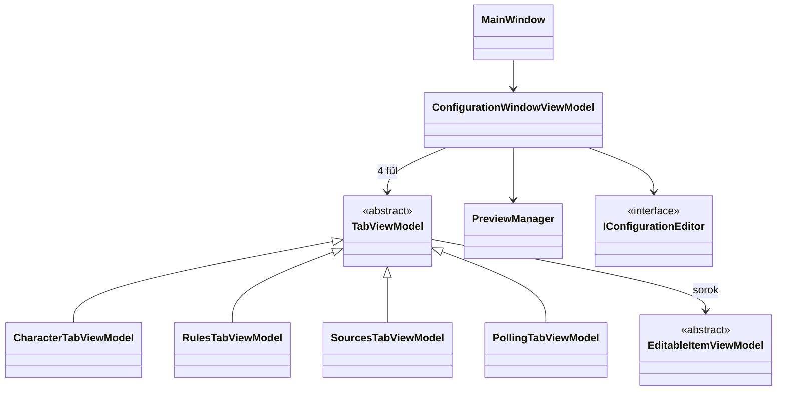
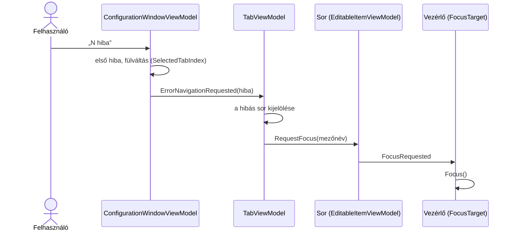

## Konfigurációs motor – a konfigurációs ablak implementációja

Ez a dokumentum a [Konfigurációs motor](../components.md#konfigurációs-motor) **View rétegének**, a konfigurációs ablaknak a megvalósítását írja le. Hogy az ablak hogyan néz ki és mit csinál, azt a [GUI terv](./view.md) rögzíti; itt az látszik, hogyan épül fel a kód. A motor felé az egyetlen kapcsolat az [`IConfigurationEditor`](../../src/ConfigurationEngine/IConfigurationEditor.cs) ([Kapcsolat a modellel](./view.md#kapcsolat-a-modellel)). Fogalmak: [Szótár](../../README.md#szótár).

---

### Felépítés

Az ablak WPF-ben, nézetmodellekkel (MVVM) készült: a XAML csak megjelenít és köt, a működés a nézetmodellekben van, így ablak nélkül is tesztelhető.

| Fájl | Szerep |
|---|---|
| [`MainWindow.xaml`](../../src/ConfigurationEngine/MainWindow.xaml), [`MainWindow.xaml.cs`](../../src/ConfigurationEngine/MainWindow.xaml.cs) | Az ablak: figyelmeztető sáv, fülek, Elvetés / Mentés; létrehozás és bezárás |
| [`View/ConfigurationWindowViewModel.cs`](../../src/ConfigurationEngine/View/ConfigurationWindowViewModel.cs) | A fő nézetmodell: szerkesztett másolat, hibák, mentés, elvetés, bezárás |
| [`View/TabViewModel.cs`](../../src/ConfigurationEngine/View/TabViewModel.cs) | A fülek közös alapja: sorok újraépítése, hibák kiosztása, előnézetek frissítése, ugrás a hibás mezőre |
| [`View/EditableItemViewModel.cs`](../../src/ConfigurationEngine/View/EditableItemViewModel.cs), [`View/InputField.cs`](../../src/ConfigurationEngine/View/InputField.cs), [`View/FieldErrorLookup.cs`](../../src/ConfigurationEngine/View/FieldErrorLookup.cs) | Egy szerkeszthető elem (sor) és a mezői, a mezőnkénti hibákkal |
| [`View/Tabs/`](../../src/ConfigurationEngine/View/Tabs) | A négy fül: nézetmodell + XAML nézet, valamint a sorok nézetmodelljei |
| [`View/PreviewViewModel.cs`](../../src/ConfigurationEngine/View/PreviewViewModel.cs), [`View/PreviewManager.cs`](../../src/ConfigurationEngine/View/PreviewManager.cs) | Az élő előnézetek kérése és élettartama |
| [`View/Controls/AnimationPreview.cs`](../../src/ConfigurationEngine/View/Controls/AnimationPreview.cs) | Az előnézet kirajzolása (`AnimationView`) |
| [`View/Controls/FocusTarget.cs`](../../src/ConfigurationEngine/View/Controls/FocusTarget.cs) | Fókusz a hibás mezőre az „N hiba” feliratra kattintáskor |
| [`View/SourceOption.cs`](../../src/ConfigurationEngine/View/SourceOption.cs), [`View/MetricText.cs`](../../src/ConfigurationEngine/View/MetricText.cs) | A legördülő listák elemei; a metrikák neve, mértékegysége, `HH:mm` alakja |
| [`View/IUserDialogs.cs`](../../src/ConfigurationEngine/View/IUserDialogs.cs), [`View/IMediaBrowser.cs`](../../src/ConfigurationEngine/View/IMediaBrowser.cs) | Megerősítő és tallózó párbeszédablakok (WPF megvalósításuk: `MessageBoxDialogs`, `WpfMediaBrowser`) |
| [`View/Styles.xaml`](../../src/ConfigurationEngine/View/Styles.xaml) | Közös stílusok (hibaüzenet a mező alatt) |
| [`tests/ConfigurationEngine.Tests/View`](../../tests/ConfigurationEngine.Tests/View) | A nézetmodellek tesztjei |



| Fül | Nézetmodell | Sor | Nézet |
|---|---|---|---|
| Karakter | `CharacterTabViewModel` | `CharacterSizeViewModel`, `MovementRowViewModel` | `CharacterTabView.xaml` |
| Szabályok | `RulesTabViewModel` | `RuleRowViewModel` | `RulesTabView.xaml` |
| Források | `SourcesTabViewModel` | `SourceRowViewModel` | `SourcesTabView.xaml` |
| Mintavételezés | `PollingTabViewModel` | `PollingRowViewModel` | `PollingTabView.xaml` |

---

### A szerkesztett másolat

A `ConfigurationWindowViewModel` a `LoadAsync` eredményét (`ConfigurationData`) tartja szerkesztett másolatként. A sorok nézetmodelljei közvetlenül ennek az objektumait módosítják, majd szólnak a fő nézetmodellnek (`NotifyEdited`). Ez:

1. frissíti a forrásválasztó listákat (`SourceOptions`, helyben, hogy a kijelölések megmaradjanak);
2. újrafuttatja a validátort a teljes másolaton (`IConfigurationEditor.Validate`);
3. eldönti, hogy a másolat eltér-e a mentettől: a mentett állapot JSON-pillanatképével hasonlít össze, így ha a felhasználó visszaírja az eredeti értéket, a másolat már nem számít módosítottnak;
4. kiváltja az `ErrorsUpdated` és az `Edited` eseményt; ezekre a fülek kiosztják a hibákat és frissítik az előnézeteket.

Amikor a másolat lecserélődik (megnyitás, mentés, Elvetés), a `DataReloaded` esemény az okkal (`DataReloadReason`) együtt szól, és a fülek újraépítik a soraikat.

---

### Hibajelzés

A [három hibaforrás](./view.md#mezőnkénti-hibajelzés) egy listában (`Errors`) gyűlik össze:

| Forrás | Hol keletkezik | Hogyan kerül a listába |
|---|---|---|
| Beviteli hiba | `InputField`: a szöveg nem alakítható át (pl. nem szám, hibás `HH:mm`) | `SetInputError`; a hibás szöveg nem kerül a másolatba |
| Validátor | `IConfigurationEditor.Validate`, minden módosítás után | `NotifyEdited` |
| Médiaellenőrzés | `IConfigurationEditor.ValidateMediaAsync`, tallózás / csere után és mentéskor | `SetMediaErrors`, a forrás azonosítója szerint |

A hibák a `Kind` + `ItemKey` + `PropertyName` hármas szerint jutnak a helyükre: a fül az összes hibát egy [`ValidationResult`](../../src/ConfigurationEngine/Validation/ValidationResult.cs)-ba teszi, és minden sor az `ErrorsFor` segítségével válogatja ki a sajátjait (`EditableItemViewModel.ApplyErrors`):

- **szöveges mező** (`InputField`): piros keret (`INotifyDataErrorInfo`) és az üzenet a mező alatt;
- **legördülő lista, jelölőnégyzet**: piros keret és az üzenet a mező alatt (`FieldErrors[mezőnév]`);
- **az elem egésze** (`PropertyName = null`): a részletek panel tetején, fix soroknál a sor alatt (`ItemErrors`);
- **a sor hibajele** (`HasAnyError`), és a fül fejlécében a hibák száma.

Amíg van hiba, a Mentés inaktív. Az „N hiba” feliratra kattintva (`GoToFirstErrorCommand`) a fő nézetmodell kiválasztja a fülek sorrendjében első hiba fülét, a fül kijelöli a hibás sort, és a sor fókuszt kér a hibás mezőre (`RequestFocus`). A mezőt jelölő vezérlő (`FocusTarget.Property`) akkor is megkapja a fókuszt, ha a fül csak most töltődik be.



---

### Élő előnézet

Minden animációs sornak saját `PreviewViewModel`-je van. A sor minden módosítás után megmondja, mit kell mutatnia (`Show(forrás, sebesség)`); ha a forrás betöltési mezői és a sebesség nem változtak, nem történik semmi. Különben a régi előnézet eldobódik (`ReleasePreviewAnimation`), és a háttérben új készül (`CreatePreviewAnimationAsync`). Ha közben újabb kérés jön, a késve érkezett előnézetet is eldobja. Tartományon kívüli sebességnél a sor az utolsó érvényes sebességgel kér.

Az előnézetek élettartamát a `PreviewManager` fogja össze ([Élettartam](./view.md#élettartam)):

| Mikor | Mit csinál a View |
|---|---|
| Sebesség- vagy forrásváltás egy sorban | a sor `PreviewViewModel`-je eldobja a régit, újat kér |
| Sor törlése | `PreviewViewModel.Release()` |
| Elvetés, az ablak bezárása | `PreviewManager.ReleaseAll()` → `ReleasePreviewAnimations()`; a vezérlők `Unloaded`-kor `Detach`-elnek |
| Mentés | `PreviewManager.KeepDuring(...)`: az újraépített sorok átveszik a régi sorok azonos (forrás és sebesség szerint egyező) előnézeteit, a maradék eldobódik |

A kirajzolást az `AnimationPreview` vezérlő végzi: saját `Canvas`, saját `AnimationView`, `Draw(0, 0)` a `CompositionTarget.Rendering` ciklusban, csak amíg látható (az aktuális fülön van). Az animációt nem lépteti és nem módosítja, azt a motor végzi. A listák soraiban kicsinyítve (`IsCompact`, `Viewbox`), a részletek paneleken teljes karakterméretben rajzol. Betöltés közben „betöltés…”, hibánál az előnézet helyén a hiba üzenete látszik. A kicsinyített doboz az üzenet kedvéért kiszélesedik (legfeljebb 160 px), a teljes üzenet súgóként is olvasható.

---

### Mentés, Elvetés, bezárás

A lépések a [GUI terv](./view.md#mentés) szerint futnak a `ConfigurationWindowViewModel`-ben:

- **Mentés** (`SaveAsync`): megerősítés kihagyott elemeknél → zárolás („Mentés…”, a fülek inaktívak) → validátor és minden forrás teljes médiaellenőrzése → `IConfigurationEditor.SaveAsync` → a mentett állapot újratöltése („Mentve”). A `ConfigurationValidationException` hibái a mezőkhöz kerülnek; más hiba a figyelmeztető sávba, a másolat megmarad. Ha a mentés sikerült, de az újratöltés nem, a sáv ezt külön jelzi, és a mentett másolat marad meg.
- **Elvetés** (`DiscardAsync`): megerősítés mentetlen változásnál → a mentett karakterméret visszaállítása a szolgáltatáson → az összes előnézet eldobása → újratöltés.
- **Bezárás** (`MainWindow.OnClosing` → `ConfirmCloseAsync`): mentetlen változásnál Mentés / Elvetés / Mégse. Hibás állapotban a „Mentés” nem zár be, hanem az első hibás mezőre ugrik. A döntés aszinkron, ezért az ablak az első bezárási kérést elutasítja, és a döntés után maga zárja be magát.

A karakterméret azonnal érvényesül (`ApplyCharacterSize` → `SetCharacterSize`), de csak akkor hívja a szolgáltatást, ha a méret tényleg változott, így a `ConfigurationChanged` sem tüzel feleslegesen. A nézetmodell megjegyzi, milyen méretet állított be, hogy Elvetéskor és bezáráskor vissza tudja állítani a mentettet.

---

### A fülek megvalósítása

- **Karakter**: a méret két egész mező; a szolgáltatás csak akkor kapja meg, ha mindkettő a `ConfigurationLimits.CharacterSizePx` tartományban van. A négy mozgásállapot sora a `MovementState` sorrendjében épül fel; a legördülő lista üres kijelölése nem írja felül a forrást.
- **Szabályok**: a lista rendezési kulcsa csökkenő `ZIndex`, azonosnál a kirajzolás fordítottja (az új, még nem mentett szabályok elöl, a felvétel fordított sorrendjében, mert mentéskor ezek kapják a legnagyobb azonosítót; a többinél csökkenő `Id`). Újrarendezés csak a `ZIndex` mező elhagyásakor (`LostFocus`), felvételkor, törléskor és újratöltéskor történik. Az új szabály negatív ideiglenes azonosítót kap ([Ideiglenes azonosítók](./implementation.md#ideiglenes-azonosítók)), így a hibái kulcsa nem függ a sorrendtől. Az `Idő` metrika küszöbei `HH:mm` szövegként szerkeszthetők (`MetricText`); metrika- vagy operátorváltáskor a küszöbmezők újraolvassák a modellt.
- **Források**: tallózás után az új forrás neve a fájl vagy mappa neve (foglalt névnél sorszámmal), azonosítója a legkisebb meglévő azonosítónál eggyel kisebb negatív szám, és a háttérben elindul a teljes médiaellenőrzés („ellenőrzés…”). A sprite sheet rácsának módosításakor a forrás korábbi médiahibái elavulnak és törlődnek; addig az előnézet mutatja, ha a forrás így nem tölthető be, mentéskor pedig az ellenőrzés újra lefut. A `FrameCount` a `Columns × Rows` értékét követi, amíg a felhasználó maga nem írt be mást. Az útvonal a listában `…\fire_big.gif`, a részleteknél `C:\…\fire_big.gif` alakú, a teljes útvonal súgóként látszik. A Törlés gomb a „Használja” lista alapján tiltódik.
- **Mintavételezés**: hét fix sor a `Metric` sorrendjében; az Alapértékek visszaállítása a `ConfigurationDefaults` értékeit írja a másolatba, és a beviteli hibákat is törli.

---

### Az ablak létrehozása

| Konstruktor | Mikor |
|---|---|
| `MainWindow(IConfigurationEditor editor)` | Integrált futás: a host a közös `ConfigurationService` példányt adja át `IConfigurationEditor`-ként |
| `MainWindow()` | Önálló (F5) futás: az ablak saját `ConfigurationService`-t hoz létre |

A host mostani hívása (`MainWindow(IConfigurationService)`) a kapott szolgáltatást `IConfigurationEditor`-ként használja ([Az ablak létrehozása](./view.md#az-ablak-létrehozása)).

---

### Alkalmazott minták

A [javasolt minták](../patterns.md) közül, a [GUI terv mintáival](./view.md#alkalmazott-minták) összhangban:

- **Wrapper Facade**: a nézetmodellek csak az `IConfigurationEditor`-t használják; a tárolóról, a validátorokról és a képkocka-betöltőről nem tudnak. A párbeszédablakok is interfész mögött vannak (`IUserDialogs`, `IMediaBrowser`).
- **Half Sync / Half Async**: a UI szálon szinkron a szerkesztés, a validálás és a kirajzolás; a médiaellenőrzés, az előnézetek betöltése és a mentés aszinkron. Az `await` után a folytatás a UI szálon fut, így az eredmények sorban, a `Dispatcher`-en keresztül érkeznek vissza. Az aszinkron parancsok (`AsyncRelayCommand`) futás közben nem indíthatók újra.
- **Component Configurator**: integrált futásnál az ablak a közös szolgáltatáspéldányt kapja, önállóan sajátot hoz létre; mentés után a motor maga tölt újra.
- **Monitor Object**: az előnézeti animációkat a motor lépteti, a View csak olvassa őket (`CurrentFrame`, méret); a szálbiztonságot az `Animation` belső zárolása adja.

---

### Tesztelés

```bash
dotnet test MonkeyStack.slnx
```

A nézetmodellek tesztjei ([`tests/ConfigurationEngine.Tests/View`](../../tests/ConfigurationEngine.Tests/View)) ablak nélkül futnak: a motort (`IConfigurationEditor`) és a párbeszédablakokat (`IUserDialogs`, `IMediaBrowser`) a tesztek helyettesítik. Fülenként ellenőrzik a [GUI terv](./view.md) pontjait: a rendezést, a tiltásokat, a mezőnkénti hibákat, az ugrást a hibás mezőre, a mentést és az elvetést, valamint az előnézetek élettartamát.
