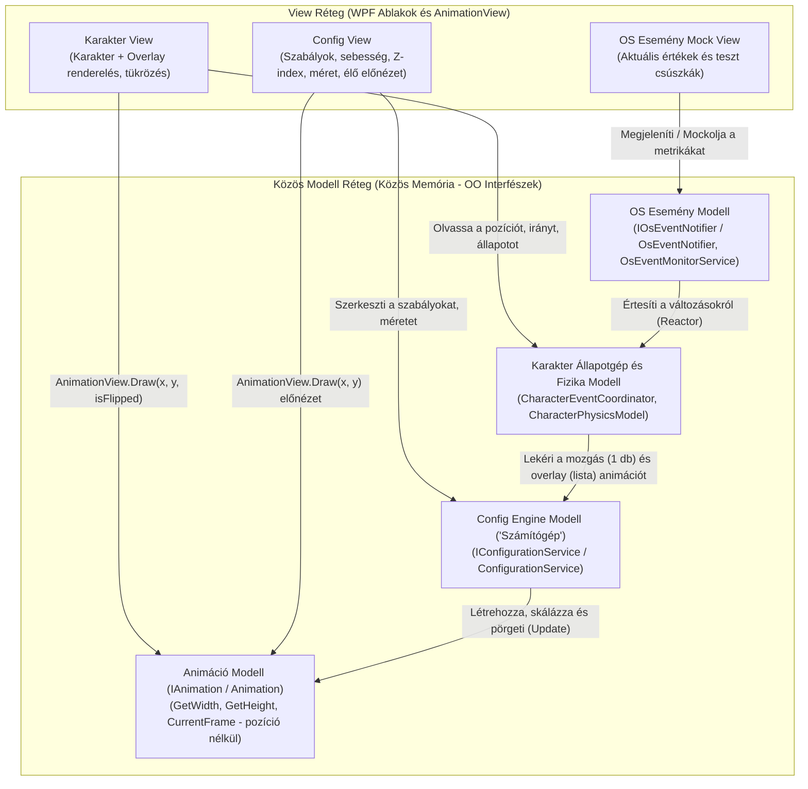
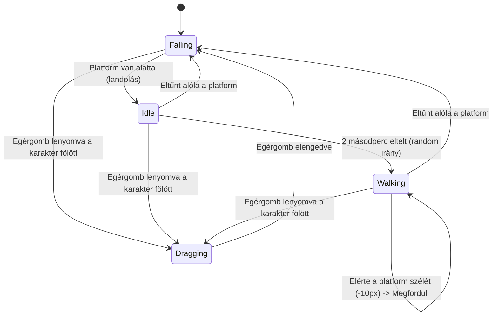

# MVC Architektúra és Közös Modell Terv

Ez a dokumentum a [Screenmate](../README.md#screenmate-karakter) alkalmazás objektumorientált, közös memóriatérben futó **Model–View–Controller (MVC)** architektúráját részletezi, kiegészítve a [Komponens tervet](./components.md).

---

## Alapelvek: Közös Modell és Független View-k

Az alkalmazás architektúrája szakít az elszigetelt alkalmazás-silók („multiverzum”) megközelítéssel, ahol különálló folyamatok próbálnak folyamatok közötti protokollokkal kommunikálni:

1. **Közös memóriabeli Modell ([`MonkeyStack.Core`](../src/MonkeyStack.Core/MonkeyStack.Core.csproj)):**
   - Az egész alkalmazás **Modell** rétege egy helyen él, közös memóriában, tisztán definiált objektumorientált (OO) interfészekkel.
   - A komponensek között ugyanazok a memóriabeli objektumpéldányok (pl. [`IAnimation`](../src/MonkeyStack.Core/Animation/IAnimation.cs) / [`Animation`](../src/MonkeyStack.Core/Animation/Animation.cs), [`OsEventDataRegistry`](../src/MonkeyStack.Core/Events/OsEventDataRegistry.cs), [`IConfigurationService`](../src/MonkeyStack.Core/Configuration/IConfigurationService.cs), [`IOsEventNotifier`](../src/MonkeyStack.Core/Events/IOsEventNotifier.cs) / [`OsEventNotifier`](../src/MonkeyStack.Core/Events/OsEventNotifier.cs)) élnek és működnek együtt.
2. **Aspektusokra csatlakozó View-k ([WPF](./tech_stack.md)):**
   - A **View** réteg teljesen függetlenül illeszkedik a Modellre: minden View a központi Modell egy-egy jól körülhatárolt aspektusára csatlakozik (a közös animáció-kirajzolást az [`AnimationView`](../src/MonkeyStack.Core/Animation/AnimationView.cs) biztosítja).
3. **Külön-külön indíthatóság és tesztelhetőség ([Component Configurator](./patterns.md)):**
   - **Integrált futás:** A fő alkalmazás egyetlen folyamatban példányosítja a közös Modellt, és ugyanabban a memóriatérben nyitja meg a Karakter, a Konfigurációs és (igény szerint) az OS-tesztelő View ablakokat.
   - **Önálló (Standalone) futás és tesztelhetőség:** Mivel az egyes részmodellek és View-k OO interfészeken keresztül kapcsolódnak (a `MainWindow`-k opcionális konstruktor-injektálással kapják a közös Modellt), mindhárom komponens ([`CharacterEngine`](../src/CharacterEngine/CharacterEngine.csproj), [`ConfigurationEngine`](../src/ConfigurationEngine/ConfigurationEngine.csproj), [`OsEventEngine`](../src/OsEventEngine/OsEventEngine.csproj)) önállóan (F5-tel) is elindítható, használható és tesztelhető.

### Miért állapotmentes a Konfig, és miért a Karakter kérdezi le?

A komponensek közötti felelősségmegosztás alapvető tervezési elve:

- **A [Konfigurációs motor](./configuration_engine/overview.md) egy „számítógép” (kiértékelő):** ezt konfigurálja be a felhasználó a [viselkedési szabályokkal](../README.md#viselkedési-szabály). Kap egy bemenetet (a karakter aktuális állapotát / regiszterét), és kiszámítja, hogy ahhoz milyen animációk tartoznak.
- **A [Karakter](./character_engine/overview.md) pedig egy állapotgép:** ő birtokolja az állapotot ([`MovementState`](../src/MonkeyStack.Core/Character/MovementState.cs) és [`OsEventDataRegistry`](../src/MonkeyStack.Core/Events/OsEventDataRegistry.cs)), és ő kezeli az eredményeket ([`CharacterEventCoordinator`](../src/CharacterEngine/CharacterEventCoordinator.cs)).
- **A Konfignak nincs saját állapota**, mert bármilyen olyan állapotnak a neve eleve valamilyen *karakterállapot* lenne – aminek viszont fogalmilag a Karakternél van a helye.
- **Következmény (Az eseménylánc iránya):** Ezért tartozik az állapot a Karakterhez, ezért használunk lekérdezést (pull/poll) a Karaktertől a Konfig felé, és ezért utazik át az eseménylánc az **OS rétegtől** ([`IOsEventNotifier`](../src/MonkeyStack.Core/Events/IOsEventNotifier.cs)) $\rightarrow$ a **Karakteren** ([`CharacterEventCoordinator`](../src/CharacterEngine/CharacterEventCoordinator.cs)) át $\rightarrow$ a **Konfighoz** ([`IConfigurationService`](../src/MonkeyStack.Core/Configuration/IConfigurationService.cs)), majd onnan az **animációk** ([`IAnimation`](../src/MonkeyStack.Core/Animation/IAnimation.cs)) vissza a **Karakterhez**.

---

## Animáció

Az [animációs forrásokból](../README.md#animációs-forrás) (GIF, képsorozat-mappa, tileset / sprite sheet) felépülő animációs objektumokat ([`IAnimation`](../src/MonkeyStack.Core/Animation/IAnimation.cs) / [`Animation`](../src/MonkeyStack.Core/Animation/Animation.cs)) a [Konfigurációs motor](./configuration_engine/overview.md) hozza létre, állítja be és pörgeti (lépteti a képkockákat az `Update(TimeSpan deltaTime)` hívással).

- **Folyamatos loopolás:** A rendszerben nincs egyszer lejátszódó effekt, csak olyan animáció, amely egy adott állapotban aktív vagy inaktív. Ezért a Config Engine az összes betöltött animációt folyamatosan loopolva pörgeti, az [Animációs motor](./character_engine/overview.md) (Karakter komponens) pedig csak megkapja az aktuális állapotoknak megfelelő animációs objektumok részhalmazát, és kirajzolja azok aktuális képkockáját (`CurrentFrame`) a képernyőre.
- **Modellbeli animációs objektum ([`IAnimation`](../src/MonkeyStack.Core/Animation/IAnimation.cs), [`Animation`](../src/MonkeyStack.Core/Animation/Animation.cs)):**
  - Rendelkezik `GetWidth()` és `GetHeight()` lekérdezésekkel, `FramesPerSecond` sebességgel, `ZIndex` rétegsorrenddel, `Update(TimeSpan deltaTime)` léptetéssel, valamint visszaadja az aktuális képkockát (`CurrentFrame`).
   - **Csak olvasható a nézeteknek:** az [`IAnimation`](../src/MonkeyStack.Core/Animation/IAnimation.cs) csak lekérdezéseket tartalmaz, ezt kapják a nézetek és a Karakter. A beállítást (`FramesPerSecond`, `ZIndex`), az átméretezést és a léptetést (`Update`) az [`IMutableAnimation : IAnimation`](../src/MonkeyStack.Core/Animation/IMutableAnimation.cs) bővítő interfész adja, amelyet csak a Konfigurációs motor használ ([Extension Interface](./patterns.md)).
  - **Nincs pozíciója a Modellben!** Ennek köszönhetően ugyanannak a modellbeli animációnak az egyik [`AnimationView`](../src/MonkeyStack.Core/Animation/AnimationView.cs) példánya a Config menüben, egy másik példánya pedig a Karakter View-ban tudja kirenderelni az animációt a saját `Canvas`-ára és saját pozíciójára.
- **View-beli animációs objektum ([`AnimationView`](../src/MonkeyStack.Core/Animation/AnimationView.cs)):**
  - A konstruktorban megkapja az [`IAnimation`](../src/MonkeyStack.Core/Animation/IAnimation.cs) modellt és a cél WPF `Canvas`-t.
  - `Draw(double x, double y, bool isFlipped = false)` metódussal rendelkezik, amely kirajzolja az adott `(x, y)` bal-felső sarok koordinátára az animáció aktuális képkockáját (igény szerint vízszintesen tükrözve).

---

## Config Engine

Kapcsolódó áttekintés: [Konfigurációs motor](./configuration_engine/overview.md)

### Modell réteg
A Config Engine állapotmentes modell rétegének ([`IConfigurationService`](../src/MonkeyStack.Core/Configuration/IConfigurationService.cs) / [`ConfigurationService`](../src/ConfigurationEngine/ConfigurationService.cs)) feladata:
1. **Szabályok betöltése és perzisztálása:** A [viselkedési szabályok](../README.md#viselkedési-szabály) ([triggerfeltétel](../README.md#triggerfeltétel) – [animációs forrás](../README.md#animációs-forrás) párok) és beállítások betöltése és mentése helyi [SQLite](./tech_stack.md) adatbázisba.
2. **Animációk futtatása:** A létrehozott [`Animation`](../src/MonkeyStack.Core/Animation/Animation.cs) példányok folyamatos léptetése (`UpdateAnimations(TimeSpan deltaTime)`) a hozzájuk rendelt sebesség alapján.
3. **Állapotoknak megfelelő animációk visszaadása** a játék két állapotgépe számára:
   - **[Mozgásállapot (Alapállapot)](../README.md#mozgásállapot-alapállapot) ([`MovementState`](../src/MonkeyStack.Core/Character/MovementState.cs)):** `GetMovementAnimation(MovementState state)` $\rightarrow$ **1 darab** `IAnimation` objektumot ad vissza, amely a konkrét mozgási állapothoz (`Idle`, `Walking`, `Falling`, `Dragging`) tartozik.
   - **[Környezeti (konfigurálható) állapot](../README.md#környezeti-konfigurálható-állapot) (Overlay):** `GetOverlayAnimations(OsEventDataRegistry registry)` $\rightarrow$ az [`OsEventDataRegistry`](../src/MonkeyStack.Core/Events/OsEventDataRegistry.cs) alapján kiértékeli a [triggerfeltételeket](../README.md#triggerfeltétel), és az aktív overlay animációk **listáját** (`IReadOnlyList<IAnimation>`) adja vissza, a beállított **Z-pozíció (`ZIndex`)** szerint rendezve.
   - **Konfigurációváltozás jelzése:** A `ConfigurationChanged` eseményen keresztül jelzi a [`CharacterEventCoordinator`](../src/CharacterEngine/CharacterEventCoordinator.cs)-nak, ha a felhasználó módosította a szabályokat vagy az animációkat, hogy a Karakter azonnal újra lekérdezhesse azokat.
4. **Képek fix méretűre skálázása (`CharacterWidth`, `CharacterHeight`):**
   - Mivel a betöltött [animációs források](../README.md#animációs-forrás) képmérete eltérhet, a Config Engine minden képet egységes, fix méretűre skáláz (alapértelmezetten pl. `100x100` pixelre, aránytartóan, alsó-középső talppontra igazítva).
   - Ez a célméret a Config menüben (a karakter beállítások fölött) dinamikusan állítható.

### View réteg
- **Globális beállítás:** A karakter beállítások fölött lehetőséget biztosít a skálázási képméret (pl. `100x100` px) módosítására.
- **Karakter mozgás-animációk:** Megjeleníti az egyes [mozgásállapotok](../README.md#mozgásállapot-alapállapot) nevét és a hozzájuk tartozó animáció konfigurációt (forrás kiválasztása, sebesség).
- **Overlay animációk:** Minden sorban megjeleníti a [triggerfeltétel](../README.md#triggerfeltétel) (szabály) konfigurációt, mellette pedig az animációs konfigurációt:
  - Új animációs mappa vagy fájl (GIF, képsorozat, tileset / sprite sheet) feltöltése/tallózása,
  - Animáció sebességének állítása,
  - **Z-pozíció** (rétegsorrend) állítása.
- **Élő előnézet:** Minden konfigurációs sorban (mind a karakternél, mind az overlayeknél) a View folyamatosan, loopolva játssza le az adott sorhoz tartozó animációt a saját [`AnimationView.Draw(x, y)`](../src/MonkeyStack.Core/Animation/AnimationView.cs) példányán keresztül.

---

## Karakter és Fizika

Kapcsolódó áttekintés: [Animációs motor](./character_engine/overview.md)

### Modell réteg (Fizika és Koordinátor)
A karakter modell feladata az állapotok ([`CharacterEventCoordinator`](../src/CharacterEngine/CharacterEventCoordinator.cs)) és a fizika / [mozgásállapot](../README.md#mozgásállapot-alapállapot) ([`ICharacterPhysicsModel`](../src/MonkeyStack.Core/Character/ICharacterPhysicsModel.cs) / [`CharacterPhysicsModel`](../src/CharacterEngine/CharacterPhysicsModel.cs)) kezelése fix ~60 FPS-es frissítési ciklussal.

- **Logikai pozíció:** A [Screenmate (Karakter)](../README.md#screenmate-karakter) pozíciója egyetlen logikai pont $(X, Y)$, amely a karakter képének **alsó középső pontja** (bottom-center pivot). Ehhez a ponthoz képest fut a fizika.
- **Platformok ([Ablakperem](../README.md#ablakperem-járható-felület) – [`PlatformSegment`](../src/MonkeyStack.Core/Character/PlatformSegment.cs)):**
  - Az operációs rendszerben nyitott ablakok látható teteje (valamint a képernyő alja / tálca mint alapplatform) platformnak minősül.
  - A takarással (occlusion – amikor egy előrébb lévő ablak kitakarja egy hátrébb lévő ablak felső peremét) is számolni kell. Mivel a fizika motor ~60 FPS-sel pörög, a platformok listáját (`IReadOnlyList<PlatformSegment>`) egy külső komponens ([Wrapper Facade](./patterns.md)) számolja újra frame-enként vagy OS eseményekre, így maga a fizika motor állapotmentes marad a platformok nyilvántartása szempontjából.
- **Fizikai állapotgép ([`MovementState`](../src/MonkeyStack.Core/Character/MovementState.cs)):**
  1. **Esés (`Falling`):**
     - Ha a karakter esik, a fizika minden frame-ben vizsgálja, hogy van-e alatta platform (a két frame közötti $\Delta y$ szakaszt ellenőrizve, hogy nagy sebességnél se essen át a vékony peremeken).
     - Ha van alatta platform, a karakter logikai pontja ráilleszkedik a platformra, és átmegy `Idle` állapotba.
  2. **Tétlen (`Idle`):**
     - A karakter **2 másodpercig** marad `Idle` állapotban (`CharacterPhysicsModel.IdleDuration`).
     - 2 másodperc elteltével átlép `Walking` (sétáló) állapotba egy véletlenszerű (random) kezdőiránnyal (balra vagy jobbra).
  3. **Séta (`Walking`):**
     - Sétáló módban a karakter az aktuális platform széléig megy: a logikai pont a platform széléig mínusz egy kis, kódban konfigurálható ráhagyásig (`CharacterPhysicsModel.PlatformEdgeMargin = 10.0` pixel) halad, majd megfordul és sétál a másik szél felé (ha a platform keskenyebb, mint a kétszeres ráhagyás, nem ragad végtelen ciklusba).
  4. **Folyamatos platform-ellenőrzés (`Idle` és `Walking` alatt):**
     - Séta és tétlen állapotban a fizika folyamatosan figyeli, hogy van-e még a karakter talpa alatt platform (pl. ha a felhasználó elmozgatott egy ablakot, vagy az aktuális platform elé húzott egy másik ablakot, ami miatt a platform eltűnt alóla).
     - Ha már nincs alatta platform, a karakter azonnal újra `Falling` állapotba kerül.
  5. **Megragadás (`Dragging`):**
     - Ha a karaktert bármilyen állapotban megragadják (= a felhasználó lenyomja az egérgombot, és a kurzor a karakter befoglaló téglalapja fölött van abban a frame-ben), a karakter azonnal átkerül `Dragging` állapotba.
     - `Dragging` állapotban a karakter pozíciója követi a kurzort.
     - Amikor a felhasználó elengedi az egérgombot, a karakter átkerül `Falling` állapotba, és a fizikai loop folytatódik.

### View réteg
- A Karakter View feladata egy helyre (a logikai $(X, Y)$ alsó-középső talppontból számított $(X - \text{Width}/2, Y - \text{Height})$ bal-felső sarokba) kirenderelni a karakter alap-animációját és a Z-sorrendű overlay animációkat az [`AnimationView.Draw(x, y, isFlipped)`](../src/MonkeyStack.Core/Animation/AnimationView.cs) metódussal.
- Ha mozgás közben a karakter megfordul (`IsFacingLeft`), a Karakter View **mind a karakter figurát, mind az összes aktív overlayt vízszintesen tükrözi** (`isFlipped: true`).

---

## OS Események

Kapcsolódó áttekintés: [OS esemény értesítő motor](./os_event_engine/overview.md)

- **Modell réteg:** A [rendszereseményeket / metrikákat](../README.md#rendszeresemény--metrika-os-check) (CPU, memória, háttértár, akkumulátor, ablakok száma, idő, inaktivitás) a közös memóriában élő [`IOsEventNotifier`](../src/MonkeyStack.Core/Events/IOsEventNotifier.cs) / [`OsEventNotifier`](../src/MonkeyStack.Core/Events/OsEventNotifier.cs), az [`OsEventMonitorService`](../src/OsEventEngine/OsEventMonitorService.cs) és a Karakter által birtokolt [`OsEventDataRegistry`](../src/MonkeyStack.Core/Events/OsEventDataRegistry.cs) kezeli ([`CharacterEventCoordinator`](../src/CharacterEngine/CharacterEventCoordinator.cs)).
- **View réteg (Mock / Tesztelő View):**
  - Az [OS esemény értesítő motor áttekintésében](./os_event_engine/overview.md#megjelenítés) leírt ablak, amely megjeleníti a jelenlegi rendszerértékeket, és csúszkákkal/vezérlőkkel lehetőséget biztosít az értékek közvetlen mockolására és tesztelésére (az `OsEventNotifier.Notify...Changed(...)` metódusok meghívásával ugyanazon a memóriabeli példányon).
  - Az [`OsEventMonitorService.IsMockModeEnabled`](../src/OsEventEngine/OsEventMonitorService.cs) kapcsoló biztosítja, hogy a tesztelői View-ban beállított értékeket a háttérben futó valós OS-lekérdezés ne írja felül a tesztelés ideje alatt.

---

## Alkalmazott Architektúrális Minták

Az MVC architektúra megvalósítása során a [patterns.md](./patterns.md) dokumentumban rögzített mintákat az alábbi pontokon alkalmazzuk és emeljük ki:

| Kategória | Minta ([patterns.md](./patterns.md)) | Alkalmazás helye és szerepe az MVC Modellben |
| :--- | :--- | :--- |
| **1. Szolgáltatáshozzáférés és -konfiguráció** | **Wrapper Facade** | A natív Win32 / OS API hívások (látható [ablakperemek](../README.md#ablakperem-járható-felület) és takarásuk lekérdezése, globális egérpozíció, [rendszeresemények](../README.md#rendszeresemény--metrika-os-check) az [`OsEventMonitorService`](../src/OsEventEngine/OsEventMonitorService.cs)-ben) egységes, platformfüggetlen OO interfészek mögé csomagolása. |
| **1. Szolgáltatáshozzáférés és -konfiguráció** | **Component Configurator** | A közös Modell és a három komponens ([`CharacterEngine`](../src/CharacterEngine/CharacterEngine.csproj), [`ConfigurationEngine`](../src/ConfigurationEngine/ConfigurationEngine.csproj), [`OsEventEngine`](../src/OsEventEngine/OsEventEngine.csproj)) összekapcsolása integrált vagy önálló (standalone teszt) indításkor, valamint a [viselkedési szabályok](../README.md#viselkedési-szabály) futásidejű átkonfigurálása ([`IConfigurationService`](../src/MonkeyStack.Core/Configuration/IConfigurationService.cs)). |
| **2. Eseménykezelés** | **Reactor** | Az [`IOsEventNotifier`](../src/MonkeyStack.Core/Events/IOsEventNotifier.cs) / [`OsEventNotifier`](../src/MonkeyStack.Core/Events/OsEventNotifier.cs) és a `ConfigurationChanged` eseményvezérelt szétküldése a Modellben a feliratkozó [`CharacterEventCoordinator`](../src/CharacterEngine/CharacterEventCoordinator.cs) felé. |
| **3. Konkurenciakezelés** | **Active Object** / **Half Sync / Half Async** | A ~60 FPS-es fizikai és animáció-léptető motor, valamint a háttérben futó aszinkron OS-metrika monitorozás leválasztása a szinkron [WPF](./tech_stack.md) UI (View) szálról. |
| **3–4. Konkurencia és Szinkronizáció** | **Monitor Object**, **Scoped Locking**, **Thread-Safe Interface** | A közös memóriában élő Modell-objektumok ([`Animation`](../src/MonkeyStack.Core/Animation/Animation.cs), [`ConfigurationService`](../src/ConfigurationEngine/ConfigurationService.cs), [`CharacterEventCoordinator`](../src/CharacterEngine/CharacterEventCoordinator.cs)) szálbiztos (`lock (_syncRoot)`) elérése, amikor a Config View vagy az OS Mock View írja, a Karakter View és a fizikai motor pedig 60 FPS-sel olvassa azokat. |
