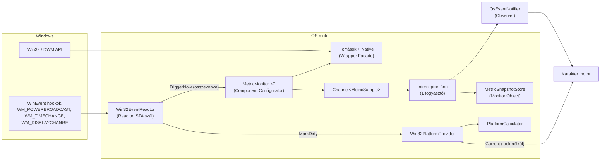
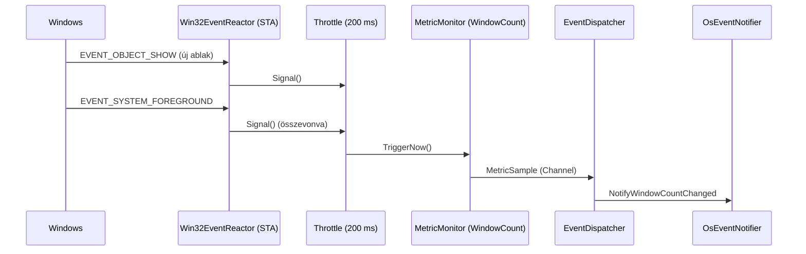
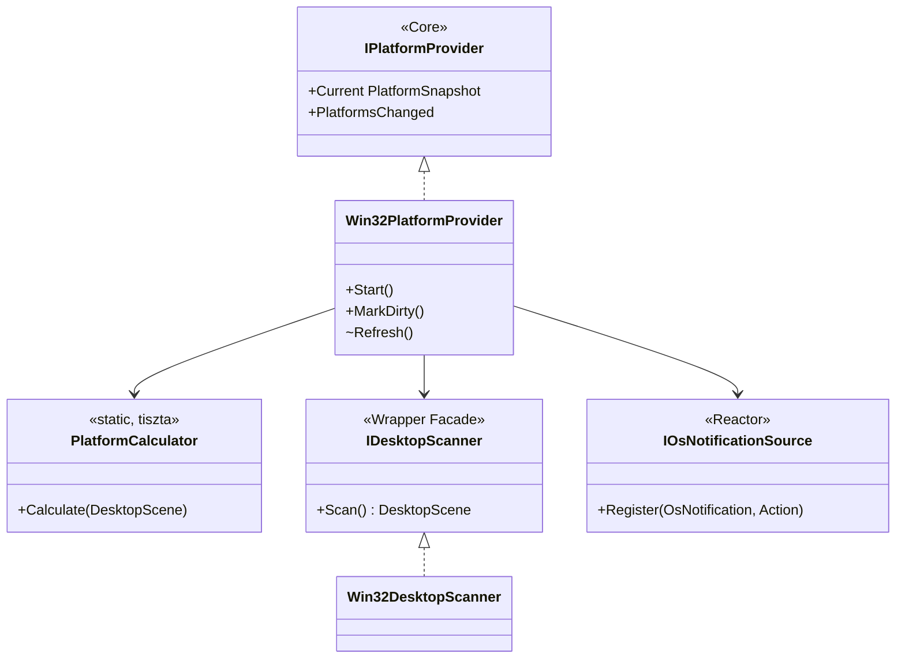

# OS esemény értesítő motor – megvalósult minták

> Az OS motor **kész kódjában** alkalmazott architekturális minták: hol vannak, miért, és mit nyertünk velük.
> A tervezéskori indoklás és az elvetett minták: [plan.md 3. fejezet](./plan.md#3-alkalmazott-architekturális-minták). A minták listája: [patterns.md](../patterns.md). Fogalmak: [Szótár](../../README.md#szótár).
> AI agenteknek: [AGENT_BRIEF.md](./AGENT_BRIEF.md).

---

## 1. Áttekintés



| Minta ([patterns.md](../patterns.md)) | Hol a kódban | Mit old meg |
|---|---|---|
| **Wrapper Facade** | `Native/NativeMethods`, `Win32System`, `WindowEnumerator`, `Win32DesktopScanner`; `Sources/*` | Win32 hívás csak a `Native/` mappában van. A motor többi része típusos, tesztelhető felületet lát (`IMetricSource`, `IDesktopScanner`). |
| **Component Configurator** | `IConfigurableComponent` (`MetricMonitor`), `MonitorRepository`, `OsEventMonitorService.Reconfigure` / `UsePollingSettings` | A metrikák periódusa és engedélyezése futás közben, újraindítás nélkül változik (a Konfigurációs motor `IPollingSettingsProvider`-éből). |
| **Interceptor** | `Pipeline/Interceptors.cs`: simítás → változásszűrés → pillanatkép → napló | Új feldolgozási lépés a lánc módosítása nélkül illeszthető be. |
| **Extension Interface** | `IMetricMonitor` + `IConfigurableComponent` (monitor), `ISimulatable` (`SwitchableSource`) | Minden kliens csak a neki szóló nézetet látja (a Reactor csak `TriggerNow`-t, a repository csak az életciklust). |
| **Reactor** | `Native/Win32EventReactor` | Több OS eseményforrás demultiplexálása egy üzenethurkon a regisztrált handlerekre ([2. fejezet](#2-reactor-m9)). |
| **Half-Sync/Half-Async** | monitorok → `Channel` → `EventDispatcher`; Reactor → `Win32PlatformProvider` újraszámolás → `Current` | A lassú vagy blokkoló munka sosem fut a UI-on vagy a 60 FPS-es fizika szálon. |
| **Active Object** (jelleg) | `IMetricMonitor.TriggerNow`, `SimulationController`, `Win32PlatformProvider.MarkDirty` | A hívó csak kérést ad le (1 helyes jelzőcsatorna), a végrehajtás a komponens saját ciklusában történik. |
| **Monitor Object** / **Scoped Locking** / **Thread-Safe Interface** | `State/MetricSnapshotStore`; `PlatformSnapshot` + `Volatile.Read/Write` | A közös állapot csak szinkronizált publikus metódusokon át érhető el; a platform-pillanatkép megváltoztathatatlan, így lock nélkül olvasható. |
| **Double-Checked Locking Optimization** | `Lazy<T>(ExecutionAndPublication)`: Reactor szál indítása, `OsEventMonitorService.Platforms` | A drága erőforrás csak első használatkor, pontosan egyszer jön létre. Kézi DCLO helyett a memóriamodell-biztos .NET-es forma. |
| **Strategy + Proxy** (GoF) | `Simulation/SwitchableSource` | Metrikánként élő vagy szimulált forrás, a lánc számára átlátszóan. |
| **Observer** (GoF) | `OsEventNotifier` C# eseményei | A Karakter felé menő publikus szerződés (az MVC terv ezt Reactornak nevezi, lásd [plan.md 3.](./plan.md#3-alkalmazott-architekturális-minták)). |
| **MVVM** | `ViewModels/*`, `MainWindow.xaml` | Az OS Mock View logikája tesztelhető, a View csak kötés. |

---

## 2. Reactor (M9)

**Probléma:** az ablakszám, az akkumulátor és az idő ritkán, de ugrásszerűen változik. Pollozással vagy késve vesszük észre (2–30 s), vagy sűrű pollozással feleslegesen terheljük a gépet.

**Megoldás:** a `Win32EventReactor` egy dedikált STA szálon üzenethurkot futtat, és két eseményforrást figyel:

| Forrás | Win32 | `OsNotification` | Handler (`OsEventMonitorService`, `Win32PlatformProvider`) |
|---|---|---|---|
| WinEvent hook | `EVENT_OBJECT_SHOW/HIDE/DESTROY`, `EVENT_SYSTEM_MINIMIZESTART/END`, `EVENT_SYSTEM_FOREGROUND` | `WindowsChanged` | `WindowCount` → `TriggerNow`; platform újraszámolás |
| WinEvent hook | `EVENT_OBJECT_LOCATIONCHANGE`, `EVENT_SYSTEM_MOVESIZEEND` | `WindowMoved` | platform újraszámolás |
| rejtett ablak | `WM_POWERBROADCAST` / `PBT_APMPOWERSTATUSCHANGE` | `PowerStatusChanged` | `Battery` → `TriggerNow` |
| rejtett ablak | `WM_POWERBROADCAST` / `PBT_APMRESUMEAUTOMATIC` | `Resumed` | minden metrika → `TriggerNow`; platform újraszámolás |
| rejtett ablak | `WM_TIMECHANGE` | `TimeChanged` | `Time`, `Inactivity` → `TriggerNow` |
| rejtett ablak | `WM_DISPLAYCHANGE`, `WM_SETTINGCHANGE`, `WM_DPICHANGED` | `DisplayChanged` | platform újraszámolás |

A minta elemei:
- **Handle / esemény:** a WinEvent és az ablaküzenet. A `Classify` metódusok a demultiplexálás táblái, unit tesztekkel lefedve.
- **Synchronous Event Demultiplexer:** a WPF `Dispatcher` üzenethurka (`GetMessage`).
- **Event Handler regisztráció:** `IOsNotificationSource.Register(OsNotification, Action)` → `IDisposable` (leiratkozás).
- **A handler nem számol**, csak jelez. A `Throttle` 200 ms-ra összevonja a sorozatokat (egy ablak megnyitása tucatnyi WinEventet ad), így egy értesítéscsomag egy mintavétel.

Döntések:
- Message-only ablak (`HWND_MESSAGE`) **nem** jó, mert nem kapja meg a broadcast üzeneteket (`WM_POWERBROADCAST`, `WM_TIMECHANGE`, `WM_SETTINGCHANGE`). Ezért egy rejtett, felső szintű `HwndSource` ablakot használunk. Az ablakszámláló úgysem látja, mert a saját folyamat ablakait kizárja.
- `WINEVENT_SKIPOWNPROCESS`: a karakter overlay ~60 FPS-es mozgása nem árasztja el a Reactort.
- A pollozás megmaradt **biztonsági hálónak** ([ADR-1](./plan.md#11-architekturális-döntések-adr-összefoglaló)). Ha a Reactor nem indul el, a motor pollozással ugyanúgy működik.
- Kikapcsolható: `OsEventEngineOptions.EnableOsNotifications`.



---

## 3. Platform-szolgáltató (M11)

**Probléma:** a [Screenmate](../../README.md#screenmate-karakter) az [ablakperemeken](../../README.md#ablakperem-járható-felület) és a tálcán jár. Ha az ablak, amin áll, eltűnik, elmozdul, maximalizálódik vagy fullscreenbe megy, le kell esnie a következő látható felületre. A döntéseket a [platform-javaslat](./platform_provider_proposal.md#0-döntések) rögzíti (#3).

**Megoldás:** három réteg, a felelősségek szétválasztásával.



1. **`Win32DesktopScanner`** (Wrapper Facade): ablakok Z-sorrendben (ugyanazzal a szűréssel, mint az ablakszámláló, plusz a minimalizált és a shell-ablakok kizárása), DWM kiterjesztett keret, monitorok munkaterülettel és DPI-vel. Csak fizikai pixelt ad vissza.
2. **`PlatformCalculator`** (tiszta függvény, natív hívás nélkül tesztelve): takarás, maximalizált és fullscreen ablak, talaj, monitorhatáron vágás, DIP-re váltás, 20 px-es szűrés.
3. **`Win32PlatformProvider`** (Half-Sync/Half-Async): a Reactor `WindowsChanged` / `WindowMoved` / `DisplayChanged` / `Resumed` jelzésére újraszámol, legfeljebb ~30 Hz-cel, jelzés nélkül 500 ms-onként. Csak változáskor ad új `PlatformSnapshot`-ot (`Version` + 1) és `PlatformsChanged` eseményt.

A fizika így használja (a Karakter motor kódja, M8):

```csharp
var snapshot = app.SharedOsMonitorService.Platforms.Current;   // lock nélküli olvasás, minden tickben
physics.Update(dt, snapshot.Platforms, cursorX, cursorY, isMouseDown, w, h);
```

**DPI:** a szolgáltató a folyamat DPI-tudatosságához igazodik. PerMonitorV2-nél a DWM keretet és a monitor saját DPI-jét használja. Rendszerszintű tudatosságnál (a WPF alapértelmezése) egyetlen váltószámot. DPI-tudatlan folyamatnál a Windows által már virtualizált koordinátákat. Mindhárom esetben WPF egységet (DIP) ad vissza. Vegyes DPI-jű többmonitoros gépen a pontos eredményhez a hostnak PerMonitorV2 manifest kell ([platform-javaslat 3.5](./platform_provider_proposal.md#35-dpi)).

---

## 4. Tesztelhetőség, mint architekturális nyereség

A minták miatt a motor natív hívás nélkül tesztelhető (`tests/OsEventEngine.Tests`, 70 teszt, a CI minden PR-on futtatja):

| Varrat (seam) | Teszt helyettesítő | Mit tesztelünk |
|---|---|---|
| `IMetricSource` (Wrapper Facade) | `FakeSource` | monitorok, lánc, szolgáltatás |
| `TimeProvider` | `FakeTimeProvider` | periódusok, `Throttle`, backoff |
| `IOsNotificationSource` (Reactor) | `FakeNotifications` | `TriggerNow` útvonalak, ki- és leiratkozás |
| `IDesktopScanner` (Wrapper Facade) | `FakeScanner` | takarás, fullscreen, maximalizált ablak, DPI, több monitor, hibatűrés |
| `Win32EventReactor.Classify` | – (tiszta függvény) | a demultiplexálás táblája |

Mérés valódi Win32-vel (Release, 10 s): a platform-szolgáltató első pillanatképe 28 ms, a motor teljes saját terhelése a Reactorral és a platform-szolgáltatóval együtt ~0,4% CPU, a leállítás ~50 ms.
