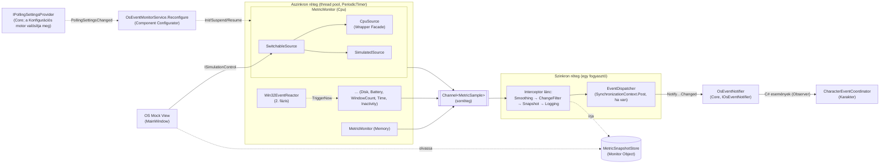
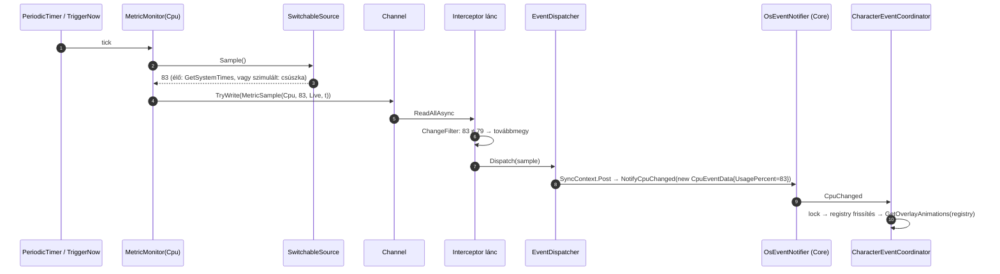
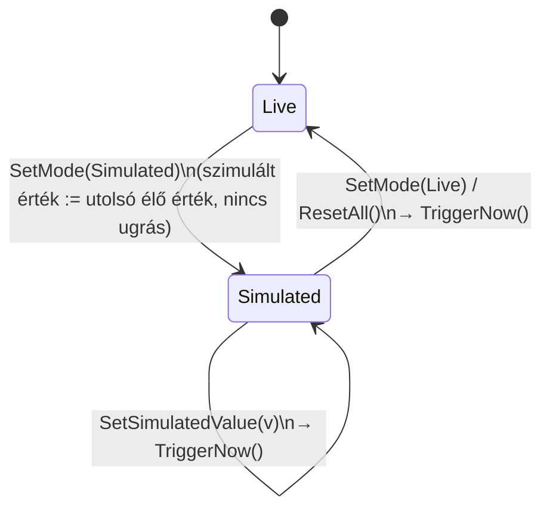

# OS esemény értesítő motor – Megvalósítási terv

> 🤖 **AI agenteknek:** ez a hosszú, részletes terv. Először a rövid [AGENT_BRIEF.md](./AGENT_BRIEF.md)-t olvasd, és ide csak a szükséges fejezetért gyere.

> Komponens: [OS esemény értesítő motor](../components.md#os-esemény-értesítő-motor) · Áttekintés: [overview.md](./overview.md) · Közös modell: [MVC architektúra – OS Események](../mvc_architecture.md#os-események)
> Fogalmak: [Szótár](../../README.md#szótár) · Minták: [patterns.md](../patterns.md) · Tech stack: [tech_stack.md](../tech_stack.md)
> Felelős: 1 fő (OS események + tesztpanel). Platform: Windows, .NET 8, WPF.
>
> Igazítva: a `main` MVC-átalakításához ([Keny3r/MonkeyStack_Szoftverarchitekturak_Hazi#2](https://github.com/Keny3r/MonkeyStack_Szoftverarchitekturak_Hazi/pull/2)) és a Konfigurációs motor szerződéséhez ([Keny3r/MonkeyStack_Szoftverarchitekturak_Hazi#1](https://github.com/Keny3r/MonkeyStack_Szoftverarchitekturak_Hazi/pull/1), [schema.md](../configuration_engine/schema.md)). A 10. fejezet pontjait a [#3](https://github.com/Keny3r/MonkeyStack_Szoftverarchitekturak_Hazi/pull/3) review-ján elfogadták.

---

## 0. TL;DR – agenteknek és csapattagoknak

Ha csak ennyit olvasol:

| Kérdés | Válasz |
|---|---|
| Mi a publikus szerződés? | A Core-beli [`IOsEventNotifier`](../../src/MonkeyStack.Core/Events/IOsEventNotifier.cs) 7 eseménye (`CpuChanged`, `MemoryChanged`, …), amit az [`OsEventNotifier`](../../src/MonkeyStack.Core/Events/OsEventNotifier.cs) valósít meg. **Ez nem változik.** |
| Ki küldi az eseményeket? | Az OS motor belépési pontja, az [`OsEventMonitorService`](../../src/OsEventEngine/OsEventMonitorService.cs). Ő méri a metrikákat, és a feldolgozási lánc végén az `OsEventNotifier.Notify…Changed(...)` metódusokat hívja. |
| Milyen adatot kapok? | A Core [`*EventData`](../../src/MonkeyStack.Core/Events/) osztályait. Minden eseményhez **új példány** jön, ezeket nem használjuk újra. |
| Melyik szálon jön az esemény? | **Sorosítva**, sosem párhuzamosan. Alapból azon a `SynchronizationContext`-en, amelyen a `Start()`-ot hívták (WPF-ben a UI szál). A fogyasztónak ettől függetlenül bármelyik szálat el kell tudnia viselni, ahogy a Konfigurációs motor is feltételezi (az [`IPollingSettingsProvider`](../../src/MonkeyStack.Core/Events/IPollingSettingsProvider.cs) eseménye is bármelyik szálon jöhet). A [`CharacterEventCoordinator`](../../src/CharacterEngine/CharacterEventCoordinator.cs) ezt már teljesíti (`lock`). |
| Mikor jön esemény? | `Start()` után egyszer minden elérhető metrikára (kezdeti pillanatkép), utána csak **változáskor** (push, lásd [Kapcsolatok](../components.md#kapcsolatok)). |
| Hogyan tesztelek 100% CPU nélkül? | Az OS ablak ([`MainWindow`](../../src/OsEventEngine/MainWindow.xaml.cs), „OS Mock View”) csúszkáival, vagy programból: `Simulation.SetSimulatedValue(Metric.Cpu, 95)`. A szimulált érték **ugyanazon a láncon** megy át, mint az élő, és szimulált módban a valódi mérés le sem fut. |
| Mit NEM tud a motor? | A küszöbértékeket és a [viselkedési szabályokat](../../README.md#viselkedési-szabály). Ezek a [Konfigurációs motor](../configuration_engine/overview.md) dolga. A motor csak nyers értékeket küld. |
| Mit ne módosíts egyeztetés nélkül? | `MonkeyStack.Core` (közös), `CharacterEngine`, `ConfigurationEngine`, [mvc_architecture.md](../mvc_architecture.md). Lásd: [10. Egyeztetendő](#10-egyeztetendő-a-többi-komponens-felelőseivel). |

Integráció a meglévő [`CharacterEngine/App.xaml.cs`](../../src/CharacterEngine/App.xaml.cs)-ben. A példányosítás és a feliratkozás már megvan, csak az indítás és a leállítás hiányzik. **Előbb feliratkozás, utána `Start()`**, különben a kezdeti pillanatkép elveszik.

```csharp
// Már létezik (App konstruktor):
//   SharedOsMonitorService = new OsEventMonitorService(SharedOsEventNotifier);
//   SharedCoordinator = new CharacterEventCoordinator(SharedConfigurationService, SharedOsEventNotifier); // feliratkozik

// Hiányzik (Animációs motor felelősével egyeztetni):
protected override void OnStartup(StartupEventArgs e)
{
    base.OnStartup(e);
    SharedOsMonitorService.Start();       // UI SynchronizationContext elkapva
}

protected override void OnExit(ExitEventArgs e)
{
    SharedOsMonitorService.Dispose();     // ciklusok leállítása, hookok felszabadítása
    base.OnExit(e);
}
```

---

## 1. Cél és hatókör

**Cél:** a [rendszereseményeket / metrikákat (OS check)](../../README.md#rendszeresemény--metrika-os-check) konfigurálható gyakorisággal, alacsony saját terheléssel kell figyelni a háttérben, és változáskor értesíteni kell a [Karakter állapotgépet](../mvc_architecture.md#karakter-és-fizika) ([Animációs motor](../character_engine/overview.md)). Mellé kell egy **OS Mock View** (aktuális értékek + csúszkák), hogy a működés valódi terhelés nélkül tesztelhető legyen.

Az [MVC terv](../mvc_architecture.md#os-események) szerinti felosztás:
- **Modell réteg** (közös memória): `IOsEventNotifier` / `OsEventNotifier` (Core), `OsEventMonitorService` és a belső mérési lánc (`OsEventEngine`).
- **View réteg**: az OS Mock View ([`MainWindow`](../../src/OsEventEngine/MainWindow.xaml.cs)), konstruktorban kapja a közös `OsEventMonitorService` példányt.

**Hatókörben:**
- 7 metrika: CPU, memória, háttértár, akkumulátor, ablakszám, idő, inaktivitás (a [Core adatmodellek](../../src/MonkeyStack.Core/Events/) szerint).
- Windows-os mérés (Win32 P/Invoke).
- Változásdetektálás, szálkezelés, futás közbeni újrakonfigurálás.
- Szimuláció (élő/szimulált forrás metrikánként) + OS Mock View.
- Unit tesztek.

**Hatókörön kívül:**
- [Triggerfeltételek](../../README.md#triggerfeltétel) kiértékelése (Konfigurációs motor).
- Perzisztencia, köztük a mintavételi gyakoriságok tárolása (Konfigurációs motor / SQLite, [`MetricPolling`](../configuration_engine/schema.md#5-metricpolling--rendszeresemény-mintavételezés)).
- [Ablakperem](../../README.md#ablakperem-járható-felület) / [`PlatformSegment`](../../src/MonkeyStack.Core/Character/PlatformSegment.cs) számítás (Karakter / fizika). Az ablak-felsoroló Win32 burkoló ott is újrahasznosítható lehet, erről egyeztetni kell.

### Nem-funkcionális követelmények

| ID | Követelmény | Mérőszám |
|---|---|---|
| NFR-1 | Alacsony saját terhelés | Átlagos CPU < 0,5% az alapértelmezett intervallumokkal. Nincs dedikált busy-loop szál. |
| NFR-2 | Fault isolation | Egy forrás hibája (kivétel) nem állítja le a többi metrikát. |
| NFR-3 | Reakcióidő | A csúszkán állított érték **< 100 ms** alatt eléri a feliratkozókat (nem várja ki a mintavételi periódust). |
| NFR-4 | Tesztelhetőség | Időzítés és idő `TimeProvider`-en keresztül, a natív hívások interfész mögött, így a logika natív hívás nélkül unit-tesztelhető. |
| NFR-5 | Bővíthetőség | Új metrika = 1 forrás osztály + 1 regisztráció + Core adatmodell (Core változás → egyeztetés). |
| NFR-6 | Kíméletes leállás | `Dispose` legfeljebb 1 s alatt leállítja a ciklusokat, felszabadítja a hookokat, és nem dob kivételt. |

---

## 2. Architektúra áttekintés

A motor egy **Half-Sync/Half-Async** felépítés:
- **Aszinkron réteg:** metrikánként egy-egy `MetricMonitor` async ciklus (`PeriodicTimer`, saját szál nélkül), plus a Win32 értesítések (Reactor, 2. fázis).
- **Sorréteg:** egy `Channel<MetricSample>`.
- **Szinkron réteg:** egyetlen fogyasztó, amely az **Interceptor** láncon (simítás, szűrés, pillanatkép, napló) átvezeti a mintákat, majd az `OsEventNotifier.Notify…Changed` hívásával kiküldi őket.



Az `OsEventMonitorService` a komponens **egyetlen belépési pontja** (Facade). Ő hozza létre és kapcsolja össze a fenti részeket, a többi osztály `internal`.

### Egy minta életútja



---

## 3. Alkalmazott architekturális minták

A [patterns.md](../patterns.md) mintái közül az alábbiakat használjuk. Mindegyiknél megadjuk, **hol** és **miért**. A nem használt mintáknál is indoklunk, mert a terv része, hogy miért nem kellenek. A közös modell szintű minta-táblázat az [MVC tervben](../mvc_architecture.md#alkalmazott-architektúrális-minták) van, ez a fejezet az OS motoron belüli részleteket adja.

> **Szóhasználat:** az `OsEventNotifier` C# eseményei önmagukban **Observer** (GoF) mintát valósítanak meg. Az MVC terv ezt a láncot *Reactor*-nak nevezi. Ebben a tervben a **Reactor** nevet a Win32 értesítések demultiplexálására használjuk ([3.2](#-reactor--win32-üzenetvezérelt-értesítések-2-fázis)), mert a POSA2 Reactor lényege a több eseményforrás figyelése és a handlerekhez szétosztás. A csapatszintű egységesítés a [10. fejezetben](#10-egyeztetendő-a-többi-komponens-felelőseivel) szerepel.

### 3.1 Szolgáltatáshozzáférés és -konfiguráció

#### ✅ Wrapper Facade – natív Win32 API-k
- **Hol:** `Native/NativeMethods.cs` (nyers `[DllImport]`), erre épül a `Win32System` és a `WindowEnumerator`, és ezeket használják a típusos források: `CpuSource`, `MemorySource`, `BatterySource`, `InactivitySource`, `WindowCountSource`.
- **Miért:** a C-stílusú API-k (`GetSystemTimes`, `GlobalMemoryStatusEx`, `GetSystemPowerStatus`, `GetLastInputInfo`, `EnumWindows`, `DwmGetWindowAttribute`) hibakezelése, struktúra-méretezése és `FILETIME` aritmetikája így egy helyre kerül. A felsőbb rétegek csak `int? Sample()`-t látnak. Ez teszi lehetővé a natív hívás nélküli unit tesztet (NFR-4). Az [MVC terv](../mvc_architecture.md#alkalmazott-architektúrális-minták) is ezt a mintát rendeli az `OsEventMonitorService`-hez.

#### ✅ Component Configurator – futás közben (újra)konfigurálható monitorok
- **Hol:** minden `MetricMonitor` megvalósítja az `IConfigurableComponent`-et (`Init`, `Fini`, `Suspend`, `Resume`, `Info`). A `MonitorRepository` tartja nyilván őket. Az `OsEventMonitorService.Reconfigure(options)` újraalkalmazza a beállításokat **újraindítás nélkül**: intervallumváltás → `Init` új periódussal, letiltás → `Suspend`, engedélyezés → `Resume`.
- **Honnan jön a konfiguráció:** a Core-beli [`IPollingSettingsProvider`](../../src/MonkeyStack.Core/Events/IPollingSettingsProvider.cs) interfészen ([schema.md, MetricPolling](../configuration_engine/schema.md#5-metricpolling--rendszeresemény-mintavételezés)). Ezt a Konfigurációs motor valósítja meg, és a host adja át az `OsEventMonitorService`-nek. A szolgáltatás feliratkozik a `PollingSettingsChanged` eseményre, és ilyenkor `Reconfigure`-t hív. Így az OS motor **nem függ** a Konfigurációs motortól, csak a Core-tól. Amíg a host nem ad át szolgáltatót (pl. standalone futás), az `OsEventEngineOptions.Default` értékei érvényesek. Leképezés: `GetPollingInterval(m) == null` → `Enabled = false`, különben `Interval` = a visszaadott érték.
- **Miért:** a követelmény „konfigurálható gyakoriságú monitorozás”. A felhasználó a konfigurációs ablakban állíthatja, és ennek alkalmazás-újraindítás nélkül kell érvényesülnie. Az `Info()` adja az OS Mock View „monitor állapot” oszlopát.

#### ✅ Interceptor – kiterjeszthető feldolgozási lánc
- **Hol:** `Pipeline/IEventInterceptor`, láncolva a szinkron rétegben:
  1. `SmoothingInterceptor`: exponenciális mozgóátlag **csak élő** CPU-ra, hogy a pillanatnyi tüskék ne villogtassák az overlay-t.
  2. `ChangeFilterInterceptor`: csak akkor enged tovább, ha `|új − utolsó küldött| ≥ deadband` (alapból 1). Ez valósítja meg a „csak változáskor push”-t.
  3. `SnapshotInterceptor`: frissíti a `MetricSnapshotStore`-t (OS Mock View).
  4. `LoggingInterceptor`: `Debug`/`ILogger` napló, kikapcsolható.
- **Miért:** a keretrendszer (monitor → sor → dispatcher) változatlan marad, a viselkedés pedig interceptorok hozzáadásával bővül, például rögzítés/visszajátszás vagy rate limit. Egyetlen fogyasztó futtatja, ezért az interceptorok belső állapota lock nélkül biztonságos.

#### ✅ Extension Interface – egy monitor, több szerep
- **Hol:** egy monitor több, egymástól független interfészt valósít meg: `IMetricMonitor` (minta előállítása, `TriggerNow`), `IConfigurableComponent` (életciklus), `ISimulatable` (forrásváltás). A kliensek csak azt a nézetet kérik el, amire szükségük van: a szimulációs vezérlő `ISimulatable`-t, a `MonitorRepository` `IConfigurableComponent`-et.
- **Miért:** egy olyan monitor, amelyet nem lehet szimulálni (pl. egy jövőbeli, csak élő metrika), egyszerűen nem valósítja meg az `ISimulatable`-t. Így nem kell egy „kövér” interfész `NotSupportedException`-ökkel. Új képesség hozzáadása nem töri a meglévő klienseket.

### 3.2 Eseménykezelés

#### ✅ Reactor – Win32 üzenetvezérelt értesítések (2. fázis)
- **Hol:** `Win32EventReactor`. Dedikált STA szálon egy message-only ablakot (`HwndSource`) és üzenethurkot futtat. Erre regisztrálnak a handlerek:
  - `SetWinEventHook(EVENT_OBJECT_SHOW/HIDE/DESTROY, …)` → `WindowCount` monitor `TriggerNow()`,
  - `WM_POWERBROADCAST` / `PBT_APMPOWERSTATUSCHANGE` → `Battery` monitor `TriggerNow()`,
  - `WM_TIMECHANGE`, `WM_POWERBROADCAST(PBT_APMRESUMEAUTOMATIC)` → `Time` és `Inactivity` monitor `TriggerNow()`.
- **Miért:** az ablakszám, az akkumulátor és az idő ritkán vagy ugrásszerűen változik, ezért gyakori pollozás helyett az OS jelez. A Reactor demultiplexálja a különböző OS-értesítéseket a megfelelő handlerre. A handler nem számol, csak azonnali mintavételt kér (debounce-szal, pl. 200 ms), így a mérési logika egy helyen marad. A pollozás megmarad a konfigurált periódussal biztonsági hálónak. **1. fázisban minden metrika pollozott**, a Reactor bővítés.

#### ⚪ Observer – a publikus szerződés
- Az `OsEventNotifier` C# eseményei. Nem POSA2 minta, de ezen keresztül megy a push a Karakter felé (lásd a fenti szóhasználati megjegyzést).

#### ⚪ ACT (Asynchronous Completion Token) – részlegesen
- A sorba írt `MetricSample` hordozza a `Metric` azonosítót és az `Origin`-t (élő/szimulált). Ez szolgál „tokenként”: a közös csatornából a szinkron réteg ez alapján rendeli a mintát a megfelelő `Notify…Changed` híváshoz és Core-adatmodellhez. Teljes értékű ACT-re (aszinkron műveletindítás + completion) nincs szükség, mert nincsenek kérés–válasz jellegű aszinkron műveleteink.

#### ❌ Proactor
- Nincsenek aszinkron I/O műveleteink (fájl, socket), amelyek completion-jét kellene kezelni. A mérések rövid, szinkron rendszerhívások.

#### ❌ Acceptor-Connector
- Nincs hálózati vagy IPC kapcsolatépítés. A komponensek egy folyamatban, közös memóriában, közvetlen referenciával kommunikálnak (lásd [MVC alapelvek](../mvc_architecture.md#alapelvek-közös-modell-és-független-view-k)).

### 3.3 Konkurenciakezelés

#### ✅ Half-Sync/Half-Async – a motor gerince
- **Async réteg:** `MetricMonitor` ciklusok (`await timer.WaitForNextTickAsync(ct)`) és a Reactor.
- **Sorréteg:** `Channel<MetricSample>` (`BoundedChannelOptions(256) { FullMode = DropOldest, SingleReader = true }`).
- **Sync réteg:** egyetlen fogyasztó taszk (interceptor lánc), majd ha van `SynchronizationContext`, `Post` a UI szálra.
- **Miért:**
  - (1) A mérések soha nem blokkolják a UI-t.
  - (2) A fogyasztó egyszálú, sorosított világot lát, így a láncban nem kell lock. A kifelé menő események is sorosítva jönnek, így a [`CharacterEventCoordinator`](../../src/CharacterEngine/CharacterEventCoordinator.cs) lockjáért sosem versenyez két OS esemény.
  - (3) A korlátos sor `DropOldest`-tel véd egy beragadt fogyasztó ellen. Az elveszett minták nem gond, mert csak a legfrissebb érték számít.
- Az [MVC terv](../mvc_architecture.md#alkalmazott-architektúrális-minták) is ezt a mintát rendeli a háttérben futó OS-metrika monitorozáshoz.

#### ✅ Monitor Object – `MetricSnapshotStore`
- **Hol:** a metrikák aktuális értéke, forrása és időbélyege. Az OS Mock View olvassa (UI szál), a lánc írja (fogyasztó szál). Új publikus olvasó API: `OsEventMonitorService.GetSnapshot()` → `OsEventDataRegistry` **másolat**.
- **Miért:** több szál fér hozzá közös állapothoz. A szinkronizáció az objektumon belül van, a hívónak nem kell tudnia róla.

#### ⚪ Active Object – a szimulációs vezérlés irányába
- A csúszka (`SetSimulatedValue`) nem közvetlenül hív eseményt. Beállítja az értéket, majd `TriggerNow()`-val **kérést** tesz a monitor saját végrehajtási környezetébe (a ciklus „wake-up” jelét). Így a hívó (UI) és a végrehajtás (monitor ciklus) szétválik, és **egy út** marad az eseményküldésre: élő és szimulált minta ugyanúgy halad. Teljes Active Object (proxy + scheduler + future) túlzás lenne. A minta lényegét, a metódushívás és -végrehajtás szétválasztását, ennyi is adja.

#### ❌ Leader/Followers
- Alacsony eseményráta (≈ 1–10 esemény/s): nincs szükség szálkészletre, amely felváltva figyeli az eseményforrást. A .NET thread pool és az async ciklusok ezt elfedik.

#### ❌ Thread-Specific Storage
- Nincs szálanként elkülönítendő állapot. A CPU-mérés előző `GetSystemTimes` értékei **példányszintűek** (a `CpuSource` mezői), és a monitor ciklusa sorosítja a hozzáférést.

### 3.4 Szinkronizáció

#### ✅ Scoped Locking
- A `MetricSnapshotStore` és a `SwitchableSource` kritikus szakaszai C# `lock` blokkokban vannak, ami a Scoped Locking nyelvi megvalósítása: kivétel esetén is felszabadul. Ugyanez a konvenció, mint a közös modellben (`lock (_syncRoot)`, lásd [MVC terv](../mvc_architecture.md#alkalmazott-architektúrális-minták)).

#### ✅ Thread-Safe Interface
- A `MetricSnapshotStore` publikus metódusai (`Update`, `Get`, `ToRegistry`) lockolnak, és csak lock nélküli **privát** segédmetódusokat hívnak (pl. `ToRegistryUnlocked`). Így elkerülhető az önholtpont és a felesleges újralockolás.

#### ✅ Double-Checked Locking Optimization – `Lazy<T>` formában
- A drágán inicializálható erőforrások lusta, szálbiztos létrehozása (pl. a figyelt meghajtó feloldása, a Reactor szál indítása első használatkor) `Lazy<T>(LazyThreadSafetyMode.ExecutionAndPublication)`-nal történik. Ez a DCLO .NET-es, helyes (memóriamodell-biztos) megvalósítása. Kézi DCLO-t nem írunk.

#### ❌ Strategized Locking
- Egyetlen zárolási stratégia (monitor lock) elegendő, és nincs olyan konfiguráció, ahol lock nélküli vagy más zárolású változat kellene. A [Half-Sync/Half-Async](#-half-synchalf-async--a-motor-gerince) eleve minimalizálja a megosztott állapotot.

### 3.5 Kiegészítő (nem POSA2) minták
- **Facade** (`OsEventMonitorService`), **Strategy** (`IMetricSource`: élő vs szimulált), **Proxy** (`SwitchableSource`, átlátszóan közvetít a valódi forrás felé), **Observer** (C# `event`), **MVC/MVVM** (OS Mock View, a [közös MVC terv](../mvc_architecture.md) szerint).

---

## 4. Metrikák mérése (Windows)

Közös belső reprezentáció: `MetricSample(Metric Metric, int Value, SampleOrigin Origin, DateTimeOffset Timestamp)`. A forrás `int?`-t ad vissza, ahol `null` = „nem elérhető”, ilyenkor nincs minta. Az `EventDispatcher` képezi le a Core adatmodellekre.

A közös [`MonkeyStack.Core.Events.Metric`](../../src/MonkeyStack.Core/Events/Metric.cs) felsorolást használjuk. Az értéktartományok és az alapintervallumok megegyeznek a Konfigurációs motor `ConfigurationLimits.MetricRange` / `MetricPolling` értékeivel ([schema.md](../configuration_engine/schema.md#metrikák-és-értéktartományok)). Most két helyen élnek (`MetricCatalog` és `ConfigurationLimits`): a #3 merge után közösen a Core-ba kerülnek.

| Metrika | Win32 / .NET forrás | Számítás | Érték, tartomány | Alap intervallum | Megjegyzés |
|---|---|---|---|---|---|
| **Cpu** | `GetSystemTimes` (kernel32) | `1 − ΔIdle / (ΔKernel + ΔUser)` (a kernel tartalmazza az idle-t) | `UsagePercent` 0–100 | 1000 ms | `PerformanceCounter` helyett: nincs bemelegedés és lokalizációs gond, olcsó. Első minta: csak alapállapot, nincs küldés. EMA simítás (α = 0,5). |
| **Memory** | `GlobalMemoryStatusEx` | `dwMemoryLoad` | `UsagePercent` 0–100 | 1000 ms | |
| **Disk** | `System.IO.DriveInfo` | `(Total − AvailableFree) / Total` | `UsagePercent` 0–100 | 30 000 ms | Alapból a rendszermeghajtó (`Path.GetPathRoot(Environment.SystemDirectory)`). Opció: `Max` az összes `Fixed` meghajtón. |
| **Battery** | `GetSystemPowerStatus` | `BatteryLifePercent` | `ChargePercent` 0–100 | 30 000 ms (+ Reactor) | `BatteryFlag & 128` (nincs akku) vagy `255` (ismeretlen) → `null`, nincs esemény, a registryben `Battery == null` marad. |
| **WindowCount** | `EnumWindows` + `IsWindowVisible` + `GetWindow(GW_OWNER)==0` + `WS_EX_TOOLWINDOW` kizárás + `DwmGetWindowAttribute(DWMWA_CLOAKED)==0` + van cím | „Alt-Tab” ablakok száma | `WindowCount` 0–1000 | 2000 ms (+ Reactor) | **Saját folyamat ablakai kizárva** (`GetWindowThreadProcessId`), hogy a screenmate, a konfigurációs ablak és az OS Mock View ne számítson. |
| **Time** | `TimeProvider.GetLocalNow()` | óra, perc | `Hour`, `Minute` (belsőleg perc éjfél óta, 0–1439) | 30 000 ms (+ Reactor) | Csak percváltáskor jut át a ChangeFilteren. 30 s-os periódusnál a késés legfeljebb 30 s (pl. 20:30-as szabály), ez elfogadható. |
| **Inactivity** | `GetLastInputInfo` + `Environment.TickCount` | `(uint)(TickCount − dwTime) / 60000` | `InactivityMinutes` 0–1440 | 2000 ms | A `uint` kivonás kezeli a 49,7 napos tick-túlcsordulást. Percfelbontás (Core modell szerint), 1440-nél levágva. |

> A „100%-os CPU” teszteléséhez **soha ne terheljük valóban a gépet**: a szimulált forrás pontosan ugyanazt a láncot és eseményt váltja ki.

---

## 5. Szimuláció és OS Mock View

### 5.1 Szimuláció működése



- `SwitchableSource` (Proxy + Strategy): metrikánként tartja az élő és a szimulált forrást, valamint az aktuális `SourceMode`-ot. **Szimulált módban a natív forrást nem hívja**, ez is kíméli a CPU-t.
- Ez **metrikánként** teszi azt, amit az [MVC terv](../mvc_architecture.md#os-események) `IsMockModeEnabled` kapcsolója globálisan: a csúszkával beállított értéket a háttérben futó élő mérés nem írja felül. A különbség, hogy a CPU-t szimulálhatjuk, miközben a memória élő marad.
- `ISimulationControl` (publikus, az `OsEventMonitorService.Simulation` tulajdonsága):

```csharp
public enum SourceMode { Live, Simulated }

public sealed record MetricDescriptor(Metric Metric, string DisplayName, int Min, int Max, string Unit);

public interface ISimulationControl
{
    IReadOnlyList<MetricDescriptor> Metrics { get; }
    SourceMode GetMode(Metric metric);
    void SetMode(Metric metric, SourceMode mode);
    void SetSimulatedValue(Metric metric, int value);   // szimulált módba is vált; Time: perc éjfél óta (0–1439)
    void ApplyPreset(IReadOnlyDictionary<Metric, int> values); // több metrika egyszerre, szimulált módba
    void ResetAll();                                     // minden metrika vissza élőre
}
```

- A szimuláció programból is használható (pl. a Karakter felelőse a saját tesztjeiben), nem csak a View-ból.

#### A meglévő `OsEventMonitorService` API sorsa

A mostani [`OsEventMonitorService`](../../src/OsEventEngine/OsEventMonitorService.cs) váz. A publikus tagjai megmaradnak, hogy a [MVC terv](../mvc_architecture.md#os-események) és a [`CharacterEngine/App.xaml.cs`](../../src/CharacterEngine/App.xaml.cs) ne törjön:

| Meglévő tag | Új viselkedés |
|---|---|
| `OsEventMonitorService(OsEventNotifier? notifier = null)` | Marad, kiegészül opcionális paraméterekkel: `(OsEventNotifier? notifier = null, OsEventEngineOptions? options = null, TimeProvider? timeProvider = null)`. |
| `Notifier` | Marad, ugyanaz a közös példány. |
| `IsMockModeEnabled` | Kényelmi kapcsoló: `true` → minden metrika szimulált módba a jelenlegi értékkel; `false` → `ResetAll()`. Olvasáskor: igaz, ha bármelyik metrika szimulált. |
| `ReportMockCpuUsage(int)` | Rövidítés: `Simulation.SetSimulatedValue(Metric.Cpu, value)`. Az esemény a láncon át jön, **nem szinkron** a hívással (< 100 ms, NFR-3). |
| `ReportRealCpuUsage(int)` | Elavult, mert az élő mérést a motor maga végzi. `[Obsolete]`, és a mintapéldaként ide hivatkozó [MVC szöveg](../mvc_architecture.md#os-események) egyeztetése után törölhető. |

### 5.2 OS Mock View (`MainWindow`)

Egyetlen ablak, ahogy az [MVC terv](../mvc_architecture.md#alapelvek-közös-modell-és-független-view-k) leírja („OS Esemény Mock View: aktuális értékek és teszt csúszkák”). A meglévő konstruktor marad: `MainWindow(OsEventMonitorService? monitorService)`. Integrált futásnál a host `App.OpenOsEventWindow()` nyitja meg a közös példánnyal.

```
┌─ OS esemény Mock View ──────────────────────────────────────────────────────┐
│ Metrika      Mód           Csúszka                 Szimulált  Élő   Monitor │
│ CPU          [Live|●Sim]   ├──────────────●──┤       92 %     7 %   1 s ✓   │
│ Memória      [●Live|Sim]   ├────●───────────┤        –       41 %  1 s ✓   │
│ Háttértár    [●Live|Sim]   ├────────●───────┤        –       63 %  30 s ✓  │
│ Akkumulátor  [Live|●Sim]   ├●───────────────┤        5 %     n/a   30 s ✓  │
│ Ablakszám    [●Live|Sim]   ├──●─────────────┤ (0–50)  –       6     2 s ✓   │
│ Idő          [Live|●Sim]   ├─────────────●──┤      21:45   14:02  30 s ✓  │
│ Inaktivitás  [Live|●Sim]   ├──────●─────────┤ (0–120) 30 p   0 p   2 s ✓   │
│                                                                             │
│ Preset: [Túlmelegedés] [Lemerülés] [Éjszaka] [Unatkozás]       [Mind Live]  │
│ Utolsó küldött esemény: CpuChanged 92 (Simulated) 14:02:31.204              │
└─────────────────────────────────────────────────────────────────────────────┘
```

- **MVC/MVVM:** a `MainWindow` egy `OsMockViewModel`-re kötődik. Az élő értékeket és a monitor állapotot a `MetricSnapshotStore`-ból frissíti egy `DispatcherTimer` (500 ms), nem iratkozik fel minden eseményre. A csúszkák az `ISimulationControl`-t hívják.
- A csúszka-tartományok a `MetricDescriptor`-ból jönnek, a UI nem tartalmaz metrika-specifikus kódot (adatvezérelt `ItemsControl`). A csúszkák alsó-felső határa a tesztelést szolgálja (pl. ablakszám 0–50), szűkebb lehet a `Metric` teljes tartományánál.
- A csúszka mozgatása **throttle-olt** (≈ 50 ms), így húzás közben sem árasztja el a csatornát. Elengedéskor mindig elküldi a végső értéket. A mozgatás önmagában szimulált módba vált.
- Presetek: *Túlmelegedés* (CPU 95, Mem 92), *Lemerülés* (Akku 5), *Éjszaka* (Idő 22:30), *Unatkozás* (Inaktivitás 30). A presetek a VM-ben vannak, bővíthetők.
- A „Monitor” oszlop az `IConfigurableComponent.Info()` értéke: intervallum + állapot (Running / Suspended / Faulted).

### 5.3 Önálló futtatás (standalone F5)
Az [MVC terv](../mvc_architecture.md#alapelvek-közös-modell-és-független-view-k) szerint minden komponens önállóan is indítható. Az `OsEventEngine` projekt WinExe, ekkor az `App.OnStartup`:
1. létrehoz egy `OsEventMonitorService`-t (saját `OsEventNotifier`-rel),
2. feliratkoztat egy **naplózó feliratkozót** (az eseményeket a View „Utolsó küldött esemény” sorába és a Debug kimenetre írja),
3. `Start()`,
4. megnyitja a `MainWindow`-t ezzel a példánnyal.

Integrált futásnál a `CharacterEngine` a host, és az `OsEventEngine` `App` osztálya nem fut.

---

## 6. Belső felépítés és publikus API

### 6.1 Mappa- és fájlszerkezet

`src/MonkeyStack.Core/Events/` (közös, **nem a mi komponensünk**, csak használjuk):
```
IOsEventNotifier.cs, OsEventNotifier.cs     publikus szerződés (meglévő, nem módosítjuk)
*EventData.cs, OsEventDataRegistry.cs       adatmodellek (meglévő)
Metric.cs, IPollingSettingsProvider.cs      közös, a #1-gyel került be (a Konfigurációs motorral közös)
```

`src/OsEventEngine/`:
```
OsEventEngine/
├─ OsEventMonitorService.cs        meglévő váz → Facade + Composition Root, publikus belépési pont
├─ OsEventEngineOptions.cs         MonitorOptions, Default (a MetricPolling alapértékeivel)
├─ App.xaml(.cs)                   standalone F5 indítás (5.3)
├─ MainWindow.xaml(.cs)            OS Mock View (meglévő konstruktorral)
├─ Monitoring/
│  ├─ MetricSample.cs, SampleOrigin.cs
│  ├─ IMetricMonitor.cs, IConfigurableComponent.cs, ISimulatable.cs   (Extension Interface)
│  ├─ MetricMonitor.cs             PeriodicTimer ciklus + TriggerNow   (Half-Async, Component Configurator)
│  └─ MonitorRepository.cs         Component Configurator repository
├─ Sources/
│  ├─ IMetricSource.cs
│  └─ CpuSource.cs, MemorySource.cs, DiskSource.cs, BatterySource.cs,
│     WindowCountSource.cs, TimeSource.cs, InactivitySource.cs        (Wrapper Facade)
├─ Native/
│  ├─ NativeMethods.cs             [DllImport] deklarációk, struktúrák
│  ├─ Win32System.cs, WindowEnumerator.cs   típusos burkolók (Wrapper Facade)
│  └─ Win32EventReactor.cs         (2. fázis) Reactor
├─ Simulation/
│  ├─ SourceMode.cs, MetricDescriptor.cs, ISimulationControl.cs
│  ├─ SwitchableSource.cs          élő/szimulált forrás egyben (Strategy + Proxy, ISimulatable)
│  └─ SimulationController.cs
├─ Pipeline/
│  ├─ IEventInterceptor.cs, InterceptorChain.cs                        (Interceptor)
│  ├─ SmoothingInterceptor.cs, ChangeFilterInterceptor.cs,
│  │  SnapshotInterceptor.cs, LoggingInterceptor.cs
│  └─ EventDispatcher.cs           Channel fogyasztó + SyncContext.Post + Notify…Changed (Half-Sync)
├─ State/
│  └─ MetricSnapshotStore.cs       Monitor Object, Thread-Safe Interface, Scoped Locking
├─ Platforms/
│  └─ Win32PlatformProvider.cs     IPlatformProvider megvalósítása (M11, platform_provider_proposal.md)
└─ ViewModels/
   └─ OsMockViewModel.cs, MetricRowViewModel.cs, ObservableObject.cs (+ RelayCommand)
```

Láthatóság: **publikus** csak az `OsEventMonitorService`, `OsEventEngineOptions`, `MonitorOptions`, `MetricCatalog`, `MonitorStatus`, `SourceMode`, `MetricDescriptor`, `ISimulationControl` és a `MainWindow`. Minden más `internal`. Tesztekhez: `[assembly: InternalsVisibleTo("OsEventEngine.Tests")]`.

### 6.2 Kulcs interfészek

```csharp
// A Metric a Core-ból jön: MonkeyStack.Core.Events.Metric { Cpu, Memory, Disk, Battery, WindowCount, Time, Inactivity }

internal enum SampleOrigin { Live, Simulated }
internal readonly record struct MetricSample(Metric Metric, int Value, SampleOrigin Origin, DateTimeOffset Timestamp);

internal interface IMetricSource
{
    Metric Metric { get; }
    int? Sample();                       // null = nem elérhető; kivétel = hiba (a monitor elkapja)
}

internal interface IMetricMonitor
{
    Metric Metric { get; }
    void TriggerNow();                   // azonnali mintavétel kérése (Reactor, szimuláció)
}

internal interface IConfigurableComponent  // Component Configurator
{
    void Init(MonitorOptions options);   // (újra)indítás adott beállítással
    void Suspend();
    void Resume();
    void Fini();
    string Info();                       // pl. "Running @ 1000 ms"
}

internal interface ISimulatable
{
    SourceMode Mode { get; set; }
    int SimulatedValue { get; set; }
}

internal interface IEventInterceptor
{
    MetricSample? Intercept(in MetricSample sample); // null = eldobja, a lánc megszakad
}

public sealed record MonitorOptions(bool Enabled, TimeSpan Interval, int Deadband = 1);

public sealed record OsEventEngineOptions
{
    public IReadOnlyDictionary<Metric, MonitorOptions> Monitors { get; init; } = DefaultMonitors;
    public bool EnableSmoothing { get; init; } = true;
    public bool EnableLogging  { get; init; } = false;
    public static OsEventEngineOptions Default { get; } = new();
    // DefaultMonitors: lásd a 4. fejezet táblázatát (= MetricPolling alapértékek)
}

public class OsEventMonitorService : IDisposable          // meglévő osztály, bővítve
{
    public OsEventMonitorService(
        OsEventNotifier? notifier = null,
        OsEventEngineOptions? options = null,
        TimeProvider? timeProvider = null);

    public OsEventNotifier Notifier { get; }             // meglévő
    public bool IsMockModeEnabled { get; set; }          // meglévő, lásd 5.1
    public ISimulationControl Simulation { get; }
    public OsEventDataRegistry GetSnapshot();            // másolat

    public void Start(SynchronizationContext? context = null); // null → SynchronizationContext.Current (ha van)
    public void Reconfigure(OsEventEngineOptions options);     // Component Configurator
    public void UsePollingSettings(IPollingSettingsProvider provider); // ha a Core-ba bekerül (10.)
    public void Dispose();                                // legfeljebb ~1 s, belül ConfigureAwait(false)

    public void ReportMockCpuUsage(int usagePercent);     // meglévő, rövidítés
    [Obsolete] public void ReportRealCpuUsage(int usagePercent); // meglévő, elavult
}
```

A dispatcher leképezése a Core `OsEventNotifier` publikus metódusaira:

```csharp
private void Publish(in MetricSample s)
{
    switch (s.Metric)
    {
        case Metric.Cpu:         _notifier.NotifyCpuChanged(new CpuEventData { UsagePercent = s.Value }); break;
        case Metric.Memory:      _notifier.NotifyMemoryChanged(new MemoryEventData { UsagePercent = s.Value }); break;
        case Metric.Disk:        _notifier.NotifyDiskChanged(new DiskEventData { UsagePercent = s.Value }); break;
        case Metric.Battery:     _notifier.NotifyBatteryChanged(new BatteryEventData { ChargePercent = s.Value }); break;
        case Metric.WindowCount: _notifier.NotifyWindowCountChanged(new WindowCountEventData { WindowCount = s.Value }); break;
        case Metric.Time:        _notifier.NotifyTimeChanged(new TimeEventData { Hour = s.Value / 60, Minute = s.Value % 60 }); break;
        case Metric.Inactivity:  _notifier.NotifyInactivityChanged(new InactivityEventData { InactivityMinutes = s.Value }); break;
    }
}
```

> Megjegyzés: a `Notify…Changed` metódusok publikusak, így elvben bárki hívhatja őket a láncot megkerülve. Ezt a csapatban konvencióval zárjuk ki: **csak az `OsEventMonitorService` hívja őket**, a teszteléshez a `Simulation` való (lásd [10.](#10-egyeztetendő-a-többi-komponens-felelőseivel)).

### 6.3 Viselkedési szerződés (a fogyasztók számára)

1. **Szál:** az események sorosítva jönnek, két esemény sosem fut párhuzamosan. Ha a `Start()` hívásakor volt `SynchronizationContext` (WPF UI szál), akkor azon, különben a fogyasztó háttérszálon. A fogyasztó ne feltételezze a UI szálat (a `CharacterEventCoordinator` ezt `lock`-kal már kezeli).
2. **Sorrend:** egy metrikán belül időrendi. Metrikák között nincs garancia.
3. **Kezdeti pillanatkép:** `Start()` után minden **elérhető** metrikára pontosan egy esemény megy, a ChangeFilter első mintája mindig átjut.
4. **Változás:** csak akkor jön esemény, ha `|Δ| ≥ Deadband`. Kivétel: élő ↔ szimulált váltás után az első minta mindig átmegy.
5. **Nem elérhető vagy letiltott metrika** (pl. nincs akku, vagy `MetricPolling.IsEnabled = false`): nincs esemény, a fogyasztó registryjében az utolsó érték vagy `null` marad.
6. **Példányok:** minden eseményhez új `*EventData` példány jön, a fogyasztó megtarthatja.
7. **Feliratkozói kivétel:** a dispatcher elkapja és naplózza, a motor fut tovább.

---

## 7. Hibakezelés, életciklus, teljesítmény

- **Forrás hiba:** a monitor elkapja, `Faulted` állapotba lép (`Info()` mutatja), exponenciális visszalépéssel (max. 60 s) újrapróbálja. A többi monitor fut tovább (NFR-2).
- **Indítás:** a konstruktor nem indít semmit (a meglévő `App` a konstruktorában hozza létre a szolgáltatást, ott még nincs UI `SynchronizationContext`). A mérés a `Start()`-tal indul.
- **Leállítás:** `Dispose` → `CancellationTokenSource.Cancel()` → a monitor ciklusok és a fogyasztó megvárva (legfeljebb ~1 s, belül `ConfigureAwait(false)`, így a UI szálról hívva sem akad el) → `Channel.Writer.Complete()` → Reactor hookok `UnhookWinEvent`, ablak megszüntetés.
- **Alvás/ébredés:** 1. fázisban a következő tick rendezi. 2. fázisban a Reactor `PBT_APMRESUMEAUTOMATIC`-ra azonnali mintavételt kér.
- **Teljesítmény:** 7 async ciklus, dedikált szál nélkül (a Reactor 2. fázisban 1 STA szál, amely üzenetre vár, CPU-t nem használ). Mérés: Release build, 10 perc üresjárat, a folyamat CPU-idejét Task Managerben ellenőrizni (NFR-1). Az `EnumWindows` a legdrágább hívás, ezért 2 s az intervalluma, és a 2. fázisban eseményvezérelt.

---

## 8. Tesztelési terv

Új projekt: `tests/OsEventEngine.Tests` (xUnit + `Microsoft.Extensions.TimeProvider.Testing` `FakeTimeProvider`). A solution fájlba való felvétel a többieket csak annyiban érinti, hogy a build kiegészül vele.

| Szint | Mit | Hogyan |
|---|---|---|
| Unit | `ChangeFilterInterceptor` (első minta átjut, deadband, mód váltás után átjut) | tiszta logika |
| Unit | `SmoothingInterceptor` (EMA, szimulált mintát nem simít) | tiszta logika |
| Unit | `MetricMonitor` (intervallum, `TriggerNow`, `Suspend`/`Resume`, `Init` új periódussal, hiba → Faulted + backoff) | `FakeTimeProvider.Advance` + fake `IMetricSource` |
| Unit | `SwitchableSource` (szimulált módban az élő forrás **nem hívódik**, váltáskor nincs ugrás) | mock forrás, hívásszámláló |
| Unit | `CpuSource` számítás, `InactivitySource` tick-túlcsordulás | a natív hívás mögé tett `ISystemTimesProvider` / `ILastInputProvider` fake-kel |
| Unit | `EventDispatcher` leképezés (`MetricSample` → helyes `Notify…Changed` és `*EventData`, Time → Hour/Minute) és szálváltás | valódi Core `OsEventNotifier` + egyedi teszt `SynchronizationContext` |
| Unit | Meglévő API kompatibilitás: `IsMockModeEnabled`, `ReportMockCpuUsage` | `OsEventMonitorService` fake forrásokkal |
| Integrációs | `OsEventMonitorService` end-to-end: `Start` → kezdeti pillanatkép 7 (akku nélkül 6) eseménnyel; `SetSimulatedValue(Cpu, 95)` → `CpuChanged(95)` < 100 ms | valódi források, `[Trait("Category","Windows")]` |
| Integrációs | `CharacterEventCoordinator` a valódi szolgáltatással: szimulált CPU → `GetOverlayAnimations` meghívódik | fake `IConfigurationService` |
| Manuális | OS Mock View, presetek, saját CPU-terhelés mérése | standalone F5 |

Elfogadási kritérium: minden unit teszt zöld, és standalone futásnál a CPU 95% preset után az esemény azonnal megjelenik a View eseménysorában, miközben a gép valós terhelése alacsony.

---

## 9. Megvalósítási lépések (mérföldkövek)

Minden lépés külön commit / PR. A zárójelben a lefedett minták. Az M1–M7 lépések **csak a saját komponensünket** (`src/OsEventEngine`, `tests/OsEventEngine.Tests`) érintik.

- [x] **M1 – Alapok:** `MetricSample`, `IMetricSource`, `NativeMethods`, 7 élő forrás (*Wrapper Facade*).
- [x] **M2 – Monitorok:** `MetricMonitor` (periodikus ciklus + `TriggerNow`; `Task.Delay(TimeProvider)` + ébresztő csatorna, mert a `PeriodicTimer` nem ébreszthető idő előtt), `MonitorRepository`, `OsEventEngineOptions` (*Component Configurator*, *Extension Interface*).
- [x] **M3 – Lánc és kiküldés:** `Channel`, `InterceptorChain` + 4 interceptor, `EventDispatcher` → `OsEventNotifier.Notify…Changed`, `MetricSnapshotStore` (*Half-Sync/Half-Async*, *Interceptor*, *Monitor Object*, *Thread-Safe Interface*, *Scoped Locking*).
- [x] **M4 – `OsEventMonitorService` kiépítése:** `Start` / `Reconfigure` / `Dispose` / `GetSnapshot` / `GetMonitorStatus` / `UsePollingSettings` (az M8 szolgáltató-oldala is), a meglévő tagok megtartásával (5.1 táblázat), standalone `App.OnStartup` naplózó feliratkozóval (*Facade*).
- [x] **M5 – Szimuláció:** `SwitchableSource` (a külön `SimulatedSource` beleolvadt), `SimulationController`, `ISimulationControl`, `IsMockModeEnabled` átkötése (*Strategy*, *Proxy*, *Active Object* jelleg).
- [x] **M6 – OS Mock View:** `MainWindow` + `OsMockViewModel`, presetek (*MVC/MVVM*).
- [x] **M7 – Tesztek:** `tests/OsEventEngine.Tests` (xUnit, `FakeTimeProvider`, hamis források; 37 teszt, natív hívás nélkül). A CI minden PR-on futtatja őket (`dotnet test MonkeyStack.slnx`).
- [ ] **M8 – Integráció (elfogadva a #3-ban):** `Start()` / `Dispose()` a `CharacterEngine` `App`-ban (Gergő és Frink Dávid), `UsePollingSettings` bekötése a Core-beli `IPollingSettingsProvider`-rel (*Component Configurator*).
- [ ] **M9 – Reactor (opcionális, 2. fázis):** `Win32EventReactor` (WinEvent hook, `WM_POWERBROADCAST`, `WM_TIMECHANGE`) → `TriggerNow` (*Reactor*, *DCLO/Lazy*).
- [ ] **M10 – Dokumentáció:** a ténylegesen megvalósult mintákat új fájlban dokumentálni (`docs/os_event_engine/patterns_applied.md`), osztály- és szekvenciadiagramokkal, a [Szótárra](../../README.md#szótár) hivatkozva.
- [ ] **M11 – Platform szolgáltató (elfogadva a #3-ban, A opció):** ✅ `IPlatformProvider` szerződés a Core-ban (#7); `Win32PlatformProvider` az OS motorban, a [platform-javaslat](./platform_provider_proposal.md) döntései szerint (*Wrapper Facade*, *Reactor*, *Half-Sync/Half-Async*).

Az M1–M7 után a komponens önállóan demózható.

---

## 10. Egyeztetendő a többi komponens felelőseivel

> ⚠️ A saját komponensen (`src/OsEventEngine`) kívüli módosítás **előtt** keresd meg az érintett komponens felelősét.

| Téma | Érintett | Döntés ([#3](https://github.com/Keny3r/MonkeyStack_Szoftverarchitekturak_Hazi/pull/3) review) | Teendő |
|---|---|---|---|
| Indítás és leállítás | Karakter motor (Gergő, Frink Dávid), [`CharacterEngine/App.xaml.cs`](../../src/CharacterEngine/App.xaml.cs) | ✅ Elfogadva: `OnStartup`-ban `SharedOsMonitorService.Start()`, `OnExit`-ben `Dispose()` ([0. fejezet](#0-tldr--agenteknek-és-csapattagoknak)). | Náluk, **az M4 után** (addig a `Start()` `NotImplementedException`-t dob). |
| Közös `Metric` felsorolás | Mindenki (`MonkeyStack.Core`) | ✅ Kész: [`MonkeyStack.Core.Events.Metric`](../../src/MonkeyStack.Core/Events/Metric.cs) (#1). Az OS motor a sajátját törölte. | – |
| Mintavételi gyakoriság | Konfigurációs motor (Levente) | ✅ Kész: [`IPollingSettingsProvider`](../../src/MonkeyStack.Core/Events/IPollingSettingsProvider.cs) a Core-ban (#1), a host adja át (`UsePollingSettings`). | Nálunk M8. |
| Tartományok és alapintervallumok egy helyen | Konfigurációs motor (Levente) | ⏳ Levente javaslata: a `MetricCatalog` és a `ConfigurationLimits` közös részét a #3 merge után a Core-ba, a `Metric` mellé. | Közös PR. |
| Mock út és a `Notify…` hívások | Frink Dávid ([mvc_architecture.md](../mvc_architecture.md#os-események)) | ✅ Elfogadva: a View a `Simulation`-t hívja, nem közvetlenül a `Notify…Changed`-et ([5.1](#51-szimuláció-működése)). Az `IsMockModeEnabled` kényelmi kapcsoló marad. | Az MVC dokumentum frissítése (Frink Dávid). |
| Minták szóhasználata | Mindenki | ✅ Elfogadva: C# esemény = Observer; Reactor = Win32 értesítések demultiplexálása ([3. fejezet](#3-alkalmazott-architekturális-minták)). | Az MVC minta-táblázat Reactor sorának pontosítása. |
| Platformok (ablakperem, takarás, fullscreen) | Karakter motor (Gergő, Frink Dávid) | ✅ Elfogadva, A opció. A szerződés a #7-tel a Core-ban (`IPlatformProvider`, `PlatformSnapshot`, `ScreenArea`, `ScreenRect`), a megvalósítás az OS motorban ([platform-javaslat](./platform_provider_proposal.md#0-döntések)). | Nálunk M11. |
| Új metrika felvétele | Mindenki (`MonkeyStack.Core`) | Folyamat: új `*EventData` + `OsEventDataRegistry` mező + `IOsEventNotifier` esemény és `Notify…` metódus + `Metric` érték + coordinator feliratkozás. | Egyeztetés kell. |
| Projekt típusa | Mindenki | Marad: az `OsEventEngine` WinExe, a `CharacterEngine` hivatkozik rá (az [MVC terv](../mvc_architecture.md#alapelvek-közös-modell-és-független-view-k) standalone F5 elve). | – |

---

## 11. Architekturális döntések (ADR-összefoglaló)

| # | Döntés | Alternatívák | Indoklás | Következmény |
|---|---|---|---|---|
| ADR-1 | **Polling elsődlegesen**, eseményvezérelt kiegészítés később (Reactor) | Tisztán eseményvezérelt; WMI eseménylekérdezések | CPU, memória és inaktivitás változására a Windows nem ad értesítést, a WMI pedig nehézkes és drága. A polling egyszerű, kiszámítható és konfigurálható. | Kis, de állandó overhead, ezért intervallumok és deadband. |
| ADR-2 | **Half-Sync/Half-Async** egyetlen fogyasztóval | Közvetlen `Notify…` hívás a timer szálról | A lánc és a kiküldés így sorosított, nem kell lockolni benne, és a fogyasztóknál sem versenyez két OS esemény. | +1 szálugrás (µs nagyságrend), elhanyagolható. |
| ADR-3 | Események **opcionálisan a `SynchronizationContext`-en** | Mindig háttérszál; mindig UI szál | A Karakter már szálbiztos, tehát nem kötelező a UI szál. A UI-hoz kötött fogyasztóknak (pl. OS Mock View) viszont kényelmes. | A fogyasztók nem építhetnek a UI szálra (6.3). |
| ADR-4 | **Változásalapú push** deadbanddel, küszöbök nélkül | Küszöbátlépésre küldés | A küszöbök a Konfigurációs motor [viselkedési szabályaiban](../../README.md#viselkedési-szabály) vannak. Ha az OS motor ismerné őket, sérülne a [komponenshatár](../components.md#kapcsolatok) és az [MVC terv](../mvc_architecture.md#miért-állapotmentes-a-konfig-és-miért-a-karakter-kérdezi-le) felelősségmegosztása. | Kicsit több esemény, de a deadband és az EMA ezt kezeli. |
| ADR-5 | **Szimuláció a forrás szintjén, metrikánként** (Strategy/Proxy) | Globális `IsMockModeEnabled` + közvetlen `Notify…` hívás a View-ból (a jelenlegi váz) | Így a szimulált érték a **teljes** valós utat végigjárja (monitor, lánc, kiküldés), tehát azt teszteljük, ami élesben fut. Metrikánként keverhető élő és szimulált érték. | A meglévő API kényelmi rétegként megmarad (5.1). |
| ADR-6 | `GetSystemTimes` a CPU-hoz | `PerformanceCounter`, WMI `Win32_Processor` | Nincs bemelegedés és nyelvi névprobléma, kicsi az overhead, nem kell külön csomag. | Saját delta-számítás (tesztelve). |
| ADR-7 | `TimeProvider` absztrakció | `DateTime.Now`, `Task.Delay` közvetlenül | Determinisztikus unit tesztek (`FakeTimeProvider`), .NET 8 beépített. | Minimális plusz kód. |
| ADR-8 | A Core `IOsEventNotifier` / `OsEventNotifier` **változatlan**, a `Notify…` metódusokon keresztül küldünk | Generikus `IObservable<MetricSample>`; saját belső `Publish` | A Karakter már erre épül, a közös modell stabilitása fontosabb. | A `Notify…` publikus, ezért konvencióval védjük (6.2). |
| ADR-9 | **Közös `Metric` felsorolás és `IPollingSettingsProvider` a Core-ban** | Saját `MetricId`; az OS motor hivatkozik a Konfigurációs motorra | Egy fogalom, egy típus. A függési irány (OS → Core ← Konfig) megfelel a [Kapcsolatok](../components.md#kapcsolatok) fejezetnek. | Megvalósult a #1-gyel. |
