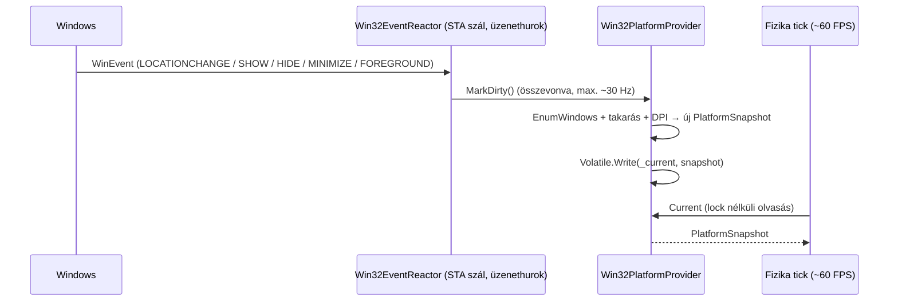

# Javaslat: járható felületek (platformok) szolgáltatása – `IPlatformProvider`

> Státusz: **ELFOGADVA** a [#3](https://github.com/Keny3r/MonkeyStack_Szoftverarchitekturak_Hazi/pull/3) review-ján (Frink Dávid, Karakter motor). Döntések: [0. fejezet](#0-döntések). Megvalósítás: [OS motor terv, M11](./plan.md#9-megvalósítási-lépések-mérföldkövek).
> A szerződés (2. fejezet) a #7-tel bekerült a Core-ba: [`IPlatformProvider`](../../src/MonkeyStack.Core/Character/IPlatformProvider.cs), [`PlatformSnapshot`](../../src/MonkeyStack.Core/Character/PlatformSnapshot.cs) (+ `Empty`), [`ScreenArea`](../../src/MonkeyStack.Core/Character/ScreenArea.cs), [`ScreenRect`](../../src/MonkeyStack.Core/Character/ScreenRect.cs). A `Win32PlatformProvider` az M11-ben jön.
> Szerző: OS esemény értesítő motor felelőse · Kapcsolódó: [OS motor terv](./plan.md) · [MVC terv](../mvc_architecture.md) · [Szótár](../../README.md#szótár)

---

## 0. Döntések

A #3 review-ján (Frink Dávid, a Karakter motor nevében):

| Kérdés | Döntés |
|---|---|
| Ki valósítsa meg? ([6.](#6-ki-valósítsa-meg)) | **A) opció**: az `IPlatformProvider` a `MonkeyStack.Core`-ba kerül, a `Win32PlatformProvider` az OS motorban lesz. Így minden Win32 / `EnumWindows` / DWM logika egy helyen marad. |
| Mozogjon-e a karakter a húzott ablakkal? | **Nem.** Ha elmozdítják alóla, essen le (`Falling`). A `PlatformSegment` nem kap `SourceId`-t. |
| Exkluzív fullscreen | **Nem kell elrejteni**, elég, ha a [3.3](#33-fullscreen-és-maximalizált-ablak) szerint leesik a monitor aljára. A `ScreenArea.HasFullscreenWindow` csak tájékoztató. |
| Minimális platformszélesség | A **20 px-nél keskenyebb** (2 × 10 px szélső ráhagyásnál keskenyebb) szakaszokat a szolgáltató kiszűri. |
| DPI manifest a hostban | Nyitott, a megvalósításkor egyeztetendő a Karakter motorral. |

---

## 1. Probléma

A követelmény szerint a [Screenmate](../../README.md#screenmate-karakter) az [ablakperemeken](../../README.md#ablakperem-járható-felület) és a tálcán tud járni. Ha az ablak, amin áll, eltűnik, elmozdul vagy **fullscreenbe / maximalizált állapotba megy**, akkor le kell esnie az alatta látható ablakra vagy a tálcára.

Ami már megvan a `main`-en:
- [`PlatformSegment`](../../src/MonkeyStack.Core/Character/PlatformSegment.cs) `(Y, LeftX, RightX)`: egy járható szakasz.
- [`ICharacterPhysicsModel.Update(..., IReadOnlyList<PlatformSegment> platforms, ...)`](../../src/MonkeyStack.Core/Character/ICharacterPhysicsModel.cs): a fizika minden tickben (~60 FPS) megkapja a listát.
- Az [MVC terv](../mvc_architecture.md#karakter-és-fizika) rögzíti, hogy a listát „egy külső komponens (Wrapper Facade)” számolja, a takarást is figyelembe véve.

Ami hiányzik:
- **Nincs interfész és nincs gazdája** annak, aki a listát előállítja.
- A **fullscreen / maximalizált** ablak, a **több monitor**, a **DPI-skálázás** és a **saját ablakok kizárása** nincs kezelve.
- Nincs döntés arról, **mikor** frissüljön a lista (60 FPS-es újraszámolás felesleges).

---

## 2. Javasolt szerződés (Core)

Megvalósítva a #7-ben, típusonként külön fájlban a `src/MonkeyStack.Core/Character/` alatt (a Karakter motor a #8-ban kérte). Eltérés a vázlattól: a `PlatformSnapshot` kapott egy `Empty` kezdőértéket.

```csharp
namespace MonkeyStack.Core.Character;

/// Képernyő-téglalap WPF egységben (DIP), a Core-ban nem függünk System.Windows.Rect-től.
public readonly record struct ScreenRect(double Left, double Top, double Right, double Bottom)
{
    public double Width  => Right - Left;
    public double Height => Bottom - Top;
}

/// Egy monitor állapota.
public sealed record ScreenArea(
    ScreenRect Bounds,          // a teljes monitor
    ScreenRect WorkArea,        // tálca nélkül
    bool HasFullscreenWindow);  // van-e rajta a teljes monitort lefedő ablak

/// A járható felületek egy pillanatképe. Megváltoztathatatlan, így szálbiztosan olvasható.
public sealed record PlatformSnapshot(
    IReadOnlyList<PlatformSegment> Platforms, // ablakperemek + monitoronként az "alj" (tálca / képernyő alja)
    IReadOnlyList<ScreenArea> Screens,
    long Version);                            // minden újraszámolásnál nő

public interface IPlatformProvider
{
    /// A legutóbbi kész pillanatkép. Olcsó, lock nélküli olvasás: a fizika minden tickben hívhatja.
    PlatformSnapshot Current { get; }

    /// Akkor váltódik ki, ha a platformok változtak. Bármelyik szálon jöhet.
    event EventHandler<PlatformSnapshot>? PlatformsChanged;
}
```

A fizika bemenete **nem változik**: a karakter tick így néz ki:

```csharp
var snapshot = platformProvider.Current;
physics.Update(dt, snapshot.Platforms, cursorX, cursorY, isMouseDown, w, h);
```

A „talaj” (tálca teteje vagy a képernyő alja) **ugyanúgy `PlatformSegment`** a listában, így a fizikának nem kell külön esetet kezelnie.

---

## 3. Algoritmus

### 3.1 Ablakok begyűjtése (Wrapper Facade)

`EnumWindows` → a felső szintű ablakok **Z-sorrendben, elölről hátra**. Megtartjuk, ha:
- `IsWindowVisible` és nem `IsIconic` (nem minimalizált),
- nem *cloaked* (`DwmGetWindowAttribute(DWMWA_CLOAKED) == 0`, pl. másik virtuális asztalon lévő vagy felfüggesztett UWP ablak),
- nem tool window (`WS_EX_TOOLWINDOW`), nincs gazdája (`GetWindow(GW_OWNER) == 0`), van címe,
- **nem a saját folyamatunké** (`GetWindowThreadProcessId`): a karakter overlay, a konfigurációs ablak és az OS Mock View nem lehet platform és nem takarhat,
- nem a tálca és nem az asztal (`Shell_TrayWnd`, `Progman`, `WorkerW` osztálynév) – ezeket külön kezeljük.

Méret: `DwmGetWindowAttribute(DWMWA_EXTENDED_FRAME_BOUNDS)`, nem `GetWindowRect`. Windows 10+ alatt a `GetWindowRect` beleszámolja a láthatatlan, ~7 px-es átméretező keretet, így a karakter a levegőben állna.

Ugyanezt a szűrést használja az [OS motor ablakszámlálója](./plan.md#4-metrikák-mérése-windows) is, ezért a kód közös lehet (`NativeMethods`).

### 3.2 Takarás (occlusion)

Minden `W` ablakra (Z-sorrendben), a felső éle a `[W.Left, W.Right]` szakasz `W.Top` magasságban. Ebből kivonjuk minden **előtte lévő** `A` ablak `[A.Left, A.Right]` vízszintes tartományát, ha `A` lefedi ezt a magasságot (`A.Top ≤ W.Top < A.Bottom`). Ami megmarad, az lesz `W` egy vagy több `PlatformSegment`-je.

Ez válaszolja meg a „van-e előtte másik ablak” kérdést, ablakonként és szakaszonként. Bonyolultság: O(n²) intervallumkivonás, ahol n ≈ 10–50, tehát elhanyagolható.

### 3.3 Fullscreen és maximalizált ablak

| Eset | Felismerés | Saját platformja | Takar? | Hova esik a karakter? |
|---|---|---|---|---|
| **Maximalizált** | `IsZoomed(hwnd)`, vagy a teteje ≤ a munkaterület teteje | **nincs** (a képernyő tetején lévő él nem járható) | igen, mindent mögötte | a tálcára (munkaterület alja) |
| **Fullscreen** (pl. videó, F11, játék ablakos módban) | a kiterjesztett keret lefedi a monitor teljes `rcMonitor` téglalapját | **nincs** | igen, mindent mögötte, a tálcát is | a monitor aljára |
| **Exkluzív fullscreen** (pl. D3D játék) | `SHQueryUserNotificationState` → `QUNS_RUNNING_D3D_FULL_SCREEN` vagy `QUNS_PRESENTATION_MODE` | – | – | opcionális: a karakter elrejtése (`ScreenArea.HasFullscreenWindow`), hogy ne zavarjon |

Mivel a maximalizált / fullscreen ablak mindent eltakar mögötte, a 3.2 szerinti kivonás után az ablak, amin a karakter állt, **elveszíti a platformját**. A fizika meglévő szabálya („ha eltűnt alóla a platform → `Falling`”) így magától leejti a karaktert, és a következő látható platformon (a talajon) landol. **A fizikába nem kell külön fullscreen-logika.**

### 3.4 Talaj és több monitor

Monitoronként (`EnumDisplayMonitors` + `GetMonitorInfo`):
- ha nincs rajta fullscreen ablak: talaj = `rcWork.Bottom` (alul lévő tálcánál ez a tálca teteje; oldalt vagy felül lévő tálcánál a monitor alja),
- ha van rajta fullscreen ablak: talaj = `rcMonitor.Bottom`,
- a talaj szakasz `[rcWork.Left, rcWork.Right]`.

Automatikusan elrejtett tálcánál a munkaterület a teljes monitor, tehát a talaj a képernyő alja.

### 3.5 DPI

A Win32 koordináták fizikai pixelben vannak, a WPF DIP-ben (1/96 inch) rajzol. Javaslat:
- a host alkalmazás (`CharacterEngine`) manifestje: **PerMonitorV2** DPI-tudatosság,
- a szolgáltató minden téglalapot a saját monitorának DPI-jével (`GetDpiForMonitor`) vált DIP-re, mielőtt `PlatformSegment` lesz belőle.

Vegyes DPI-jű monitoroknál a monitorhatáron átnyúló ablak élét monitoronként külön szakaszra vágjuk.

---

## 4. Frissítés: mikor számolunk újra?

60 FPS-sel `EnumWindows`-t hívni felesleges. Javaslat: **eseményvezérelt újraszámolás, ritka pollozással biztonsági hálónak.**



- `SetWinEventHook(WINEVENT_OUTOFCONTEXT)` ezekre: `EVENT_OBJECT_LOCATIONCHANGE` (csak `idObject == OBJID_WINDOW`, `idChild == 0`, különben a kurzor mozgása is jönne), `EVENT_OBJECT_SHOW/HIDE/DESTROY`, `EVENT_SYSTEM_MINIMIZESTART/END`, `EVENT_SYSTEM_FOREGROUND` (Z-sorrend változás), `EVENT_SYSTEM_MOVESIZEEND`.
- Ehhez üzenethurok kell azon a szálon, amelyik a hookot beállította: ez ugyanaz a `Win32EventReactor`, amit az [OS motor terve M9-ben](./plan.md#9-megvalósítási-lépések-mérföldkövek) az ablakszámhoz és az akkumulátorhoz használ.
- Összevonás (coalescing): ablakhúzás közben a `LOCATIONCHANGE` nagyon sűrű, ezért legfeljebb ~30 Hz-cel számolunk újra.
- Biztonsági háló: 500 ms-onként akkor is újraszámolunk, ha nem jött esemény.

---

## 5. Alkalmazott minták ([patterns.md](../patterns.md))

| Minta | Hol | Miért |
|---|---|---|
| **Wrapper Facade** | `NativeMethods` + `WindowEnumerator`, `MonitorEnumerator` | A Win32 / DWM / Shell API-k egy típusos felület mögé kerülnek, a többi kód csak `ScreenRect`-et lát. Az MVC terv is ezt írja elő. |
| **Reactor** | `Win32EventReactor` | Több Windows eseményforrás (WinEvent hookok, `WM_DISPLAYCHANGE`, `WM_DPICHANGED`) demultiplexálása a megfelelő handlerre egy üzenethurkon. |
| **Half-Sync/Half-Async** | Reactor szál (async) → újraszámolás → kész pillanatkép (sync olvasás a fizika ticken) | A drága Win32 lekérdezés sosem fut a 60 FPS-es fizika szálon. |
| **Thread-Safe Interface** / megváltoztathatatlan pillanatkép | `PlatformSnapshot` + `Volatile.Read/Write` | A fizika minden tickben lock nélkül olvashat, nincs versenyhelyzet. |
| **Double-Checked Locking** (`Lazy<T>`) | A Reactor szál és a hookok lusta indítása | Csak akkor indul, ha valaki tényleg kéri a platformokat. |

---

## 6. Ki valósítsa meg?

| Opció | Előny | Hátrány |
|---|---|---|
| **A) Az OS motor** (`src/OsEventEngine/Platforms/Win32PlatformProvider.cs`) – *ajánlott* | Közös `NativeMethods`, ablakszűrés és `Win32EventReactor` az ablakszámlálóval. Egy helyen van minden Win32 kód. | Az OS motor felelőssége bővül (nem csak „rendszeresemény”). |
| **B) A Karakter / fizika** | A felelősség ott marad, ahol felhasználják. | Duplikált Win32 kód és második Reactor szál, vagy közös könyvtár kell. |

Mindkét esetben az interfész a Core-ban van, és a host (`CharacterEngine/App`) köti össze, így a fizika nem függ az implementációtól.

---

## 7. Nyitott kérdések (a fizika felelősével)

1. **Mozgó ablakkal együtt mozogjon-e a karakter?** Ha a felhasználó húzza az ablakot, amin a karakter áll, a platform `Y`-ja változik. Jelenleg a fizika ilyenkor leesést látna. Ha együtt kell mozognia, a `PlatformSegment`-nek kellene egy azonosító (pl. `long SourceId` = ablak handle), hogy a fizika követni tudja. Ez Core változás.
2. **Exkluzív fullscreen alatt** rejtsük-e el a karaktert, vagy csak essen le?
3. **Minimális platformszélesség:** a túl keskeny maradék szakaszokat (pl. < karakterszélesség) eldobjuk-e már a szolgáltatóban?
4. A **DPI manifest** a host alkalmazásban (`CharacterEngine`) van, ezt neki kell beállítania.

---

## 8. Ha elfogadjátok: lépések

1. ✅ `IPlatformProvider`, `PlatformSnapshot`, `ScreenArea`, `ScreenRect` a Core-ba (#7).
2. `Win32PlatformProvider` (A vagy B opció szerint) + unit tesztek egy hamis ablaklistával (takarás, maximalizált, fullscreen, több monitor).
3. Host: PerMonitorV2 manifest, a szolgáltató létrehozása, átadása a fizika tick ciklusának.
4. Dokumentáció: link az [MVC terv „Karakter és Fizika”](../mvc_architecture.md#karakter-és-fizika) fejezetéből (a fejezet felelősének engedélyével).
